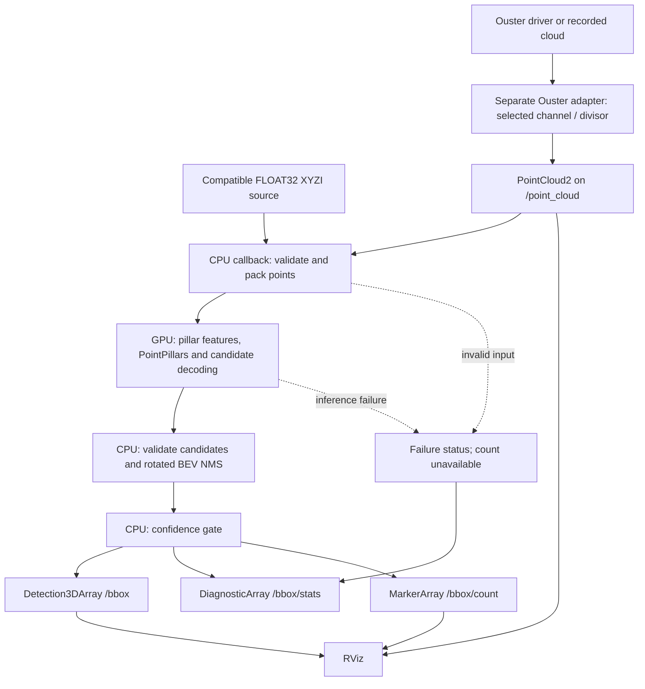

# How the implementation fits together

Reviewed 8 November 2026. This page describes the code that exists today. The final section describes proposed work; it is not part of the deployed pipeline.

The project takes a LiDAR point cloud, runs a pretrained PointPillars network and publishes 3D object boxes through ROS 2. It has two input routes: a source that already supplies the expected XYZI layout, and an Ouster source that needs an explicit channel conversion. Neither route trains the model.

For setup, use [the startup guide](docs/STARTUP_AND_REPLAY.md). For measured quality, read [the channel decision](docs/OUSTER_CHANNEL_DECISION.md). For a research narrative, start with [the thesis draft](docs/THESIS_DRAFT.md).

## Current implemented layers after confidence filtering

The direct XYZI route is a configuration choice. The launchers do not automatically inspect an arbitrary source and decide whether to bypass the adapter. The Ouster adapter always converts the explicitly selected field.

| Component | What it does | Main implementation |
| --- | --- | --- |
| ROS inference node | Receives a cloud, calls the runtime and publishes results | `src/pp_inference_node.cpp` |
| Input validation and packing | Checks layout, capacity and intensity scale; packs finite XYZI points | `src/pointcloud_adapter.cpp`, `include/pp_infer/ros_adapter.hpp` |
| Ouster conversion | Builds a separate FLOAT32 XYZI message from signal or reflectivity | `src/ouster_adapter.cpp`, `src/ouster_adapter_node.cpp` |
| TensorRT runtime | Inspects the engine, owns its execution context and GPU buffers, runs inference | `src/pointpillar.cpp`, `include/pp_infer/cuda_resources.hpp` |
| Box geometry and NMS | Computes rotated overlap and suppresses duplicate candidates | `src/postprocess.cpp` |
| Output and monitoring | Applies the live confidence threshold and publishes boxes, statistics and count text | `src/detection_output.cpp` |
| Deployment | Builds/reuses the image, prepares/reuses an engine and supervises foreground containers | `Dockerfile`, `docker/entrypoint.sh`, `tools/deploy.sh`, `tools/docker_foreground.sh` |

## One scan, from input to output

1. The driver or player publishes `sensor_msgs/msg/PointCloud2`.
2. For Ouster input, the separate adapter reads the selected scalar channel and divides it by a configured positive divisor. It preserves XYZ and the header, publishes compact XYZI and reports rejected messages. It does not edit the source bag.
3. The inference callback validates the cloud and packs finite points into reusable CPU storage. The detector expects little-endian scalar FLOAT32 x, y, z and intensity; row padding is supported. Oversized or malformed clouds are rejected.
4. The runtime copies the points and point count to GPU buffers. The fixed batch-one engine performs pillar processing, network inference and candidate decoding.
5. The CPU checks candidate counts and box values, then runs class-agnostic rotated BEV NMS. This matches the postprocessing policy used in the recorded comparison; a class-aware redesign remains a separate decision.
6. The output layer keeps boxes whose score meets the current confidence threshold. It publishes an array even when that valid scan has no accepted boxes.
7. The output header comes from the input. The code does not invent a world transform, shift the sensor origin or track object identities across scans.

As of the 23 November local repair, invalid input or failed inference publishes an empty detection array with the failed input header to request clearing previous boxes, together with warning diagnostics and unavailable counts. This is not a successful empty scan and does not increment successful-frame/detection totals. Consumers must inspect matching status and timestamps; separate topics are not atomic. Input silence and queued old scans can still leave stale output. See the [solution protocol](docs/POINTPILLARS_SOLUTION_PROTOCOL_20261123.md) for verification scope.

## CPU, GPU and process ownership

The adapter and detector are separate ROS processes when started with `tools/start_ouster.sh`. The combined launcher supervises both. Inside the detector, inference still runs **synchronously in the subscription callback**, with reliable history depth **700**. There is no latest-frame worker or one-slot handoff today.

The runtime owns its logger, TensorRT runtime, engine, execution context, profiler, persistent CUDA stream and capacity-sized buffers. These resources are reused across scans. A serious GPU execution failure latches a fault; the runtime does not silently rebuild itself on each frame.

GPU execution is only one part of processing time. The short inference/NMS timings in the channel study exclude sensor acquisition, ROS transport and full end-to-end age. They are not a sustained real-time benchmark.

## Input and model contract

The current export uses four input features, x/y/z/intensity, and a maximum of 204,800 points. Its encoded spatial range is approximately x/y ±51.2 m and z [−1.4,4.4] m. The pillar limits are 10,000 pillars and 32 points per pillar. Exact export attributes are recorded in [the model contract](config/model_contract.json).

Point-count validation does not ensure compliance with the internal pillar limits. Twenty of 32 labeled Ouster scans in the primary study exceeded the pillar limit. The geometry-only bounded selection in the experiment is a **sensitivity control**, not enabled production preprocessing.

The adapter supports literal fields named `signal` or `reflectivity`. Some recorded Ouster clouds instead name signal `intensity`; they need an explicit, verified field mapping for a future ROS signal replay. The current adapter does not silently interpret every intensity field as signal. See [adapter details](docs/LIVE_OUSTER_ADAPTER.md).

Reflectivity/255 remains an experimental numerical encoding. It is not a guarantee of equivalence to the model's training reflectance. In the current study it gives stronger vehicle BEV results than signal/65535, while neither configuration achieves qualifying 3D matches.

## Output layers and state

| Topic | Message | Meaning |
| --- | --- | --- |
| `/bbox` | `vision_msgs/msg/Detection3DArray` | Accepted boxes for a successful scan; empty clear request on reported failure |
| `/bbox/stats` | `diagnostic_msgs/msg/DiagnosticArray` | Latest status, threshold, counts and cumulative totals |
| `/bbox/count` | `visualization_msgs/msg/MarkerArray` | Count text for RViz |

Topic names follow detection-topic remapping. For a valid scan, `post_nms_count = filtered_count + published_count`, and `published_count` equals the detection-array length. Cumulative totals count repeated detection events, not unique physical objects, and reset when the node restarts.

The statistics and marker publishers retain their latest messages with Reliable / Transient Local QoS. Retention helps new viewers, but does not establish freshness. Match headers when comparing messages for the same scan. On failure, unavailable counts must not be read as zero.

The node/YAML confidence default is 0.5. Standard launchers supply 0.4 unless explicitly overridden. The live `confidence_threshold` parameter can change without rebuilding the engine. Query it rather than assuming the current value from a file.

## Build, storage and external inputs

The package separates `pp_core`, ROS adapter libraries and `pp_runtime` so CPU geometry can be tested without a GPU. `PP_BUILD_RUNTIME=OFF` disables the TensorRT/CUDA runtime; `PP_BUILD_ROS_ADAPTER=OFF` also removes ROS/PCL requirements. [Native build instructions](docs/local_runtime.md) explain the supported combinations.

Deployment uses the local checkout by default. A matching saved runtime-input checksum skips the build; changed source uses cached dependency/model layers. Base pulls are explicit. `PP_BUILD_ONLY=1` is optional and stops before launching a detector.

The build verifies the pretrained ONNX checksum and installs the declared software packages. GPU package versions are pinned, but other apt packages and base image tags are not fully frozen. At startup, the entrypoint hashes the model and deployment GPU/build identity, then reuses a matching engine or builds one. The detector loads the engine once. The ONNX remains in the image; engines persist in the `pp-engines` Docker volume. No runtime database is used.

Large datasets and raw measurements are stored under ignored `.recovery` directories. Git contains code, small summaries, figures and provenance. A source checkout alone is not a backup of the evidence. Model/data licensing and dataset attribution remain attached to their source records.

## What is proposed next

The engineering sequence is:

1. Establish and test valid-return and pillar-capacity handling without changing one feature variant's geometry independently.
2. Resolve the vertical/input-training mismatch using a verified reference; do not install an empirical display-only z shift.
3. Evaluate an Ouster-compatible trained model or fine-tune if the current model remains inaccurate.
4. Add a latest-frame worker, configurable sensor QoS and stage/end-to-end timing after correctness requirements are fixed.
5. Measure sustained overload, memory stability and latency on the target sensor, then evaluate fresh recording-disjoint annotated data.

The proposed worker would own one active and at most one pending cloud, with a single owner of the inference context. It would deliberately replace older pending work and report that behavior. That design does not bound every driver/DDS queue or turn average inference time into a real-time guarantee.

The original modernization brief is preserved in [the review plan](PROJECT_REVIEW_AND_UPDATE_PLAN.md). The [task ledger](recovery/tasks.json) keeps accuracy, worker, full memory/performance acceptance and CI open rather than marking them complete because a replay succeeded.
