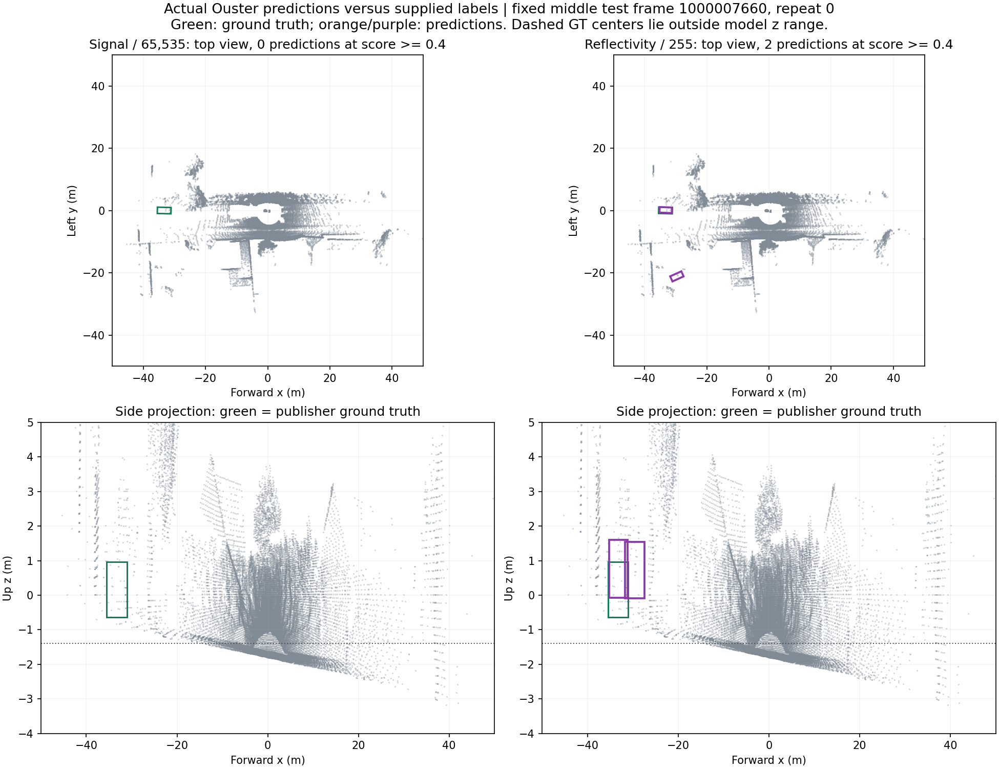

# PointPillars for ROS 2 Jazzy

**24 November continuation:** [Independent candidate comparison](docs/CANDIDATE_MODEL_COMPARISON_20261124.md) recovers 3 of 6 labeled Ouster test pedestrians at gate 0.3, versus zero baseline matches, while vehicle false positives worsen. The exact frame-1403 person remains unresolved; no production model replacement or accuracy acceptance is established.

**23 November continuation:** [A–Z solution protocol](docs/POINTPILLARS_SOLUTION_PROTOCOL_20261123.md) records the 78 unsuccessful height/sampling diagnostics, independent-label/model-adaptation decision gates and the separate failure-output freshness repair. No pedestrian accuracy solution is accepted.

This project turns LiDAR point clouds into 3D object detections using a pretrained PointPillars model and TensorRT. ROS 2 carries the clouds and results; RViz shows the points, predicted boxes and detection counts. The current implementation runs in Docker on Ubuntu 24.04 with an NVIDIA GPU.

**Current stage — 21 November 2026:** the complete input audit passed all 6,137 Ouster clouds across seven recordings and ten streams. A new 2,268-inference study found no pedestrian accuracy fix. An exact user-identified source scan confirms a nearby pedestrian candidate is vertically/laterally misplaced and scores below 0.3; six additional inferences document that case. Read the [latest measured investigation](docs/OUSTER_VERIFICATION_AND_PERSON_DIAGNOSIS_20261121.md) and [preserved image catalog](docs/IMAGE_ARCHIVE.md). Reflectivity/255 remains the comparison baseline; the requested clipped/100 live preview has not demonstrated an improvement. No accurate 3D configuration is accepted.

The earlier 8 November channel study found four of 60 test vehicles matched in BEV at gate 0.4 with reflectivity/255 and none with signal/65535; neither had qualifying test 3D matches. Those frozen results remain separate from the new gate-0.3 comparisons.



Green boxes are publisher annotations. The lower views reveal vertical disagreement hidden in a view from above. This is an actual measured example, not an illustration of successful accuracy. [Figure provenance](docs/figures/ouster-channel-ground-truth-provenance.json).

**9 November investigation:** [New decoder, voxel-feature and bounded-input controls](docs/DETECTION_INVESTIGATION_AND_PLAN.md) narrow the remaining causes. A small offline input-preparation tool is available; live preprocessing and the frozen accuracy conclusions are unchanged.

## Choose your starting point

| You want to… | Read or run |
| --- | --- |
| Use a live Ouster driver or replay the downloaded bag | [Startup and replay guide](docs/STARTUP_AND_REPLAY.md) |
| Understand the pipeline and CPU/GPU roles | [Project explained](README_PROJECT_EXPLANATIONS.md) |
| Understand signal versus reflectivity | [Channel decision and next experiments](docs/OUSTER_CHANNEL_DECISION.md) |
| Inspect accepted/rejected clouds | [Ouster adapter guide](docs/LIVE_OUSTER_ADAPTER.md) |
| Change the confidence gate or view counts | [Filtering and monitoring](docs/CONFIDENCE_FILTER_AND_MONITORING.md) |
| Find the evidence and remaining work | [Current status and results](docs/CURRENT_STATUS_AND_RESULTS.md) |
| Build without Docker | [Native development](docs/local_runtime.md) |
| Write the thesis or explain the research | [Documentation index](docs/README.md), [presentation source](docs/PROJECT_MIGRATION_PRESENTATION.tex) |

## Build and run with one command

First make sure the host NVIDIA driver, Docker and NVIDIA Container Toolkit work. Host ROS/CUDA/TensorRT development packages are unnecessary for container inference. Run these commands from the project root:

```bash
git clone https://github.com/AhmedAliMohammed1/MasterThesis.git "$HOME/pointpillars"
cd "$HOME/pointpillars"
sudo bash tools/deploy.sh
```

Deployment checks the GPU and Docker, builds the local checkout when runtime inputs change, and starts **the detector only**. A matching image is reused without a build. Documentation edits do not rebuild the runtime. The first build needs network access for dependencies and the pinned model; later builds reuse available Docker layers. Host drivers are never installed or upgraded by this script.

For later detector-only runs:

```bash
sudo bash tools/start.sh
```

If your publisher already supplies valid FLOAT32 XYZI, publish it on `/point_cloud` with compatible reliable QoS. For raw Ouster fields, use the adapter workflow below. The launchers do not automatically inspect a cloud and switch between passthrough and conversion.

## Start Ouster with the driver already working

Prepare the image without starting a detector, then start the adapter and detector together:

```bash
sudo env PP_BUILD_ONLY=1 bash tools/deploy.sh
sudo bash tools/start_ouster.sh
```

`PP_BUILD_ONLY=1` is **optional**. It is useful here because ordinary deployment starts a detector; stop that instance before launching the combined Ouster container.

The live profile expects `/ouster1/points`, domain 0 and Zenoh, matching the recorded live setup. Your driver and a reachable Zenoh router must already be running. If your driver uses Fast DDS, a different topic or a different domain, pass matching overrides. [Examples and adapter limits](docs/LIVE_OUSTER_ADAPTER.md).

The primary experiment recordings are now **raw01** (default) and **ouster1**, in
`/media/ae/New Volume1/rosbags`. Use separate terminals:

```bash
# Terminal 1: adapter + detector, using the bag profile.
sudo bash tools/start_ouster.sh bag
# Terminal 2: raw01 by default; choose ouster1 for the second recording.
sudo bash tools/start_ouster_bag.sh
# sudo bash tools/start_ouster_bag.sh ouster1
```

Both use Fast DDS, domain 99 and `/ouster1/points`. The player mounts the original
standalone MCAP read-only; no metadata generation or conversion is needed. Both
recordings have literal `signal` and `reflectivity` fields in sampled clouds.
Reflectivity/255 remains the default. Historical MOSEP recordings remain available
through `dry`, `rain30` and `rain100`. [Complete replay instructions](docs/STARTUP_AND_REPLAY.md).

One Ctrl+C stops each foreground launcher; allow up to eight seconds for cleanup. The image and `pp-engines` cache persist. Existing named containers are preserved and reported, rather than replaced.

## Visualize points and boxes in RViz

RViz runs on a graphical desktop with host ROS Jazzy and the `vision_msgs` RViz plugin. Use it as your desktop user, without sudo. With the Ouster bag pipeline running:

```bash
bash tools/visualize.sh bag
```

For the standard KITTI demo, `bash tools/visualize.sh` uses the `velodyne` profile. If RViz is missing, install `ros-jazzy-rviz2` and `ros-jazzy-vision-msgs-rviz-plugins` after configuring host ROS Jazzy. For an existing window, choose **File → Open Config**; the launcher opens a new window.

A rendered box establishes that messages reached the viewer. Ground-truth matching is needed to establish its accuracy.

## Check the running application

```bash
sudo docker logs --tail 80 pointpillars
sudo docker exec pointpillars /entrypoint.sh ros2 topic list -t
sudo docker exec pointpillars /entrypoint.sh ros2 topic echo /ouster_adapter/stats --once
sudo env PP_MONITOR_BACKEND=docker bash tools/monitor_detections.sh once
sudo env PP_MONITOR_BACKEND=docker bash tools/monitor_detections.sh threshold
```

The adapter-statistics command applies only when the Ouster adapter is running. Use `--help` on each helper for overrides. All participants must agree on topic, ROS domain and middleware.

| Interface | Purpose |
| --- | --- |
| `/point_cloud` — `sensor_msgs/msg/PointCloud2` | Validated FLOAT32 XYZI detector input |
| `/bbox` — `vision_msgs/msg/Detection3DArray` | Accepted detections with the original cloud header |
| `/bbox/stats` — `diagnostic_msgs/msg/DiagnosticArray` | Per-scan and cumulative processing counts |
| `/bbox/count` — `visualization_msgs/msg/MarkerArray` | RViz count label |
| `/ouster_adapter/stats` — `diagnostic_msgs/msg/DiagnosticArray` | Input schema, reception, conversion and rejection diagnostics |

Shell launchers default to confidence **0.4**; the C++/YAML default is **0.5**. Query the running parameter rather than assuming. The threshold is adjustable live and does not require rebuilding the engine.

## Model, engine and build cache

The image contains the checksum-verified pretrained ONNX at `/opt/models/pointpillars.onnx`. Startup creates an FP32 TensorRT engine for the selected GPU or reuses a matching engine in the persistent `pp-engines` volume. Engine generation does not retrain the model. The node loads the engine once and reuses its buffers.

`PP_FORCE_BUILD=1` forces a cached build; `PP_PULL_BASE=1` explicitly refreshes base images. `PP_SOURCE_MODE=remote` selects published Git source; `PP_GIT_REF`/`PP_GIT_REPO` also imply remote mode unless overridden. Ordinary deployment includes local runtime edits without a push. See [Docker details](docker/README.md).

The tested main GPU is an RTX 4060 Laptop. The recipe targets Linux x86-64; ARM/Jetson and Windows/WSL2 need separate validation. Keep independent backups of ignored bags, models, engines and experiment observations under `.recovery`; Git contains summaries and provenance, not all raw evidence.

## Download and play the sample bag, with matching camera video

For a separate KITTI integration demo, build the inference image and start the detector, then run:

```bash
bash tools/rosbag_demo.sh prepare  # Download/check assets and prepare camera MP4.
bash tools/rosbag_demo.sh          # Loop LiDAR playback; inference stays separate.
bash tools/rosbag_demo.sh stop     # Stop only helper-owned playback.
```

The helper uses Docker tools and defaults to `../rosbags/kitti04`. Its camera MP4 is a scene reference, not labeled ground truth or an automatic RViz overlay. Do not publish this demo and Ouster simultaneously to `/point_cloud`. See `bash tools/rosbag_demo.sh --help` for paths, rates and recovery options.

## What the latest evidence establishes

The channel study completed **1,120 measured GPU inferences** and **119 Python tests**. Those inferences include repeated scans and a separate capacity sensitivity control; they are not 1,120 independent scenes. The earlier deployment image passed seven C++/ROS tests and actual replay/shutdown checks. These are separate validation scopes.

The runtime remains a synchronous ROS callback with reliable depth 700. A background worker, configurable sensor QoS, a production capacity policy, sustained latency acceptance and accurate 3D detection remain unfinished. [The current status](docs/CURRENT_STATUS_AND_RESULTS.md) separates implemented behavior, measured results and proposals. Dataset attribution belongs with reused figures/data; see [figure documentation](docs/figures/README.md) and `LICENSE` for the software.

For the full development story, read [the engineering journey](docs/ENGINEERING_JOURNEY.md): the documented problems, attempted solutions, evidence and unresolved work, also included in the thesis draft.
