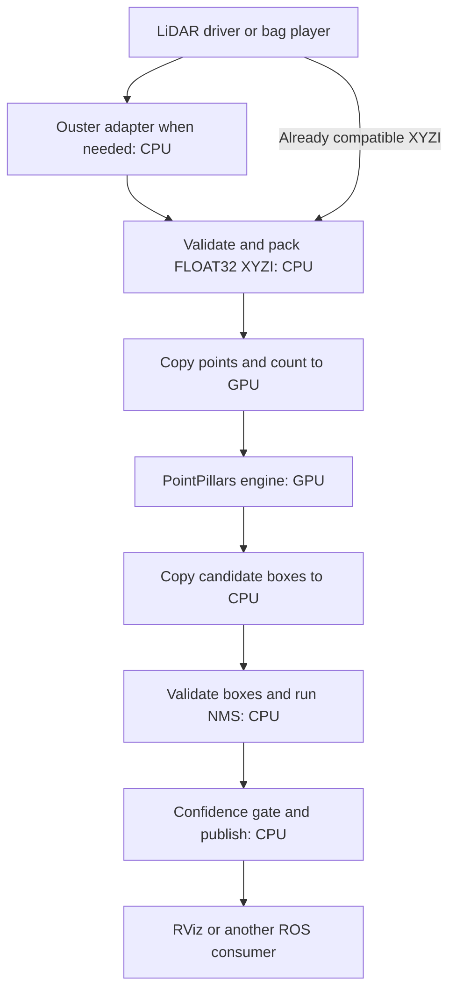
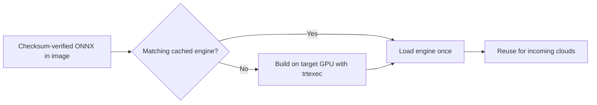
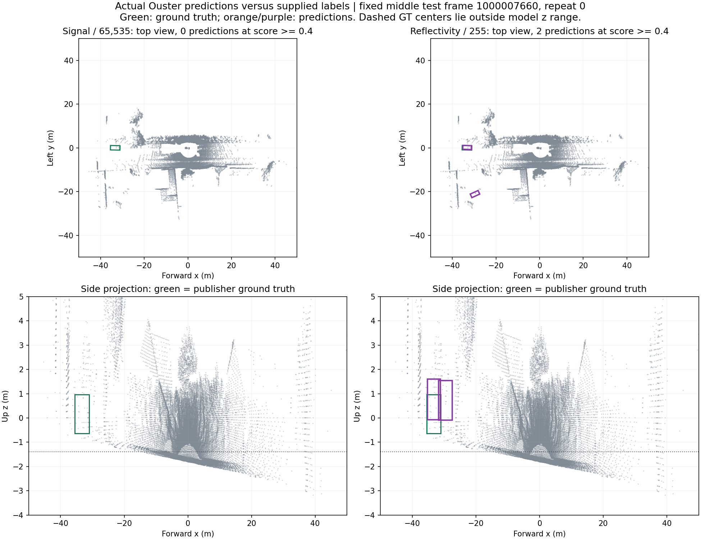

# PointPillars: the project explained

Reviewed 8 November 2026. This guide explains what the code does and what the research currently supports. Use [startup and replay](docs/STARTUP_AND_REPLAY.md) for commands, [current results](docs/CURRENT_STATUS_AND_RESULTS.md) for evidence, and [the channel study](docs/OUSTER_CHANNEL_DECISION.md) for the latest accuracy comparison.

## 1. The current state

The project runs a pretrained PointPillars network on LiDAR clouds and publishes object boxes through ROS 2. Docker deployment, the separate Ouster adapter, confidence filtering and RViz monitoring are implemented. Accurate 3D detection has not been achieved on the evaluated diagnostic data.

Reflectivity/255 is the better supported **experimental** Ouster feature for this model: on the frozen 16 test scans it found four of 60 in-region vehicles from above in each of five runs, while signal/65,535 found none. Both had zero qualifying 3D matches. Numerical success, repeatability and accuracy answer different questions; completing inference without an error is not evidence that a box is correct.

## 2. How we reached this state

The original implementation targeted Ubuntu 20.04, ROS Foxy and TensorRT 8. The migration targets Ubuntu 24.04, ROS Jazzy and TensorRT 10.16.1.11. It keeps the pretrained ONNX weights and updates the surrounding APIs, data checks, GPU resource management, postprocessing and deployment.

Early KITTI evaluation found poor accuracy. A separate TensorRT 8 reference reproduced the main problem; unchanged NVIDIA NMS and our NMS selected identical boxes from the same candidates. Later work added an Ouster adapter and direct channel comparisons against independent annotations. This narrows the investigation, but does not establish that TensorRT, NMS or feature scaling alone explains the remaining error.

## 3. Why the original code needed an update

TensorRT 10 uses named tensor interfaces. Jazzy message fields and dependency versions also differ from the older stack. The migration adds checked sizes, candidate validation, reusable GPU buffers and automatic resource cleanup. Testable geometry and message adapters make it possible to investigate failures without requiring the full sensor pipeline.

These safeguards reject malformed inputs and outputs. They do not establish complete GPU memory safety, a validated training contract or accurate detections.

## 4. What TAO, ONNX, TensorRT and the engine mean

| Term | Meaning here |
| --- | --- |
| PointPillars | A neural-network approach that groups cloud points into vertical pillars and predicts objects. |
| TAO / NGC | NVIDIA's model tooling and distribution source for the pretrained artifact. This project does not retrain through TAO. |
| ONNX | The saved network and weights, downloaded and checksum-verified during image construction. |
| TensorRT | The NVIDIA toolkit that builds and runs an optimized GPU execution plan. |
| Engine | The serialized execution plan prepared for a particular GPU/build configuration. |
| ROS 2 | The message transport and node framework around inference. |
| RViz | The viewer for point clouds, boxes and status labels. |

## 5. CPU and GPU responsibilities, and who talks to whom

The arrows show supported workflows; the launcher does **not** automatically detect which branch to use. Select detector-only startup for existing compatible XYZI, or the Ouster launcher for explicit conversion.

The ROS callback prepares points, schedules GPU work, receives candidates, removes overlapping boxes with non-maximum suppression (NMS), applies the confidence gate and publishes. TensorRT's CPU API schedules the GPU computation. All inference runs synchronously inside the current callback; no background inference worker is deployed.

### Supported tensor interface

| Tensor | Type | Batch-one shape | Meaning |
| --- | --- | --- | --- |
| `points` | FLOAT32 | `[1,204800,4]` | XYZI storage |
| `num_points` | INT32 | `[1]` | Actual valid point count |
| `output_boxes` | FLOAT32 | `[1,393216,9]` | Candidate storage |
| `num_boxes` | INT32 | `[1]` | Actual candidate count |

Candidate rows are `x,y,z,length,width,height,yaw,class_id,score`. Class order is Vehicle, Pedestrian, Cyclist; publication uses numeric-string IDs. Docker YAML retains generic class labels. The outer input capacity differs from the internal 10,000-pillar and 32-points-per-pillar limits. A cloud may fit the input tensor and still exceed an internal capacity.

## 6. Downloads and extraction: the original native setup

The optional native setup uses an extracted TensorRT SDK under `.recovery/sdk`. Its identity is recorded in [the runtime inventory](config/runtime_inventory.json). Extraction does not register packages with apt or install a host driver. [Native setup](docs/local_runtime.md) explains the build environment. Historical absolute paths describe the original machine and should not be copied to a new host.

## 7. Downloads and engine generation in Docker today

`deploy.sh` builds from the local checkout by default. It hashes runtime source/configuration and reuses an image with the same hash. Documentation changes do not rebuild the application. Changed source uses cached dependency/model layers when available. Missing caches or dependency changes can still require downloads.

### How the engine is created, step by step

1. Image construction installs ROS/CUDA/TensorRT and downloads the pinned ONNX.
2. Startup checks the selected GPU and calculates the engine key from model hash, GPU/driver/CUDA identity and build recipe.
3. If the corresponding nonempty engine is missing, `trtexec` builds an FP32 batch-one engine with TF32 disabled. The default builder workspace is 512 MiB.
4. A successful temporary engine is promoted into persistent storage. Interrupted partial files are removed.
5. The entrypoint starts the installed inference binary and passes `engine_path`. The node loads the engine once and reuses its context and buffers.

The current entrypoint executes the C++ binary directly for cleaner shutdown. A native `ros2 run pp_infer pp_infer` is another way to invoke that binary, but it needs an existing engine and does not build one. The legacy `model_path` parameter does not load ONNX; `data_type` does not change an existing engine's precision. Startup still needs the ONNX checksum even when the engine is cached.

## 8. Configurable sensor settings mean ROS QoS

QoS controls delivery policy and queueing, rather than changing network predictions. The Ouster adapter subscribes with sensor-data best-effort QoS and republishes reliable XYZI. The detector requests reliable delivery with depth 700. A best-effort-only raw publisher cannot generally satisfy that detector request directly under DDS. All nodes also need matching topics, middleware and ROS domain.

## 9. NMS and whether a higher threshold improves accuracy

NMS removes overlapping candidate boxes. The later confidence gate publishes only scores at or above the selected value. The launchers default to 0.4; native C++/YAML defaults are 0.5. A higher gate can reduce clutter and also remove true positives. It cannot repair wrong positions, wrong dimensions or confidently wrong boxes. Choose a threshold on tuning data and then evaluate untouched data.

## 10. How we tested the implementation

CPU tests cover geometry and data contracts; ROS tests cover conversions and message behavior; GPU runs exercise actual inference. The current recorded suite has 119 Python tests. The deployment image separately passed seven C++/ROS tests. The latest channel study made 1,120 measured GPU inferences: 480 MOSEP observations, 320 primary labeled observations and 320 capacity-control observations. Repeats are not independent scenes.

The direct study runner compiles unchanged production inference/NMS, but bypasses ROS transport and the adapter node. Earlier replay/conversion tests establish those separate parts. Test counts should always be reported with their scope and date.

## 11. Why accuracy is poor: evidence and uncertainty

The annotated Ouster test gives reflectivity a vehicle advantage in a view from above, but neither normalized feature produces qualifying 3D matches. Reflectivity's four matched vehicle centers are 0.60–1.14 m too high; their 3D overlap fails the declared criterion. No pedestrian advantage or cyclist result is established.

[Attribution and fixed-frame selection](docs/figures/ouster-channel-ground-truth-provenance.json). A separate geometry-only capacity control preserved the four-versus-zero BEV result and zero qualifying 3D matches. It was an experiment, not deployed preprocessing.

## 12. How to isolate the cause

Keep reflectivity/255 as a recorded experimental baseline. Investigate valid-return handling, internal pillar capacity, sensor/model coordinate conventions and decoder/anchor assumptions. Do not apply a guessed vertical offset fitted to inspected test labels. If the fixed model remains inaccurate, evaluate an Ouster-compatible trained model or fine-tune with a separate training split. Lock choices before a new recording-disjoint acceptance study.

The [decision report](docs/OUSTER_CHANNEL_DECISION.md) states dataset limits, exact matching rules and a proposed pilot acceptance gate. That gate is a proposal, not an approved requirement.

## 13. Which files changed, and why

| Component | Main source | Responsibility |
| --- | --- | --- |
| ROS detector | `src/pp_inference_node.cpp` | Synchronous callback and inference orchestration |
| Generic cloud adapter | `src/pointcloud_adapter.cpp` | FLOAT32 XYZI packing and candidate/message validation |
| Ouster conversion | `src/ouster_adapter.cpp`, `src/ouster_adapter_node.cpp` | Explicit channel conversion and diagnostics |
| GPU runtime | `src/pointpillar.cpp`, `include/pp_infer/cuda_resources.hpp` | TensorRT execution, checked buffers and cleanup |
| CPU postprocessing | `src/postprocess.cpp` | Rotated overlap and NMS |
| Publication | `src/detection_output.cpp` | Confidence parameter, boxes and counters |
| Deployment | `Dockerfile`, `docker/entrypoint.sh`, `tools/deploy.sh` | Reproducible image and cached engine startup |
| Channel research | `tools/run_ouster_ab.py`, `tools/ouster_gt_evaluation.py` | Frozen inference collection and annotated evaluation |

## 14. Future-use reading order and presentation status

Read [the README](README.md), [startup guide](docs/STARTUP_AND_REPLAY.md), [architecture](IMPLEMENTATION_ARCHITECTURE.md), then [current evidence](docs/CURRENT_STATUS_AND_RESULTS.md). Use the [documentation index](docs/README.md) to find the thesis draft and LaTeX guides. Historical records remain dated evidence; they do not define today's launch behavior. A saved PDF is current only when its compilation and source identity have been verified.
