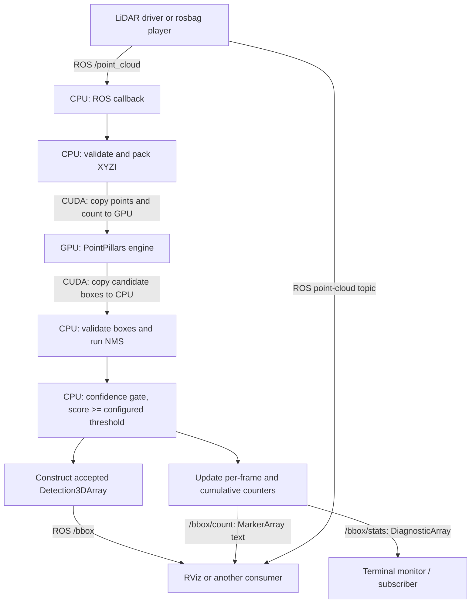
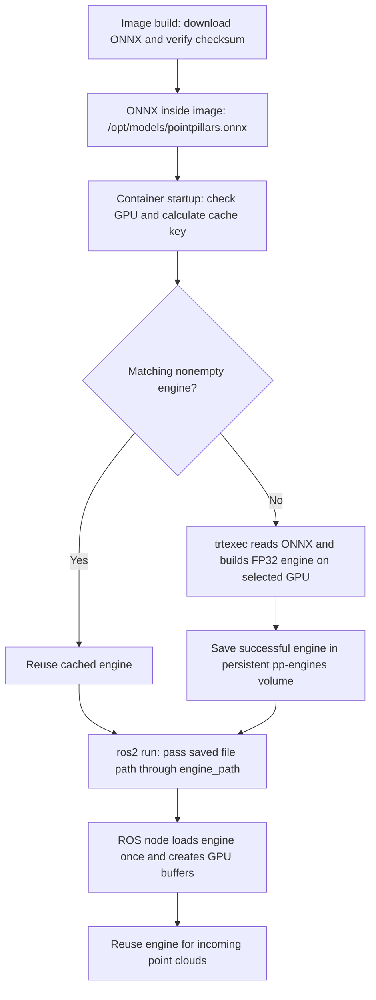

# PointPillars: project explanations and migration reference

> **Latest update — 23 October 2026:** confidence filtering and counters were pushed/deployed from `8a87a73`; 73 Python tests, five C++/ROS tests and 60 deployed GPU replay frames passed. The trial detector, KITTI player and RViz were then stopped at the user's request (19:47 UTC); image, engine cache and frozen results are preserved. Accuracy acceptance remains open. [Verified results and restart instructions](docs/CURRENT_STATUS_AND_RESULTS.md#trial-shutdown-and-restart--23-october-2026).

> **Status reviewed 23 October 2026.** This explanation now includes the 13–14 October Ouster feature/camera and frontal KITTI results, plus figures extracted from the supplied 20 October screencasts. Earlier dated findings remain historical evidence. [Current results and evidence](docs/CURRENT_STATUS_AND_RESULTS.md).

Updated **23 October 2026** against local source `ee6b36c`, inventories and saved results. Numerical evidence remains dated to its recorded experiments on 1–14 October. This documentation pass also inspected the supplied screencasts dated 20 October; it did not run new GPU inference.

This reference explains the migration, CPU/GPU/ROS flow, downloads, checks and poor diagnostic accuracy. See [current results](docs/CURRENT_STATUS_AND_RESULTS.md) for the consolidated tables, limitations and video figures, and the dated [discussion continuation](docs/CHAT_DISCUSSION_RECORD.md) for earlier requests.

The [presentation source](docs/PROJECT_MIGRATION_PRESENTATION.tex) now adds accuracy, Ouster/frontal results and screencast figures to its three original migration/flow/lifecycle slides. The old three-page PDF is a historical rendition, not a current rendering of the expanded source.
## 1. The current state

The subsequent [confidence-filter feature](docs/CONFIDENCE_FILTER_AND_MONITORING.md), implemented on 23 October, adds a default 0.5 publication gate, live threshold updates, per-frame/cumulative statistics and an RViz count label. Low-score detections are excluded before ROS publication; kept fields remain unchanged. This does not remove high-confidence false positives or change the earlier frozen accuracy results.

The project contains a working deployment and inference pipeline: receive a LiDAR cloud, run the pretrained model on an NVIDIA GPU, filter candidate boxes, and publish ROS detections. Docker build, engine generation, synthetic GPU/ROS execution, engine-cache reuse, real-bag message flow and RViz rendering passed on the available Ubuntu machine.

**Accuracy acceptance remains unfinished.** The labeled KITTI diagnostic baseline was poor. Successful compilation and a visible box establish execution and message compatibility, but they do not establish a correct detection.

The tested deployment uses Linux x86-64, Ubuntu 24.04, ROS 2 Jazzy, TensorRT 10.16.1.11 and container CUDA 12.9 components. The physically tested GPU was an RTX 4060 Laptop. Startup checks compute capability 7.5 or newer. That check alone does not validate every GPU. Windows/WSL2, ARM/Jetson and other physical GPUs have not passed this deployment's recorded validation.

The host needs a working NVIDIA driver, Docker and NVIDIA Container Toolkit. Host ROS/CUDA/TensorRT development installations are unnecessary for Docker inference. The optional desktop RViz viewer needs host ROS Jazzy, RViz and the vision message display plugin.

The current node still processes clouds synchronously inside its callback. It uses reliable delivery and queue depth 700. The proposed background inference worker with one replaceable pending frame is **not implemented**. Configurable sensor QoS, timing metrics, sustained benchmarks, further failure/memory checks and operational/CI acceptance remain open.

## 2. How we reached this state

| Stage | What changed and why |
| --- | --- |
| Original 2022 code | Foxy-era application with TensorRT 8 APIs, fixed CUDA/library paths, limited validation and manual resource management. |
| 1 October 2026 | Chose Ubuntu 24.04/Jazzy, created the architecture/task ledger and source checkpoint mechanism, then implemented CPU geometry and local ROS adapters. |
| Later on 1 October | Migrated the TensorRT controller while the SDK downloaded. Extracted the completed SDK, verified required plugins, built an FP32 engine and passed synthetic execution. |
| 2 October | Verified native execution and colcon, packaged Docker, automated published-source/dependency/model downloads, and added real KITTI bag playback, RViz and matching camera video. |
| 3 October | Prepared 32 labeled KITTI frames, measured a poor baseline, and compared independent TensorRT 8 and 10 executions. Found shared repeatability and pillar-capacity concerns. |

The migration reused the deployable pretrained ONNX. We did not retrain or fine-tune its weights.

Read the [full project history](docs/PROJECT_HISTORY_AND_DECISION_RECORD.md) and [earlier chronological discussion](docs/CHAT_DISCUSSION_RECORD.md) for the original events. Early plans and publication states are historical. Later source and dated evidence determine current status.

## 3. Why the original code needed an update

### Build and software compatibility

The old CMake configuration fixed CUDA 11.3 and system include/library paths. It selected C++14 in one place and forced C++11 elsewhere. Our target used a different OS/ROS stack and a project-local TensorRT extraction.

We adopted C++17, explicit dependency discovery and target-based linking. The build now permits CPU-only or ROS-adapter-only checks without the GPU runtime. Colcon remains the user-facing ROS build tool and CMake remains its package backend.

### ROS message compatibility

The original detection construction used `hyp.id` and `hyp.score`. Jazzy's message schema uses `hyp.hypothesis.class_id` and `hyp.hypothesis.score`. We updated construction, preserved input headers, populated hypothesis pose, and added typed startup parameters with bounds checks.

### Explicit TensorRT input/output interface

The old code supplied four buffer pointers in an assumed binding order and used `enqueueV2`. The new runtime assigns buffers by the names `points`, `num_points`, `output_boxes` and `num_boxes`, using `setTensorAddress` and `enqueueV3`.

Startup validates tensor role, dtype, dimensions, device location, linear format and one supported batch-one profile. TensorRT major version 10 is required by the current build. A different engine interface fails explicitly.

### Input and output safety

The old callback converted incoming data and allocated input memory from the received point count without adequately checking the engine's fixed capacity. The new adapter checks message bytes, XYZI field types/offsets, row padding and point count before conversion. It rejects oversize clouds and filters nonfinite points.

The old caller ignored the inference submission result and trusted the returned box count. The new runtime checks submission/completion, validates the count before copying rows, and validates class indices and box values before publication. GPU execution failure faults the runtime until restart and drops the frame.

### Resource lifetime and repeated work

The old callback created CUDA streams/events and allocated input memory for each cloud. Its callback timing stream and inference stream were inconsistent. A raw `PointPillar` allocation lacked node-owned cleanup, the deserialization runtime had unmanaged lifetime, and a context could retain a pointer to a temporary profiler.

We introduced owned TensorRT objects, one persistent CUDA stream and four reusable device buffers. Host output storage is also reused. Copies, inference and completion follow the same stream. CPU/PCL/ROS operations can still allocate. No before/after performance benchmark has established the complete speedup.

### Geometry correctness and testability

The original rotated-overlap calculation had problematic empty/degenerate intersection cases. We introduced bounded polygon clipping, validated arguments/geometry and stable equal-score ordering. CPU geometry no longer includes CUDA types. The default class-agnostic suppression and original `>=` threshold comparison remain.

## 4. What TAO, ONNX, TensorRT and the engine mean

| Item | Role |
| --- | --- |
| TAO | NVIDIA's model training, fine-tuning and export toolkit. |
| Trainable `.tlt` | A training artifact. We inventoried the downloaded file but did not decrypt or run it. It is not required for this deployment. |
| Deployable `.onnx` | Exported computation, learned weights and custom operator definitions. This is our deployment starting point. |
| TensorRT SDK | Headers, shared libraries, plugins, parser and tools such as `trtexec`. |
| TensorRT `.engine` | Generated execution artifact prepared for the selected GPU/software environment. |
| CUDA/driver | GPU memory transfers and execution support. The host supplies the NVIDIA driver. |
| ROS 2 | Message transport between the LiDAR source, detector and consumers. |
| Docker | Packages the application and its dependencies. |

TensorRT's builder parses ONNX with the required plugins and generates an engine. The application loads that engine. Changing a legacy `data_type` node parameter does not change the precision of an already-built engine.

## 5. CPU and GPU responsibilities, and who talks to whom



RViz separately subscribes to the point cloud so it can display points and boxes together. It is a consumer, not part of inference.

The CPU runs the C++ node and calls TensorRT/CUDA libraries. Those libraries arrange GPU computation. The GPU does not subscribe to ROS or publish messages. ROS middleware handles communication between programs. CPU/GPU buffers handle communication inside the detector.

### CPU work per frame

1. Receive the cloud and validate its byte layout and capacity.
2. Convert with PCL, discard nonfinite points and pack `x,y,z,intensity` values. Intensity is divided by the configured scale, currently 1.0.
3. Clear unused GPU input padding and output-count storage. Transfer the valid points and their actual count.
4. Launch TensorRT and wait for completion. Copy and validate the output count, then copy the required rows and wait again. This is a checked count-first transfer, not a fully asynchronous multi-frame pipeline.
5. Validate candidates and apply CPU rotated NMS.
6. Validate all post-NMS candidates and keep only scores at or above the configured confidence threshold. Convert accepted yaw values to quaternions and publish class, score and box geometry with the original timestamp/frame.
7. Update published/filtered detection totals and publish diagnostics plus the RViz text marker. A valid empty cloud skips GPU inference and publishes an empty array.

### GPU work inside the model

- `VoxelGeneratorPlugin` groups points into vertical grid cells called pillars and prepares features.
- Learned feature computation creates a representation for each pillar.
- `PillarScatterPlugin` places pillar features into a grid viewed from above.
- Neural-network layers predict object classes and box parameters.
- `DecodeBbox3DPlugin` produces candidate boxes with score and class.

### Supported tensor interface

| Tensor | Type | Batch-one shape | Meaning |
| --- | --- | --- | --- |
| `points` | FLOAT32 | `[1,204800,4]` | Fixed-capacity XYZI input. |
| `num_points` | INT32 | `[1]` | Actual number of valid points. |
| `output_boxes` | FLOAT32 | `[1,393216,9]` | Candidate box storage. |
| `num_boxes` | INT32 | `[1]` | Actual candidate count. |

Rows contain `x,y,z,length,width,height,yaw,class_id,score`. Source/documentation support center-based boxes, yaw in radians, and LiDAR axes x forward, y left, z up. The verified class order is 0 Vehicle, 1 Pedestrian, 2 Cyclist. ROS publishes numeric-string IDs. Docker YAML still uses generic class labels and the partial JSON model contract is not enforced as an artifact-bound runtime manifest.

The engine's 204,800-point input limit differs from the internal export limit of 10,000 pillars and 32 points per pillar. A cloud can fit the input tensor and still exceed an internal limit.

## 6. Downloads and extraction: the original native setup

The ONNX already existed at `/home/ae/Downloads/pointpillars_deployable.onnx` when inspected on 1 October at 22:01 Europe/Berlin. The exact original download time/method was not recorded. Later verification matched its hash to NVIDIA NGC `pointpillarnet/deployable_v1.1`. The file is 5,572,374 bytes. It needs no archive extraction.

At 22:49 you reported downloading TensorRT. At 23:11 you reported completion. We inspected the approximately 5.17 GB file:

```text
/home/ae/Downloads/
nv-tensorrt-local-repo-ubuntu2404-10.16.1-cuda-12.9_1.0-1_amd64.deb
```

The outer DEB contains a repository of component DEBs. Sudo needed a password, so the actual procedure extracted package data locally instead of performing the initially proposed system installation:

1. Extract the outer DEB into a temporary `.recovery/sdk/repository` area.
2. Extract selected component packages into `.recovery/sdk/tensorrt-10.16.1`.
3. Expose headers/libraries/tools through `tools/env_tensorrt.sh`.
4. Verify the three plugin creators and build the engine with `trtexec`.

The SDK root was `/home/ae/Desktop/MasterThesis/.recovery/sdk/tensorrt-10.16.1/usr`. After the Linux checkout moved, its corresponding root was `/media/ae/New Volume/MasterThesis/.recovery/sdk/tensorrt-10.16.1/usr`. Headers, shared libraries and tools lived below `usr/include`, `usr/lib` and `usr/bin`. No TensorRT host apt/dpkg registration or package maintainer scripts ran in this extraction. Temporary repository contents were later removed.

The generated native smoke engine was `.recovery/engines/pointpillars-fp32.smoke.engine`. The name deliberately denotes execution testing rather than accuracy acceptance. Docker does not require these native assets.

These Linux locations describe the earlier machine. This explanation checkout is at `E:\MasterThesis`; it is not evidence that those Linux assets or services currently exist on Windows.

## 7. Downloads and engine generation in Docker today

Run the existing deployment wrapper on a prepared Linux GPU host:

```bash
sudo bash tools/deploy.sh
```

### During image build

The Dockerfile fetches published Git source, installs ROS/CUDA/TensorRT dependencies, downloads and verifies ONNX, then builds/tests the application with colcon. Local uncommitted or unpushed application changes are not included in its remote source fetch. A full commit SHA can pin the source. Base images and ROS repository packages can still change.

| Asset | Source | Final image location |
| --- | --- | --- |
| TensorRT components | NVIDIA's signed Ubuntu apt repository, pinned `10.16.1.11-1+cuda12.9` | Required shared libraries in `/opt/tensorrt/lib/`. Headers remain in the build stage. |
| CUDA runtime libraries | Pinned NVIDIA packages | `/opt/cuda/lib/`. |
| ONNX | NGC API, `pointpillarnet/deployable_v1.1/files/pointpillars_deployable.onnx` | `/opt/models/pointpillars.onnx`. |
| Engine builder | TensorRT tools package | `/usr/local/bin/trtexec`. |
| Compiled ROS package | Published repository source | `/workspace/install/`. |
| Source identity | Build-stage Git revision | `/opt/pp_infer/source-revision.txt`. |

Apt downloads and unpacks component packages inside the build image. The Docker route does not use the original large DEB or project-local SDK. ONNX is model data stored directly in the image. It is not an installer or an archive. Cached Docker layers may avoid repeated downloads.

### During container startup

The entrypoint checks the selected GPU and calculates a cache key from the model hash, GPU UUID/capability, driver/CUDA information and TensorRT build recipe. It reuses a matching nonempty engine or generates one with `trtexec`.

The engine is **generated, not downloaded**. Its path is `/var/lib/pp_infer/<cache-key>.engine`, backed by Docker volume `pp-engines`. The recipe uses FP32, batch one, TF32 disabled and a default 1024 MiB builder workspace. Workspace is not the total GPU memory limit.

A file lock serializes same-key generation. A temporary file becomes the final engine only after the builder succeeds. Matching restarts reuse the cache. A different target GPU requires its own matching engine. A later-corrupted nonempty cache entry is not automatically repaired.

`docker build` produces the image. The wrapper then runs the container, where engine creation and node startup occur. Inference needs GPU access at startup, while the image build does not require a GPU.

### How the engine is created, step by step

1. **Prepare the image.** The [Dockerfile](Dockerfile) installs TensorRT/CUDA components and downloads the deployable ONNX from [NVIDIA NGC](https://api.ngc.nvidia.com/v2/models/nvidia/tao/pointpillarnet/versions/deployable_v1.1/files/pointpillars_deployable.onnx). It verifies SHA-256 `2dcabddc3a365e9608a112d7bbbb7db769a6dddeeaa59aa03611a83113326da1` and stores the model at `/opt/models/pointpillars.onnx`. The image contains the builder, libraries and compiled application; no target engine is built at this stage.
2. **Identify the target at startup.** [docker/entrypoint.sh](docker/entrypoint.sh) loads the ROS environment, hashes ONNX and checks the GPU selected by `PP_GPU_INDEX` (default 0). The GPU model/UUID, compute capability, CUDA driver/runtime API information, host driver and build recipe contribute to the cache key.
3. **Look for an existing engine.** The script locks the matching cache entry. If `/var/lib/pp_infer/<cache-key>.engine` exists and is nonempty, it skips engine generation. If missing or empty, it starts `trtexec`.
4. **Read the trained network.** The CPU-side TensorRT builder parses ONNX, including the trained weights and required PointPillars plugins. It uses the fixed batch-one input profile: `points` has shape `[1,204800,4]` and `num_points` has shape `[1]`.
5. **Choose an implementation for the GPU.** TensorRT prepares an execution plan suited to that GPU. The CPU manages the build and the GPU can be used to time candidate implementations. The recipe is FP32, with TF32 disabled and a default 1024 MiB workspace allowance. `--skipInference` skips the subsequent inference benchmark; it does not make engine building CPU-only. No training or weight fine-tuning happens here.
6. **Write the engine file.** `--saveEngine` writes the serialized execution plan to a temporary file. After the builder succeeds, the script moves it to the final `.engine` path and releases the lock. Serialization means saving the plan as binary data. This is not renaming ONNX or extracting an archive.
7. **Keep it for future launches.** The default `pp-engines` volume preserves the engine when the container is removed. A changed model, GPU identity, driver/CUDA information or recipe produces a different cache key and therefore a different engine entry. A matching nonempty cache entry is reused; corruption discovered during loading requires repair rather than an automatic rebuild.



The builder may take time on first startup. Later launches with a matching cache avoid that build. The engine still needs compatible TensorRT, CUDA and plugin libraries; the file is not a standalone program and should not be assumed portable between GPUs or SDK versions.

### How ros2 run loads and reuses the engine

The entrypoint finishes cache preparation **before** starting the ROS executable. It launches `ros2 run pp_infer pp_infer` with `/opt/pp_infer/node.yaml`, `engine_path:=/var/lib/pp_infer/<cache-key>.engine`, the `/pointpillars` name override and configured topic remappings.

Inside the application, startup follows this sequence:

1. [src/pointcloud_adapter.cpp](src/pointcloud_adapter.cpp) reads and validates startup parameters, including the required `engine_path`.
2. [src/pp_inference_node.cpp](src/pp_inference_node.cpp) constructs `PointPillar(engine_path)` once when the node starts.
3. [src/pointpillar.cpp](src/pointpillar.cpp) initializes TensorRT plugins and creates a runtime. It opens the engine file on the CPU and reads its bytes.
4. `deserializeCudaEngine` reconstructs TensorRT's engine object from those bytes. The application checks the four named tensors and supported batch-one interface, creates an execution context, allocates reusable GPU buffers and binds their addresses with `setTensorAddress`.
5. The node keeps that engine and context alive. Each valid nonempty cloud uses CUDA transfers and `enqueueV3` to execute it, followed by CPU validation, NMS and ROS publication. It does not reopen the engine or rebuild it for each frame. A valid empty cloud skips inference and publishes an empty detection array.

If an engine is missing, incompatible or invalid, the node fails startup with an error. The current ROS executable does not automatically fall back to loading ONNX and rebuilding.

### Why ONNX is not loaded by the current ROS node

ONNX is read by `trtexec` when an engine needs building. The current ROS node reads only the engine through `engine_path`. The normal entrypoint still reads ONNX to calculate its checksum **even when it will reuse a cached engine**, so `/opt/models/pointpillars.onnx` must remain available for that startup route.

| Setting or command | What it actually does |
| --- | --- |
| `engine_path` | Selects the existing engine file loaded by the ROS node. |
| `model_path` | Legacy parameter stored by the node; it does not cause ONNX loading or engine creation. |
| `data_type` | Legacy parameter accepting `fp32`/`fp16`; it does not change a loaded engine. The container builder recipe determines its precision. |
| Direct `ros2 run pp_infer pp_infer` | Starts the compiled application. It requires a prepared compatible engine, runtime libraries and valid parameters; it does not download/install/build them. |
| `sudo bash tools/deploy.sh` | Builds the image and runs the container, whose entrypoint prepares the engine before starting ROS. |

The distinction to remember is: **Docker build prepares software and ONNX; container startup prepares or reuses the engine; ROS loads that engine once and processes clouds.**

## 8. Configurable sensor settings mean ROS QoS

Quality of Service (QoS) controls message delivery and buffering. It is distinct from changing LiDAR hardware settings.

- Reliable delivery attempts to deliver every message. Best effort permits loss and is common for live sensor streams.
- Queue depth controls how many incoming messages can wait. A large queue can increase frame age when processing falls behind.
- A reliable subscriber cannot match a best-effort publisher.

Our subscription currently hardcodes reliable delivery and depth 700. Making this configurable would allow matching the actual publisher through parameters instead of editing C++. This remains pending alongside the latest-frame worker.

## 9. NMS and whether a higher threshold improves accuracy

Non-Maximum Suppression (NMS) removes overlapping candidate detections likely to describe the same object. It sorts by score, keeps the highest-scoring remaining box, suppresses boxes with enough overlap, and repeats.

Example: three strongly overlapping car boxes score 0.92, 0.85 and 0.70. NMS can keep the 0.92 box and remove the duplicates. It does not correct the position, dimensions or class of a box.

Overlap uses intersection over union (IoU): shared footprint area divided by total footprint area covered by the boxes. Zero means no shared area and one means identical footprints. Our CPU NMS uses rotated footprints viewed from above. The default is class-agnostic, so overlapping candidates can suppress each other even across class IDs.

Current settings consider the top 4096 candidates and suppress at IoU `>= 0.01`. This is an overlap threshold, not a confidence threshold. The export separately encodes a decode score threshold of approximately 0.1.

Increasing NMS IoU from 0.01 to 0.1 keeps more overlapping boxes. It may retain nearby distinct objects and improve recall, but it may also retain duplicates and increase false positives. A larger threshold does not guarantee better accuracy. Select settings on tuning data, then evaluate fixed settings on a separate untouched split. NMS changes cannot explain or repair all vertical-coordinate or pillar-capacity problems.

## 10. How we tested the implementation

These rows retain their original recorded checks. On 23 October, the current Linux checkout also passed all 64 Python tests; this was not a new GPU/ROS integration run.

| Layer | Recorded verification | What it establishes and its limit |
| --- | --- | --- |
| Recovery | 12 tests for integrity, drift and interrupted checkpoints | Source continuation behavior. It does not preserve every large asset. |
| CPU geometry | 15 cases and 2000 randomized comparisons, with AddressSanitizer/UndefinedBehaviorSanitizer | Local geometry and malformed-input safety. Leak checking was unavailable in the traced environment. |
| ROS adapter | 11 data fixtures and 2 parameter cases | Layout/padding/capacity, finite filtering, configuration and message mapping. Installed ROS node allocation exposed an ASan issue, so normal parameter tests and instrumented data tests were separated. |
| Full build | Four CPU/ROS CTest modes passed with the SDK and Docker builds | Compilation/linking and local tests. GPU smoke execution is a separate check. |
| Actual GPU | Engine/plugin loading, 10 synthetic frames, capacity rejection, profiler toggling, empty results and destruction | Supported execution on the available GPU. Synthetic clouds do not establish real-data accuracy. |
| Deployment | Fresh engine generation, cached restart, invalid GPU selection and Dockerfile-only build | Automated setup/cache behavior for the tested host. |
| Real bag and viewer | 25 matched frames inside Docker and another 25 through host transport, plus RViz rendering | Real-message compatibility and display. The raw bag/video has no object annotations. |
| Labeled evaluation | 32 diagnostic frames, split 16 tuning/16 test with separate original recording drives. Evaluator controls and 41 Python tests | Calibrated scoring and a poor measured diagnostic baseline. No accuracy acceptance. |
| Independent comparison | 32 frames, 3 repeats, 2 runtimes: 192 raw inferences. Identical-candidate NMS agreed in all 192 observations. Latest suite: 50 Python tests | Strong filtering agreement and a shared inference problem. Exact training/numerical parity remains unresolved. |
| GPU memory probes | Two CUDA 12.9 allocation checks ran with zero reported errors | Limited allocation evidence. Shared tensor allocations can hide internal tensor-bound issues. Earlier CUDA 12.0 instrumentation failed. Full memory/race validation remains incomplete. |

## 11. Why accuracy is poor: evidence and uncertainty

On the 16 diagnostic test frames at moderate KITTI difficulty, the frozen first ROS observations had zero accepted 3D matches for Car, Pedestrian and Cyclist. Moderate BEV AP_R40 was approximately 5.75%, 0% and 0.0258%. Vehicle is explicitly mapped to KITTI Car compatibility. This is a small, selected diagnostic sample, not an official leaderboard or population score.

For 12 test cars matched from above, predicted centers were about 1.53 m too high at the median. Poor/elevated candidates already appeared before ROS display. Independent TensorRT 8 execution reproduced the broad failure. Both runtimes also varied between repeats.

The model's weights may be unsuitable for KITTI, but we cannot attribute the entire problem to them. The model card describes a different solid-state LiDAR dataset. Input/training conventions and shared plugin behavior remain possible contributors.

Twelve of 32 clouds exceeded 10,000 occupied pillars. Every frame also had crowded pillars above 32 points. NVIDIA's published source raises an internal bounds concern under excess occupancy. Source inspection is not proof of the exact packaged machine instructions.

Two tuning-only capped-input controls improved repeated raw matching to approximately 99.6-100%. They changed range/capacity selection while preserving retained XYZI bits. This supports a contributor to variation, not a confirmed root cause or demonstrated accuracy improvement. No capped preprocessing or empirical z shift was installed in production.

## 12. How to isolate the cause

Investigate changing predictions and inaccurate geometry separately. Preserve input/model/engine identities and first observations. Change one factor per controlled experiment.

1. **Verify the measurement.** Known boxes must survive calibration and score correctly. Existing exact/missing/duplicate controls passed, but repeat affected controls when their conversion/evaluator changes.
2. **Verify packing.** Compare point counts and exact XYZI bytes at the inference boundary with the frozen source cloud. Check units, axes, origin and intensity against this export's training conventions.
3. **Isolate capacity handling.** Separately control out-of-range points, pillar count and points per pillar. Compare pillar coordinates/features with an independently checked implementation. The existing combined capped experiment is a clue, not an isolation of one kernel.
4. **Establish a stronger reference.** Obtain a known fixture for this exact export or prove that a training-framework checkpoint/configuration corresponds to it. Our `.tlt` is not yet a verified exact counterpart. TensorRT 8 and 10 can share a plugin problem.
5. **Compare intermediate outputs.** Locate the first disagreement in pillar features, network predictions or box decoding. Match candidates by class/geometry rather than array position because ordering can vary.
6. **Investigate the vertical error.** Verify training sensor origin/height and decoder center conventions. Do not choose a global 1.53 m correction just because it fits the inspected sample.
7. **Assess model suitability.** Once execution matches a trusted reference, compare intended-domain and KITTI data. A dataset mismatch can justify fine-tuning or another model. A new model is not a substitute for establishing whether the current pipeline interprets data correctly.
8. **Evaluate a justified change on untouched data.** Keep NMS/score choices on tuning data and use a larger new acceptance split. The diagnostic test results have already been inspected.

## 13. Which files changed, and why

The following groups cover the implementation and support files added or edited since the original baseline. Some are diagnostic additions rather than changes to production inference.

| Files | Purpose and reason |
| --- | --- |
| `CMakeLists.txt`, `package.xml` | Modern compiler/dependency setup, separate build targets and tests. |
| `src/pp_inference_node.cpp` | Node owns the runtime and delegates cloud packing/output mapping. Drops invalid/failed frames. The callback remains synchronous. |
| `src/pointcloud_adapter.cpp`, `include/pp_infer/ros_adapter.hpp` | New testable ROS boundary for typed configuration, safe XYZI packing and Jazzy detections. |
| `src/pointpillar.cpp`, `include/pp_infer/pointpillar.h` | TensorRT 10 named-tensor controller, engine/interface checks, persistent resources and checked inference. |
| `include/pp_infer/cuda_resources.hpp` | Automatic CUDA buffer/stream ownership and checked operations. |
| `include/pp_infer/model_contract.hpp`, `include/pp_infer/output_contract.hpp` | Checked size arithmetic, input limits and output count/class/box validation. |
| `src/postprocess.cpp`, `include/pp_infer/postprocess.h` | CPU-independent rotated geometry and NMS with edge-case validation. |
| `src/device_info.cpp` | Installed GPU preflight helper used consistently by startup. |
| `Dockerfile`, `docker/entrypoint.sh`, `docker/node.yaml`, `tools/deploy.sh` | Automatic dependency/model/source setup, target engine caching, node configuration and one-command build/run. |
| `tools/env_tensorrt.sh`, `tools/inspect_onnx_metadata.py` | Native SDK environment and model-interface inventory. |
| `tools/recovery.py`, `recovery/tasks.json`, `recovery/PROGRESS.md`, `recovery/RESUME.md` | Checkpoints, dated evidence, task status and continuation procedure. |
| `tests/core/test_postprocess.cpp`, `tests/runtime/test_output_contract.cpp`, `tests/ros/test_ros_adapter.cpp`, `tests/runtime/runtime_smoke.cpp` | Local CPU/ROS checks and separately run real-engine smoke checks. |
| `tools/rosbag_demo.sh`, `tools/prepare_kitti_demo.py`, `docker/demo-tools.Dockerfile`, `tests/test_kitti_demo.py` | Resumable bag/camera preparation and controlled playback. |
| `tools/visualize.sh`, `rviz/pointpillars.rviz`, `rviz/class_colors.yaml` | Host display of original points and published boxes, with numeric class colors. |
| `tools/prepare_kitti_validation.py`, `tools/kitti_geometry.py`, `tests/test_kitti_validation.py` | Frozen labeled data selection and calibrated ground-truth geometry. |
| `tools/kitti_accuracy.sh`, `tools/kitti_inference.py`, `tools/kitti_evaluation.py`, `tools/kitti_diagnose.py`, `tests/test_kitti_evaluation.py`, `rviz/kitti_validation.rviz` | Prediction collection, fixed evaluation rules, diagnostics and green ground-truth display. |
| `docker/reference/Dockerfile`, `docker/reference/Dockerfile.trt10`, `docker/reference/runner.cpp`, `docker/reference/nms_driver.cpp` | Separate TRT8/TRT10 diagnostic execution and identical-candidate NMS comparison. |
| `tools/kitti_reference.py`, `tools/kitti_reference_probe.py`, `tools/kitti_reference_repeat.py`, `tests/test_kitti_reference.py` | Reference collection, exploratory engine probe, repeat scoring and diagnostic controls. |
| `tools/kitti_voxel_control.py`, `tools/kitti_reference_memcheck.py`, `docker/REFERENCE_MEMCHECK.Dockerfile` | Tuning-only capacity experiments and limited real allocation instrumentation. |
| `tools/kitti_reference_view.py`, `rviz/kitti_reference.rviz` | Cyan frozen reference overlay beside live predictions and green annotations. |
| `config/environment_inventory.json`, `config/model_inventory.json`, `config/runtime_inventory.json`, `config/model_contract.json` | Observed platform/model/SDK identities and partial semantic contract. |
| `config/docker_inventory.json`, `config/demo_inventory.json`, `config/visualization_inventory.json` | Deployment/demo/viewer evidence and asset identity records. |
| `config/kitti_sources.json`, `config/kitti_validation_inventory.json`, `config/kitti_accuracy_inventory.json`, `config/kitti_reference_inventory.json` | Dataset sources, frozen identities, accuracy results and diagnostic evidence. |
| `tools/prepare_ouster_demo.py`, `tools/ouster_features.py`, `tools/prepare_ouster_variant.py`, `tools/compare_ouster_features.py`, `tools/compare_ouster_repeats.py` | Original Ouster preparation, explicit feature variants and same-scan numerical/repeatability comparison. |
| `tools/export_ouster_camera.py`, `tools/prepare_ouster_visual.py`, `tools/prepare_ouster_raw_view.py`, `tools/rosbag_ouster.sh`, `tools/rosbag_ouster_detail.sh` | Camera previews, payload-preserving merged playback and original-data visualization alongside normalized inference. |
| `tools/prepare_kitti_front.py`, `tools/rosbag_kitti_front.sh`, `rviz/kitti_front.rviz` | Full-scan raw KITTI drive 0005 with forward-facing camera and calibrated source projection. |
| `tests/test_ouster_demo.py`, `tests/test_ouster_features.py`, `tests/test_ouster_camera.py`, `tests/test_kitti_front.py` | Input/feature preservation, timing, calibration and owned-player controls. |
| `docs/CURRENT_STATUS_AND_RESULTS.md`, `docs/figures/` | Consolidated dated results, screencast PNGs and source/frame provenance. |
| `tests/test_recovery.py`, `.gitignore`, `.dockerignore` | Recovery checks and exclusion of large/generated artifacts from source and build context. |
| `label.txt` | Model class-label file, later verified against the exact NGC export. Current YAML label integration is still pending. |
| `README.md`, `docker/README.md`, `docs/local_runtime.md`, `docs/LEGACY_FOXY_README.md` | Current setup/run instructions plus clearly preserved historical installation procedure. |
| `PROJECT_REVIEW_AND_UPDATE_PLAN.md`, `IMPLEMENTATION_ARCHITECTURE.md`, `docs/PROJECT_HISTORY_AND_DECISION_RECORD.md`, `docs/CHAT_DISCUSSION_RECORD.md`, `docs/PROJECT_IMPLEMENTATION_AND_DEPLOYMENT_GUIDE.tex` | Starting review, staged architecture, history and A-to-Z operation guide. Planned components must be distinguished from delivered code. |
| `docs/MODEL_VALIDATION_PLAN.md`, `docs/KITTI_VALIDATION_DATA.md`, `docs/KITTI_ACCURACY_RESULTS.md`, `docs/MODEL_REFERENCE_COMPARISON.md` | Validation method, data preparation, actual poor baseline and narrowed investigation. |

The historical `launch/pp_infer_launch.py` remains an unmodernized configuration with old absolute paths. It is not the validated deployment route.

## 14. Future-use reading order and presentation status

Read this reference for explanation, [README.md](README.md) for operation, [recovery/RESUME.md](recovery/RESUME.md) for continuation, and the latest accuracy/reference documents for unresolved findings. Inspect actual processes and artifact identities rather than assuming an old "left running" statement is current.

Source checkpoints omit SDKs, engines, models, bags, media and most generated evidence. Keep independent backups. Docker engine caching and source checkpointing solve different problems.

The [LaTeX presentation](docs/PROJECT_MIGRATION_PRESENTATION.tex) now has seven active slides: the original purpose/migration, CPU/GPU/ROS flow and engine lifecycle, followed by measured KITTI accuracy, later Ouster/frontal results and two screencast figures, plus the published filtering trial and verified counter capture. Inline TikZ diagrams remain editable; screenshot PNGs live under `docs/figures/`. Keep those assets beside the source for the complete illustrated output. The standalone preview provides a labeled placeholder when project images are unavailable.

The built-in compiler was attempted for all three updated LaTeX sources on 23 October. All failed before source parsing because its TeX bundle was not cached and could not be downloaded. Compilation and rendered page layout remain unverified. The source stays in the built-in editor; no terminal TeX installation was added. The old `output/pdf/PROJECT_MIGRATION_PRESENTATION.pdf` is a separate historical three-page rendition, not a compiled or current version of the expanded source. Diagnostics are retained under `.recovery/verification/docs-2026-10-23/latex-compilation.json`.

The [current results](docs/CURRENT_STATUS_AND_RESULTS.md) distinguish numerical experiments, integration checks and visual illustrations. The [history](docs/PROJECT_HISTORY_AND_DECISION_RECORD.md) and [discussion record](docs/CHAT_DISCUSSION_RECORD.md) retain the earlier three-slide requests and compilation attempts as dated history.

## Latest sensor results and visual examples — 23 October 2026

The [Ouster feature experiment](docs/OUSTER_FEATURE_COMPARISON.md) changed only the fourth feature. Raw signal rejected 15/48 observations; three normalized variants rejected 0/144. Explicit reflectivity/255 replay matched all 556 message occurrences, but there are no object labels and calibration/accuracy remain unvalidated. The ordinary helper still defaults to raw signal; the detail wrapper selects the normalized candidate.

Camera export preserves 111 original image and CameraInfo payloads and 556 normalized clouds. Bag-record timing coordinates streams with different header clocks; it does not establish acquisition-time synchronization. The original-data detail topic preserves full source geometry/auxiliary fields alongside normalized inference.

The [frontal KITTI comparison](docs/FRONTAL_COMPARISON_AND_RVIZ_DETAIL.md) received 154 matched clouds/detections and 154 camera/CameraInfo messages. Its full 360-degree scans retain 98,532–124,122 points each. Neither this unlabeled clip nor Ouster replaces the frozen poor KITTI accuracy baseline.


First supplied recording at 32.035 s. Visible points, boxes and scores illustrate rendering; the screenshot alone does not establish object correctness or the experiment identity. [Second example and provenance](docs/CURRENT_STATUS_AND_RESULTS.md#visual-examples-from-the-supplied-screencasts).
