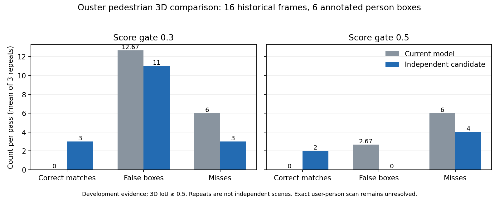

# Independent PointPillars candidate comparison — 24 November 2026

An independent learned PointPillars checkpoint recovers actual 3D pedestrian matches on the historical labeled Ouster subset. This is a measured development improvement; the exact user-selected person and final deployment acceptance remain unresolved.

## What changed and what was measured

The experiment uses the unchanged architecture and strictly loaded `pretrained/epoch_160.pth` weights from [zhulf0804/PointPillars](https://github.com/zhulf0804/PointPillars), commit `620e6b0d07e4cb37b7b0114f26b934e8be92a0ba`. A CPU adapter supplies first-arrival voxelization and polygon NMS in place of compiled extensions. It converts bottom-z/clockwise boxes into the project's centered-z/CCW convention, preserving dimensions and mapping classes. Full360 uses four fixed rotations and predicted-center sector ownership. No height shift or intensity change was applied. This changes the learned model as well as its inference implementation; the evidence does not isolate a single cause of the gain.

All 32 frozen Dur360 inputs now have three candidate repeats: 96 unique records, preserving the original 67 and adding only the missing 29. Outputs are identical across candidate repeats; repeats are not independent scenes. The evaluator compares the same hashed inputs and labels, ROI, confidence gates and 3D matching rules against the frozen production baseline. Pedestrian IoU is 0.5; Vehicle IoU is 0.7. The evaluation ROI for both box centers is XY `[-50,50)` m and Z `[-1.4,4.4)` m. Unsupported Cyclist predictions are reported separately because this dataset supplies no Cyclist ground truth.

## Actual Ouster 3D result

The historical test split has 16 frames and six in-ROI pedestrian annotations. Counts are means over three repeats; baseline variability accounts for fractional values.

| Confidence gate | Baseline pedestrian TP / FP / FN | Candidate pedestrian TP / FP / FN | Candidate precision / recall |
| --- | --- | --- | --- |
| 0.3 | 0 / 12.667 / 6 | 3 / 11 / 3 | 21.43% / 50% |
| 0.4 | 0 / 3 / 6 | 2 / 5 / 4 | 28.57% / 33.33% |
| 0.5 | 0 / 2.667 / 6 | 2 / 0 / 4 | 100% / 33.33% |

[Figure provenance](figures/2026-11-24/candidate-pedestrian-comparison-provenance.json). Six annotated person boxes do not necessarily represent six different individuals.

At 0.3, both pedestrian precision and recall improve with fewer false positives. At 0.4, false positives increase. The observed 100% precision at 0.5 comes from only two detections; the historical train split at that gate has one true and one false pedestrian detection. It cannot establish general 100% precision or justify choosing a production threshold.

Vehicle regressions matter: at 0.3 the test candidate has 11 TP / 78 FP / 49 FN, versus baseline 0 / 35.667 / 60. More true matches come with substantially more false boxes. Vehicle false positives also rise at 0.4 and 0.5. This is not an across-the-board solution.

Deterministic paired frame bootstrap intervals (10,000 samples, repeats averaged within frame first) remain wide: at 0.3, pedestrian precision gain is 0.2143 with 95% interval [0, 0.4375], recall gain 0.5 with [0.3333, 1]. Nearby scans may correlate. These already-examined 32 scenes are development data, not an independent acceptance holdout.

## KITTI control and the exact person

All 32 KITTI inputs also have three identical candidate repeats. At gate 0.4, historical test moderate 3D counts change from Car 0/20/54 to 49/5/5, Pedestrian 0/10/31 to 16/21/15, and Cyclist 0/25/19 to 18/0/1 (TP/FP/FN). Pedestrian false positives worsen despite recovered true matches. An independent split audit finds 14 project frames in the upstream train list and 18 in its val list. Exact checkpoint training membership remains uncertified. KITTI results therefore support development diagnosis, not unseen generalization or all-vehicle accuracy.

For ouster1 frame 1403, none of the three candidate repeats produces a pedestrian box containing **both** source-verified head and lower-body landmarks at any tested gate (0.1/0.3/0.4/0.5). This does not mean neither landmark is individually covered. Two visible points are not a full 3D annotation; they cannot establish box IoU, full body height, calibration, precision or recall. The requested exact-person case remains unsolved.

## Independent checks and remaining limitations

The independent reviewer checked geometry/class conversions against upstream corners, 100 random nonsquare boxes across all views, and ownership of 10,001 azimuths. Four original adapter tests passed. Final integrity checks verified all 96 Dur360 identities, original-prefix preservation, the exact missing-key continuation, hashes and repeat equality. A second matcher reproduced all 192 persisted core metric groups using the already-tested polygon IoU primitive; geometry, bootstrap and AP were not independently reimplemented. The evaluator suite passed 21/21 tests in the recorded evaluation run.

CPU versus compiled-extension numerical parity remains unverified, including boundary/tie behavior. Native model ROI is X `[0,69.12)`, Y `[-39.68,39.68)`, Z `[-3,1)` m. Rotated views leave some evaluation coverage limitations, counted as misses. Predicted centers near sector seams can duplicate or disappear; there is no global NMS. CPU results establish no TensorRT export parity, live ROS accuracy, latency or sustained operation.

## Next evidence required for a final solution

1. Independently annotate complete oriented 3D pedestrian and vehicle boxes in representative primary `raw01` and `ouster1` scenes, including frame 1403. Record difficult/occluded cases, coordinate frame and label provenance; avoid using predictions to define labels.
2. Verify sensor frame, gravity/ground alignment and applicable calibration against source data. The visible-point span is not a calibrated height correction.
3. Freeze new acceptance scenes before more tuning; keep scene/recording separation from development and any Ouster fine-tuning data. Absolute targets remain undecided; require measured improvement over the same frozen baseline and explicitly assess vehicle false-positive regressions.
4. Test seam/coverage failures and compiled-extension parity, then fine-tune or select a compatible model using development data. Recheck the exact person with full labels. A checkpoint that improves one small subset cannot be assumed to solve the primary bags.
5. Freeze the candidate and threshold, validate export against reference boxes/scores on identical inputs, then run held-out paired 3D evaluation and live ROS/latency checks. Adopt a production model only after these gates pass.

The [A–Z protocol](POINTPILLARS_SOLUTION_PROTOCOL_20261123.md) remains the broader acceptance plan. The candidate result advances its model-comparison stage; it does not complete all gates.

## Reproducibility and inspection scope

The reusable offline entry point is [tools/experimental_pointpillars.py](../tools/experimental_pointpillars.py). It accepts explicit source/checkpoint identities, an exact input/hash manifest, repeated `--input` arguments, a new output directory, and optional `--full360`/`--repeats`. The implementer reports 10/10 runner tests passing in the existing NumPy/PyTorch environment, including input/source mutation and failure-output checks; optional dependencies are required and a system-Python skip is not a pass. Consult its `--help` and independent implementation verification before running it. The reported numerical experiment used the preserved original adapter and continuation driver, not this newly extracted runner.

[Compact tracked inventory](../config/candidate_model_comparison_20261124.json) records the final result and evidence identities. Primary evidence is ignored and requires separate backup:

- [Final paired report](../.recovery/verification/candidate-eval-20261124/evaluation-report.md), [independent adapter review](../.recovery/verification/candidate-eval-20261124/adapter-review.md), [commands and outcomes](../.recovery/verification/candidate-eval-20261124/commands.md).
- [Completed continuation provenance](../.recovery/verification/candidate-resume-20261124/README.md), [validation](../.recovery/verification/candidate-resume-20261124/validation.json), and `complete.json` (SHA256 `5ab2069b91f8323a6a1332cccadc6ce1edbe5d4fbf01080745c05f31be8ff346`).
- [Output audit](../.recovery/verification/candidate-eval-20261124/output-audit.json), [Dur360 inventory](../.recovery/verification/candidate-eval-20261124/dur360-output-audit.json), [upstream split audit](../.recovery/verification/candidate-eval-20261124/pretraining-split-audit.json), and [independent metric/integrity audit](../.recovery/verification/candidate-eval-20261124/independent-adapter-audit.json).

Documentation inspection covered `prompt.md`, `CLA.md`, root and documentation READMEs, recovery handoff/current notebook sections, the original candidate README, the final reports/command record and named summary audits above, the complete extracted runner source, its test file, the plotting script and compact result inventory. No AGENTS.md was found in the project-parent tree. Detailed scientific and integrity checks are attributed to the recorded evaluation/review agents; this documentation pass did not rerun inference, independently inspect every raw prediction, or certify uninspected production files. Existing Git changes were preserved.

Final independent runner verification: all 10 optional-runner tests passed in the existing PyTorch environment. A fresh full360 replay of the frozen person input produced all seven predicted boxes exactly equal to the archived candidate output. This verifies extraction consistency while preserving the known failure to contain both landmarks. See [final replay audit](../.recovery/verification/candidate-eval-20261124/person-runner-parity-final-result.json).
