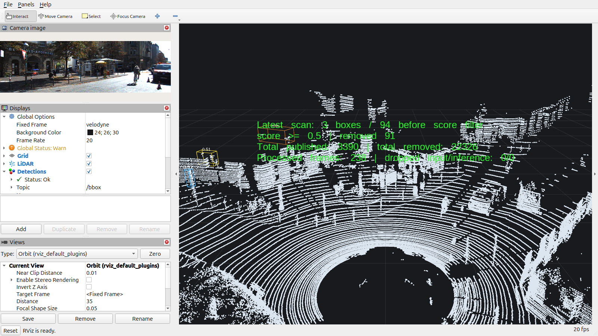

# Confidence filtering and detection monitoring

Reviewed 8 November 2026. The confidence gate keeps detections with `score >= confidence_threshold`. Removed boxes are absent from the published detection array. Accepted boxes retain their fields, order, timestamp and frame ID.

A score is a model output, not a calibrated probability that an object is correct. Filtering reduces low-score clutter; it cannot fix high-confidence false positives or incorrect box heights. [The current annotated Ouster study](OUSTER_CHANNEL_DECISION.md) found zero qualifying 3D matches for both tested channels, including with this additional gate disabled.

## Where filtering happens

```mermaid
flowchart LR
  A[Validate and pack XYZI] --> B[GPU inference]
  B --> C[Validate candidate boxes]
  C --> D[CPU NMS]
  D --> E[Confidence gate]
  E --> F[/bbox: accepted boxes]
  E --> G[/bbox/stats: counters]
  E --> H[/bbox/count: RViz text]
```

NMS removes overlapping candidates before this gate. A threshold of `0.0` disables only this extra publication gate; the model's decode cutoff and NMS still apply. Equality passes. Valid parameter values are finite ROS doubles in [0,1].

## Set or read the threshold

The supplied shell launchers default to **0.4**. Native C++ and `docker/node.yaml` default to **0.5**. Direct entrypoint startup without an override uses the YAML value. Query the actual running node:

```bash
sudo docker exec pointpillars /entrypoint.sh \
  ros2 param get /pointpillars confidence_threshold
sudo docker exec pointpillars /entrypoint.sh \
  ros2 param set /pointpillars confidence_threshold 0.7
```

Use decimal values such as `0.0`, rather than an integer parameter. A valid change applies to subsequent processed scans without rebuilding/restarting the engine; previously published scans are not re-filtered. Invalid updates are rejected and retain the committed value.

Choose an initial value through any detector/Ouster launcher:

```bash
sudo env PP_CONFIDENCE_THRESHOLD=0.7 bash tools/start_ouster.sh bag
```

For native startup, add `-p confidence_threshold:=0.7` to the configured `ros2 run` command. The native node name defaults to `/minimal_publisher` unless remapped. Most other processing/adapter configuration remains read-only.

## Read counters in the terminal

From the project root, with inference already running:

```bash
sudo env PP_MONITOR_BACKEND=docker bash tools/monitor_detections.sh once
sudo env PP_MONITOR_BACKEND=docker bash tools/monitor_detections.sh threshold
sudo env PP_MONITOR_BACKEND=docker bash tools/monitor_detections.sh
```

`once` reads a retained snapshot, `threshold` queries the live parameter, and the last command streams counters until Ctrl+C. The helper starts neither inference nor playback. The default `auto` backend uses host ROS Jazzy when available, otherwise Docker. The explicit Docker backend is useful for a bag pipeline on domain 99 because it inherits the container's domain unless overridden. A host backend needs matching domain/middleware itself.

A snapshot or parameter query has a bounded default wait of ten seconds. No response produces an explanation rather than a zero count. A retained snapshot may be old; inspect its stamp. The snapshot threshold belongs to its processed scan, while a parameter query reports the current setting.

| Setting | Purpose |
| --- | --- |
| `PP_MONITOR_BACKEND` | `auto`, `host` or `docker` |
| `PP_CONTAINER_NAME` | Target container, default `pointpillars` |
| `DETECTIONS_TOPIC` | Base topic, default `/bbox` |
| `PP_NODE_NAME` | Parameter target, default `/pointpillars` |
| `PP_MONITOR_TIMEOUT` | Positive wait in seconds |
| `ROS_DOMAIN_ID` | Explicit domain when required |
| `RVIZ_CONFIG` | Viewer profile for `rviz` mode |

Run `bash tools/monitor_detections.sh --help` for all modes. For a custom detection topic, statistics/count topics derive from that resolved base name, and RViz needs a matching profile.

## Understand the values

| Topic | Message type | Meaning |
| --- | --- | --- |
| `/bbox` | `vision_msgs/msg/Detection3DArray` | Accepted boxes for a successful scan |
| `/bbox/stats` | `diagnostic_msgs/msg/DiagnosticArray` | Latest status, per-scan and cumulative counts |
| `/bbox/count` | `visualization_msgs/msg/MarkerArray` | The same aggregate information as RViz text |

For a successful scan, let `N` be the valid post-NMS count and `K` the accepted count. Then **removed = N − K**, and `len(message.detections) = K`. This is a count after NMS, not all raw network candidates.

Read diagnostic string values from `status[0].values`:

| Key | Meaning |
| --- | --- |
| `frame_status` | `ok`, `invalid_cloud` or `inference_error` |
| `confidence_threshold` | Gate used for this status |
| `post_nms_count` | N, before confidence filtering |
| `filtered_count` | N − K |
| `published_count` | K |
| `processed_frames_total` | Successful scans, including valid empty outputs |
| `published_detections_total` | Sum of accepted boxes since restart |
| `filtered_detections_total` | Sum of removed boxes since restart |
| `invalid_cloud_frames_total` | Frames rejected before inference |
| `inference_error_frames_total` | Frames rejected during inference/output checks |

With the 23 November local repair, a reported failed frame publishes an empty detection array carrying the failed input header to request clearing previous boxes. Its warning diagnostics retain **`unavailable`** per-scan counts, and successful-frame/detection totals do not increase. A valid empty/all-filtered scan also publishes an empty array, but has successful status and zero accepted boxes. Match headers and status when combining independently received arrays/statistics; `/bbox` alone cannot distinguish these cases. This change does not address upstream adapter rejection, sensor silence, lost messages, queued old scans or invalid TF. Actual viewer rendering requires separate verification. See the [solution protocol](POINTPILLARS_SOLUTION_PROTOCOL_20261123.md).

Cumulative values count detection events, not unique objects: one object seen in ten scans can contribute ten detections. Totals reset on node restart; there is no tracker here. Statistics and marker publishers are reliable, depth one, transient local so late subscribers can receive the last status. Retention is not a heartbeat.

For a direct ROS read inside the container:

```bash
sudo docker exec pointpillars /entrypoint.sh \
  ros2 topic echo /bbox/stats --qos-durability transient_local --once
```

## Monitor the latest scan in RViz

With the bag-profile pipeline running, open the viewer as your desktop user:

```bash
ROS_DOMAIN_ID=99 RMW_IMPLEMENTATION=rmw_fastrtps_cpp \
  RVIZ_CONFIG="$PWD/rviz/ouster.rviz" \
  bash tools/visualize.sh -f lidar/os_lidar
```

Expand **Detection count (latest scan)**. For a custom RViz configuration, add MarkerArray on `/bbox/count`, select Reliable / Transient Local, and use the cloud's frame. The text is located at (8,0,5) metres in that frame, so adjust the view if needed. No world-frame transform is invented.

`bash tools/monitor_detections.sh rviz` delegates to the viewer and opens a new window. To modify an existing window, select **File → Open Config** or add the display manually. A new profile replaces the whole view.



This 23 October capture shows three accepted boxes from 94 post-NMS candidates, with 91 removed at threshold 0.5. It demonstrates rendering and arithmetic, not accuracy or a currently running session. [Identity and attribution](figures/filter-counters-provenance.json).

## Preserve comparable accuracy experiments

Record the threshold with every new result. The KITTI baseline helper explicitly requests `0.0` on current images and verifies matching per-frame statistics; it refuses a changed/nonzero gate during collection. Keep a new output directory whenever runtime/exporter identity changes, and do not overwrite frozen baselines.

The Ouster channel decision reports a frozen primary gate of 0.4 plus a separate unfiltered evaluation. Both features used identical geometry within each experiment. Do not choose a winner from fewer boxes, higher scores or a cleaner screenshot. Precision, recall and geometric matching against independent annotations answer that question.

## Implementation and validation

`src/detection_output.cpp` owns the dynamic parameter and aggregate publication; `src/pointcloud_adapter.cpp` validates candidate messages. The shared output path reports successful/empty scans and rejected inputs/inference failures. Tests exercise score boundaries, preserved headers/fields, rejected updates, remapped topics, cumulative/error counts and late subscribers.

The 23 October filtering trial verified 60 native and 60 deployed GPU frames plus actual RViz rendering. Later deployment/shutdown checks passed seven C++/ROS tests. The latest recorded Python suite has 119 tests; the 1,120-inference channel study assesses feature results separately from ROS delivery. [Current evidence and open work](CURRENT_STATUS_AND_RESULTS.md).
