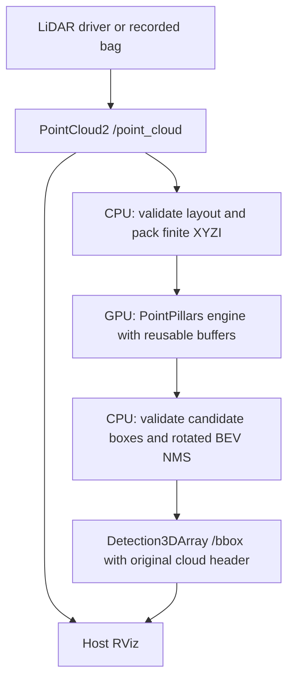
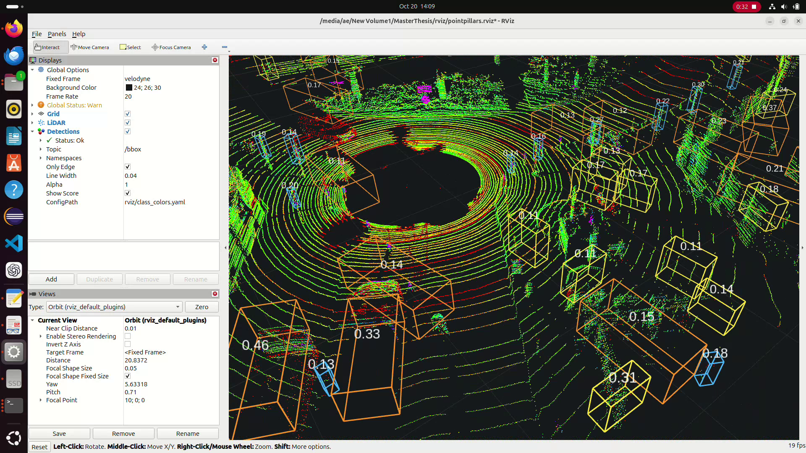
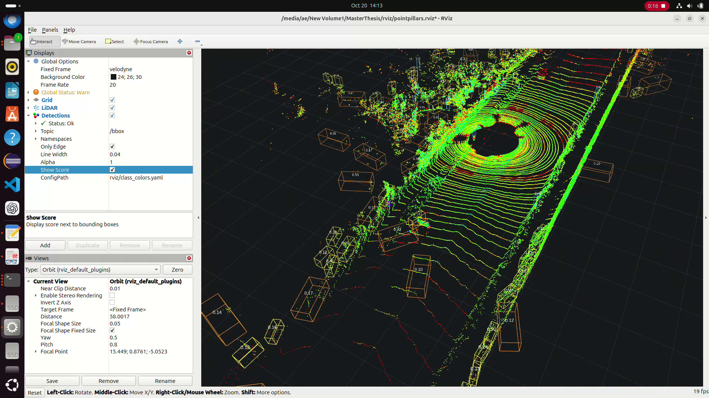
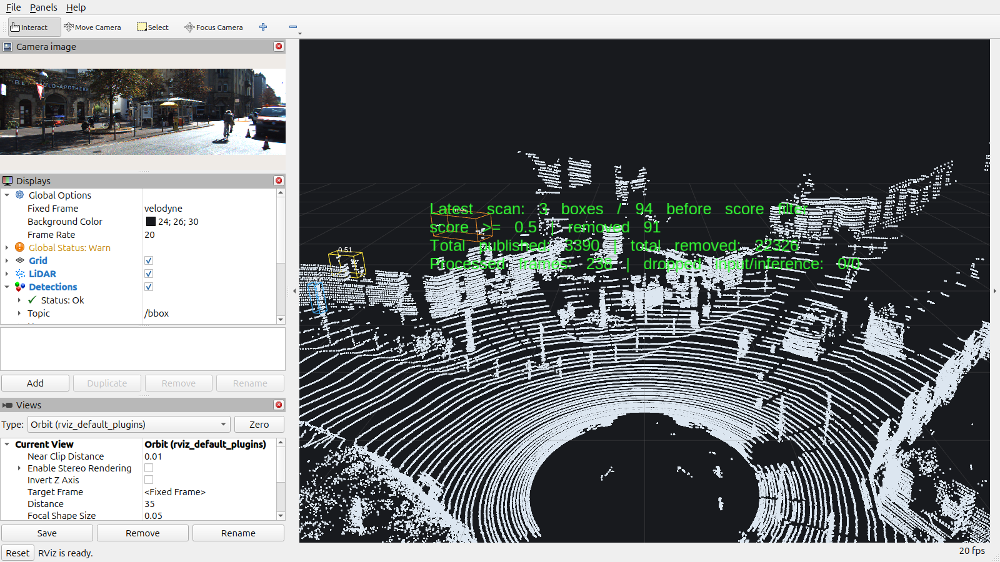

# Current project status and results

> **Latest update — 23 October 2026:** confidence filtering and counters were pushed/deployed from `8a87a73`; 73 Python tests, five C++/ROS tests and 60 deployed GPU replay frames passed. The trial detector, KITTI player and RViz were then stopped at the user's request (19:47 UTC); image, engine cache and frozen results are preserved. Accuracy acceptance remains open. [Verified results and restart instructions](CURRENT_STATUS_AND_RESULTS.md#trial-shutdown-and-restart--23-october-2026).

Reviewed **23 October 2026** against source commit `ee6b36c95808ee1f6edd90b33976c536d71b1b34`, the working tree, result inventories and saved reports. This is the documentation review date. Numerical experiments below were recorded on **1–14 October**; the supplied screencast filenames are dated **20 October**. That documentation-only review ran no new GPU experiment; the subsequent deployment verification below supersedes that limitation.

## Published deployment verification — 23 October 2026

Feature source `8a87a7378c8c11ad187e7c19bc4ecc6e649948c8` was pushed to `origin/main`, built through `tools/deploy.sh` and verified inside the running `pointpillars` container. The RTX 4060 Laptop GPU is accessible through host execution; the earlier driver failure reflected the restricted execution context. Startup reused the existing `pp-engines` engine cache. KITTI front-drive playback and RViz were started on domain 0, with the final threshold restored to **0.5**. The trial was subsequently stopped as described below.

All **73 Python tests** and **five Docker-build C++/ROS tests** passed. A native GPU smoke test passed. Real replay verified 20 matching input/detection/statistics/marker frames at each of thresholds 0.0, 0.5 and 0.95, both natively and in the deployed image: **60 native plus 60 deployed frames**. Published scores, message headers, per-frame count arithmetic and marker totals agreed. The live RViz window visibly rendered points, accepted boxes, scores and the four-line counter text. This verifies filtering and monitoring, not detection accuracy; the frozen accuracy results below are unchanged.

Local evidence: `.recovery/verification/published-deployment/` contains `deployment.json`, `deploy.log`, `python-tests.log`, `native-gpu-smoke.log`, `native-live-output-check.json`, `live-output-check.json`, `latest-stats.txt`, `final-threshold.txt` and `rviz-live.png`. These ignored local artifacts are not included in Git. See [the feature guide](CONFIDENCE_FILTER_AND_MONITORING.md) for monitoring commands. Process identities describe this observation only; inspect actual state before future process management.

## Purpose and implementation

**Published and GPU-verified implementation on 23 October:** a configurable publication confidence gate (default 0.5), live threshold updates, `/bbox/stats` and an RViz count marker are now implemented. Boxes below the threshold are not published. See [the feature guide](CONFIDENCE_FILTER_AND_MONITORING.md) for the exact behavior, configuration and verification. Numerical experiment tables below remain frozen results from the earlier unfiltered node; they do not measure this new setting. Historical documentation-only verification statements near the end retain their original scope.

`pp_infer` detects candidate Vehicle, Pedestrian and Cyclist objects in LiDAR scans using NVIDIA's pretrained PointPillars export. It publishes ROS 2 `Detection3DArray` messages for RViz or another consumer. The tested deployment is Ubuntu 24.04, Linux x86-64, ROS Jazzy, TensorRT 10.16.1.11, container CUDA 12.9 and an RTX 4060 Laptop GPU. These are recorded project versions, not a claim about the latest available software.



| Component | Implementation and responsibility |
| --- | --- |
| Build and dependencies | `CMakeLists.txt` and `package.xml`: C++17, CPU-only core, optional ROS adapter, CUDA/TensorRT runtime; colcon drives ROS builds. |
| CPU geometry | `src/postprocess.cpp`, `include/pp_infer/postprocess.h`: rotated overlap, stable score ordering, validated NMS; production suppression is class-agnostic. |
| Input/output adapter | `src/pointcloud_adapter.cpp`: little-endian scalar FLOAT32 XYZI, checked layout/row padding/byte limits, finite-point filtering, intensity division, numeric class IDs, center/yaw/header mapping. |
| GPU runtime | `src/pointpillar.cpp`: four named tensors, batch-one contract, `enqueueV3`, owned context/stream/buffers, checked counts and candidate decoding. |
| ROS entry point | `src/pp_inference_node.cpp`: synchronous subscription callback, reliable depth 700, publication on `bbox`; container remaps node name/topics. |
| Deployment | `Dockerfile`, `tools/deploy.sh`, `docker/entrypoint.sh`, `docker/node.yaml`: published Git source, checksum-pinned ONNX, target-GPU engine generation/cache, node startup. |
| Data and results | `tools/prepare_*`, `tools/kitti_*`, `tools/compare_ouster_*`: preparation, frozen predictions, calibration/evaluation and controlled reference/feature experiments. |
| Visualization | `tools/visualize.sh`, `rviz/`: direct vision_msgs display, sensor-specific frames, optional camera, ground truth and reference overlays. |
| Evidence/recovery | `config/*_inventory.json` indexes identities and saved evidence; `recovery/` records milestones; ignored `.recovery/` holds local data, engines, reports and logs. |
| Tests | `tests/core`, `tests/ros`, `tests/runtime` and Python `tests/test_*.py`: geometry/contracts, message handling, preparation, evaluation, matching, preservation and recovery. |

The image build downloads ONNX and installs the libraries/application. Container startup builds or reuses a matching FP32/no-TF32 engine in `pp-engines`, then passes `engine_path` to ROS. The C++ node reads the engine once; it does not load ONNX or retrain weights. A direct `ros2 run` needs an existing engine and configuration.

## Labeled KITTI diagnostic accuracy — 3 October

The frozen dataset contains **16 tuning and 16 test frames**, separated by original recording drive. The table is **test/moderate**, using the declared KITTI-compatible evaluator and camera-visibility policy. Vehicle is mapped explicitly to **Car compatibility**, without merging Van/Truck into Car.

| Class | Valid ground truth | 3D TP / FP / FN | 3D AP_R40 | BEV TP / FP / FN | BEV AP_R40 |
| --- | ---: | --- | ---: | --- | ---: |
| Car | 54 | 0 / 146 / 54 | 0% | 12 / 128 / 42 | 5.7516% |
| Pedestrian | 31 | 0 / 53 / 31 | 0% | 0 / 53 / 31 | 0% |
| Cyclist | 19 | 0 / 206 / 19 | 0% | 2 / 203 / 17 | 0.02577% |

The 12 BEV-matched test cars had a median **1.529 m upward** center error. Of 2,876 predictions across both splits, 862 intersected the labeled camera view; 2,014 were excluded by the frozen visibility rule. RViz displays all predictions. First observations are preserved because repeated inference varies.

**Accuracy acceptance is not achieved.** This annotation-selected diagnostic sample is neither a population score nor a KITTI leaderboard submission. Both splits have now been inspected; a larger untouched acceptance set and agreed targets remain necessary. Details: [KITTI results](KITTI_ACCURACY_RESULTS.md), [accuracy inventory](../config/kitti_accuracy_inventory.json).

## Independent TensorRT comparison — 3 October

The exact ONNX and identical inputs were run three times per frame in separate TensorRT 8.6 and 10.16 environments: **192 raw observations**. NVIDIA's unchanged NMS and this project's NMS selected the same boxes on **192/192 identical-candidate observations**. That isolates NMS behavior; it does not establish equal inference outputs.

The TRT8 compatibility reference also produced zero moderate 3D matches and about 1.53 m upward car error. Strict numerical/training parity remains unmet. Twelve of 32 clouds exceeded the 10,000-pillar limit, reaching 15,180 occupied pillars. Two tuning-only controls capped occupied pillars and points per pillar; repeat matching improved to roughly **99.6–100%** at the diagnostic tolerance. No production point-selection fix was installed.

Two CUDA 12.9 allocation memchecks reported zero errors, but internal tensors may share allocations. They do not clear internal tensor-bounds concerns or complete GPU memory/race validation. The weights alone are not established as the root cause. Details: [reference comparison](MODEL_REFERENCE_COMPARISON.md), [reference inventory](../config/kitti_reference_inventory.json).

## Ouster feature comparison and complete replay — 13 October

Sixteen fixed OS1-32 scans, four fourth-feature encodings and three repeats produced **192 raw observations**. XYZ bits, order, point count and zero returns were preserved.

| Fourth feature | Rejected observations | Invalid candidate rows | Median accepted final boxes | Median of final-score medians |
| --- | ---: | ---: | ---: | ---: |
| Original signal | 15 / 48 | 33 | 590 | ≈1.000 |
| Signal / 65,535 | 0 / 48 | 0 | 15 | 0.164 |
| Reflectivity / 255 | 0 / 48 | 0 | 18.5 | 0.166 |
| min(reflectivity / 100, 1) | 0 / 48 | 0 | 26 | 0.173 |

All 33 invalid rows had nonfinite length. The three normalized variants had no invalid rows in **144 observations**. This supports the unscaled fourth feature as a contributor to numerical failure; smaller counts and lower scores do not establish accuracy.

Complete `reflectivity_div255` ROS replay matched **291/291** and **265/265** input/output occurrences, with no recorded invalid message fields or detector log errors. Duplicate source headers were counted as separate occurrences. Original `raw_signal` remains the default of `rosbag_ouster.sh`; the detail wrapper explicitly selects normalized input. Reflectivity/255 is a bounded code encoding, not validated physical reflectance or training calibration. There are no object labels for these recordings. Details: [feature experiment](OUSTER_FEATURE_COMPARISON.md), [feature inventory](../config/ouster_feature_inventory.json).

## Camera and scene-detail results — 13–14 October

Ouster camera export contains **58 + 53 original images**, approximately 2 Hz. Two 1280×1070 MP4 previews last **29.000 s** and **26.433 s**. The merged replay preserved all **111 image**, **111 CameraInfo** and **556 normalized cloud** payloads. Camera/LiDAR header clocks differ; coordination uses bag record time. No calibrated detection-image overlay or proven acquisition-time synchronization is claimed. Attribution: Kenji Koide, AIST, calibration dataset v3, DOI `10.5281/zenodo.7780490`, CC-BY-4.0. See [camera guide](OUSTER_CAMERA_VISUALS.md).

The original-data Ouster view adds `/ouster/raw_points` alongside normalized inference. Five live cloud pairs passed comparisons of all non-intensity bytes. Its scans retain 32,768 entries, including 13,206–15,775 zero-range/zero-XYZ entries in the selected experiment; those do not add visible surfaces. Closer/brighter rendering changes presentation, not point density.

The separate KITTI raw drive `2011_09_26_drive_0005_sync` contains **154 full 360° clouds and 154 front-camera images**, with **98,532–124,122 points/scan**. Recorded integration received **154 matched detections, 154 images and 154 CameraInfo messages**. Original XYZI hashes and decoded camera pixels matched source data. Predictions numbered 83–132 per frame, median 106; counts are not accuracy. The camera is forward-facing; LiDAR is not cropped. Attribution: Geiger, Lenz, Stiller and Urtasun, KIT/TTI-C, CC-BY-NC-SA-3.0. See [detail/frontal guide](FRONTAL_COMPARISON_AND_RVIZ_DETAIL.md) and [inventory](../config/kitti_front_inventory.json).

## Visual examples from the supplied screencasts

Frames were extracted from the two local WebM files in `/media/ae/New Volume/datasets/vedios`, whose filenames are dated 20 October. Offsets below are decoded presentation timestamps from the start of each recording, rounded to milliseconds. Full frames are preserved in PNG format.



First recording, **32.035 s**: a close RViz view shows intensity-colored LiDAR points, candidate boxes and score labels.



Second recording, **16.023 s**: a wider road view shows point geometry and boxes. These screenshots establish visible rendering in the supplied recordings. They do not identify the underlying bag, feature variant, engine hash or correctness of individual boxes; those require the recorded experiment manifests. No camera projection or ground truth is visible in these selected frames. [Frame provenance and checksums](figures/README.md).

## Useful commands

Start inference separately with `sudo bash tools/deploy.sh`. Use **one player per input topic/domain**; keep inference, player and RViz domains matched. Run the player and corresponding viewer in separate terminals.

| Purpose | Player / preparation | Viewer |
| --- | --- | --- |
| Original KITTI sequence04 demo | `bash tools/rosbag_demo.sh` | `bash tools/visualize.sh` |
| Normalized Ouster diagnostic | `PP_OUSTER_FEATURE=reflectivity_div255 bash tools/rosbag_ouster.sh` | `RVIZ_CONFIG="$PWD/rviz/ouster.rviz" bash tools/visualize.sh` |
| Original Ouster geometry + camera | `bash tools/rosbag_ouster_detail.sh` | `RVIZ_CONFIG="$PWD/rviz/ouster_detail.rviz" bash tools/visualize.sh` |
| Frontal KITTI recording | `bash tools/rosbag_kitti_front.sh` | `RVIZ_CONFIG="$PWD/rviz/kitti_front.rviz" bash tools/visualize.sh` |
| Labeled KITTI comparison (domain 42) | `bash tools/kitti_accuracy.sh live` | `bash tools/kitti_accuracy.sh view` |
| Existing frozen accuracy report | `bash tools/kitti_accuracy.sh report` | No viewer required |

Preparation/deployment can need network access and host dependencies as described in each guide. No playback, container replacement, installation or image rebuild was performed for this documentation update.

## Constraints, discrepancies and next work

- **Current code versus design:** the latest-frame worker is proposed, not implemented. Inference remains synchronous, with reliable depth 700. Configurable sensor QoS, timing/drop metrics, sustained benchmarks and CI/operational acceptance remain unfinished.
- **Model contract:** artifact-bound labels are verified, but `docker/node.yaml` still has generic labels and scale 1.0. Runtime publishes numeric IDs. Input/training semantics, deterministic bounded voxelization, broader failure/memory checks and accuracy acceptance remain open.
- **Startup:** the historical native launch file still contains a fixed `/home/nvidia/...` engine path and scale 255. Use the documented configured Docker/native procedure. Docker builds published Git, so local unpushed runtime edits are excluded.
- **Historical wording:** early plans, transcript quotations and archived Foxy commands describe their original dates. In particular, direct RViz detection display now works through the plugin; old “RViz cannot display Detection3DArray” statements are historical. A completed compatibility comparison still does not mean original-training parity passed.
- **Git state:** review started at `ee6b36c` with no tracked modifications and an untracked user `prompt.md`, preserved. Validation/reference work is committed in `29ef404`; later demo work is committed in `ee6b36c`. Older “local until committed” remarks are historical. No push/publication claim is inferred from local Git history.
- **Evidence:** ignored results/media are not backed up by Git/source checkpoints. Saved ownership/process records describe earlier sessions; inspect live state before stopping resources. No current running-container state is asserted here.
- **Documentation scope:** every project Markdown guide/history and all three LaTeX sources were refreshed. `CLA.md` retains its legal terms; the user's untracked `prompt.md` is unchanged. Generated/build/cache/SDK trees were excluded.

Next resolve original input/training conventions and bounded voxelization, then test a justified correction or suitable model against a larger untouched acceptance set. Keep the frozen poor baseline and provenance intact.

## Verification of this documentation update

The **64 existing Python tests passed** on 23 October. Six local HTTP-fixture tests initially could not bind loopback sockets inside the sandbox; the complete rerun with local socket access passed. This checks current helper behavior, not fresh GPU inference.

The review rehashed **8 KITTI baseline JSON artifacts, 11 reference JSON artifacts and 9 Ouster feature JSON artifacts** against their inventories: all matched. The complete frontal KITTI observation file matched its recorded SHA256 and summary; the Ouster raw-view observation matched its inventory. Runtime/experiment data were not regenerated. Test/check logs are under `.recovery/verification/docs-2026-10-23/`.

All three updated LaTeX sources were submitted to the built-in compiler. Each failed before parsing because the TeX bundle was uncached and its download failed. Compilation and page layout remain unverified; sources and figure assets are preserved. Static source/asset/link checks and compiler diagnostics are recorded in the dated [progress entry](../recovery/PROGRESS.md). Old PDFs are historical renditions until regenerated from the updated sources; they must not be described as current compilations.

## Trial shutdown and restart — 23 October 2026

At **19:47 UTC (21:47 Europe/Berlin)** the user requested closing the current processes. The recorded IDs were matched before stopping `pointpillars-kitti-front-bag` and `pointpillars`; the exact `rviz2 -d .../rviz/kitti_front.rviz` process received SIGINT and exited. A follow-up Docker/process inspection found no remaining trial containers or RViz process. The detector's last verified setting was **0.5**; there is no live detector parameter to query while it is stopped. The image, `pp-engines` volume, data and frozen reports remain. Local shutdown evidence: `.recovery/verification/published-deployment/shutdown.json`.

To repeat the trial, run these in **three separate terminals** from the project root, using Docker permissions appropriate to the host:

```bash
# Terminal 1: checks/builds published source, then starts inference.
PP_CONFIDENCE_THRESHOLD=0.5 bash tools/deploy.sh
# Terminal 2: starts/reuses the prepared KITTI front-drive player.
bash tools/rosbag_kitti_front.sh
# Terminal 3: opens a NEW RViz window with the last tested configuration.
RVIZ_CONFIG="$PWD/rviz/kitti_front.rviz" bash tools/monitor_detections.sh rviz
```

`deploy.sh` always invokes `docker build --pull` after refusing an existing same-name container. Eligible layers can be cached; it is not an update-only deployment manager. It creates a new container after a successful build. Container `--rm` removes it on exit while preserving the image and named engine volume. Use one cloud player per topic/domain.

The monitor's `rviz` mode calls `tools/visualize.sh`. Both open a new window. To load this profile in an already-open RViz window, use **File → Open Config** and choose `rviz/kitti_front.rviz`; to keep your existing layout, add a Reliable / Transient Local MarkerArray display on `/bbox/count` instead. Monitoring alone starts neither inference nor playback. With inference running, `PP_MONITOR_BACKEND=docker bash tools/monitor_detections.sh` streams counters, and the `threshold` option reads the live setting.



The saved scan has 3 published boxes, 94 before score filtering and 91 removed at 0.5. Totals count detection events after filtering, not unique objects. No accuracy improvement is inferred. [Capture provenance and dataset attribution](figures/filter-counters-provenance.json).
