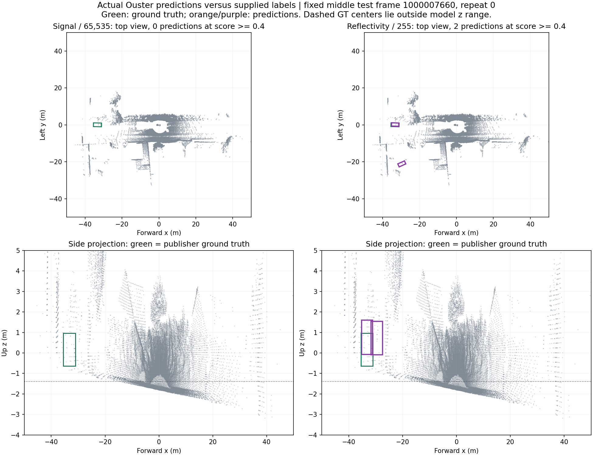
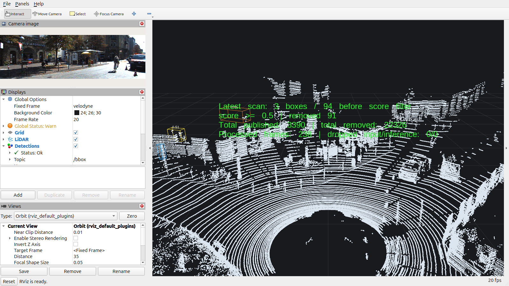

# Project status and measured results

## Latest verification — 21 November 2026

The [latest report](OUSTER_VERIFICATION_AND_PERSON_DIAGNOSIS_20261121.md) records 6,137 audited source clouds, 30 actual C++ adapter checks, eight native tests, twelve evaluator tests and 2,268 successful measured GPU inferences. No tested preprocessing variant recovered a Pedestrian match in the reused 16-scan test subset. At gate 0.3, baseline /255 and clipped /100 both yield five Vehicle BEV matches; /100 adds false pedestrian boxes. Height quantiles with /255 yield seven Vehicle BEV matches and zero Vehicle 3D matches. A training-fitted output-z diagnostic gives two of 60 Vehicle 3D matches, not a universal correction.

Six separate exact-person inferences on ouster1 frame 1403 (+70.05539416 s) find nearby Pedestrian candidates scoring 0.197–0.222 under /100, about 0.48 m from the observed-point midpoint and vertically displaced. Partial legs prevent full-height or IoU claims. All [images are retained](IMAGE_ARCHIVE.md). Successful runtime checks do not establish accuracy.

Reviewed 21 November 2026; the dated sections below preserve earlier studies. The project now runs an Ouster-to-PointPillars pipeline, records diagnostic counters and displays results in RViz. **Reflectivity/255 is the better-supported experimental input for the tested model. Accurate 3D detection has not been achieved.**

Use this page to understand the current stage. Use [startup and replay](STARTUP_AND_REPLAY.md) to run the project, and the [channel decision report](OUSTER_CHANNEL_DECISION.md) for the full experiment and proposal. Saved screenshots and past shutdown records describe dated observations; they do not establish which processes are running now.

## Detection diagnosis — 9 November 2026

The [new investigation and repair plan](DETECTION_INVESTIGATION_AND_PLAN.md) separates application bugs, packaged-plugin behavior and pretrained sensor compatibility. Actual GPU controls pass the Vehicle decoder's three center-z residual cases and all ten voxel features on a three-point/two-pillar input. Twelve CPU ground-truth tests pass. Eighteen new GPU controls on two unlabeled Koide scans completed: bounded inputs achieved full post-NMS matching to the first repeat at tolerance 0.001; zero-return removal alone was not consistently better. Counts above 0.4 remained 2/0 per scan, and no accuracy was measured. A tuning-only range audit finds that the model retains 83.96% of counted Car-box points; this is a coverage measurement, not a proven cause of height error.

The exact pretrained model and label hashes match the publisher, but the available model-level card does not establish KITTI/Ouster training for this exact export. Capacity-safe offline preprocessing is implemented as an explicit opt-in helper; live defaults and the frozen 1,120-observation accuracy study remain unchanged. No complete accuracy repair is claimed. The plan records the remaining intermediate/reference checks and the need for a new annotated acceptance set.

## What works, and what remains open

| Area | Verified capability | Practical limit |
| --- | --- | --- |
| ROS/GPU pipeline | Validates XYZI, runs the TensorRT engine, publishes boxes and counters | Successful inference does not mean correct objects |
| Ouster adapter | Creates FLOAT32 XYZI from an explicitly selected channel and divisor | No automatic claim of training-compatible intensity calibration |
| Deployment | Local-source build by default, matching-image reuse, persistent engine cache | First builds and changed dependencies can require downloads |
| Original-bag replay | Matching bag profile, topic, middleware and domain; one Ctrl+C stops each launcher | Best-effort input and large-cloud transport can affect delivery |
| RViz | Points, accepted boxes, scores and count text; optional raw/camera views | Images alone do not establish accuracy or synchronization |
| Research evidence | Labeled KITTI baseline, reference comparison and labeled Ouster channel study | Both current channels fail the declared 3D matching criteria |

The latest recorded test suite has **119 passing Python tests**. The preceding launcher build passed seven C++/ROS tests. Those counts describe their respective verification runs; this documentation refresh does not imply a new GPU experiment.

## How data moves through the project

```mermaid
flowchart TD
    A[Ouster driver or original bag] --> B[Ouster adapter: selected field / divisor]
    B --> C[PointCloud2 XYZI on /point_cloud]
    X[Already compatible XYZI source] --> C
    C --> D[CPU: validate layout and pack finite points]
    D --> E[GPU: cached PointPillars engine]
    E --> F[CPU: validate boxes and apply rotated NMS]
    F --> G[Confidence gate]
    G --> H[/bbox: accepted Detection3DArray]
    G --> I[/bbox/stats and /bbox/count]
    C --> R[RViz]
    H --> R
    I --> R
```

The detector callback remains synchronous with a reliable queue depth of 700. The Ouster adapter accepts best-effort sensor input and publishes reliable output. The current launcher explicitly starts the adapter; it does not discover arbitrary schemas and automatically switch between passthrough and conversion. An already compatible XYZI source can feed the detector directly.

The tested stack is Ubuntu 24.04, ROS 2 Jazzy, TensorRT 10.16.1.11, container CUDA 12.9 and an RTX 4060 Laptop GPU. These are project versions, not claims about the latest available releases. Model classes are Vehicle, Pedestrian and Cyclist; ROS output uses numeric class IDs. The ONNX is downloaded and checksum-verified during image preparation. Startup builds or reuses a target-GPU engine in `pp-engines`; the node loads it once and reuses its buffers.

## Latest Ouster comparison — 8 November 2026

The study ran unchanged production C++ inference/NMS directly, with the same engine and identical geometry for both features. It made **1,120 measured GPU inferences**, excluding 18 warmups:

| Data and purpose | Distinct scans | Repeats × channels | Inferences |
| --- | ---: | ---: | ---: |
| MOSEP dry/rain numerical and repeatability check | 48 | 5 × 2 | 480 |
| Dur360BEV-Extended labeled comparison | 32 | 5 × 2 | 320 |
| Separate bounded-pillar sensitivity control | Same 32 | 5 × 2 | 320 |

The main labeled test contains 16 scans, with **60 vehicles and six pedestrians inside the declared evaluation region**. At confidence 0.4:

| Test Vehicle metric | Signal / 65,535 | Reflectivity / 255 |
| --- | ---: | ---: |
| BEV matches per run | 0 | 4 in every repeat |
| Mean BEV precision | 0% | 27.81% |
| BEV recall | 0% | 6.67% |
| Qualifying 3D matches | 0 | 0 |

BEV means the footprint seen from above. A 3D match also needs enough vertical overlap. The four first-repeat reflectivity BEV matches were **0.60–1.14 m too high** and failed the 0.7 Vehicle 3D-IoU criterion. Neither channel matched the six test pedestrians under the declared criteria. No cyclist annotations occur in this selection.



Green boxes are publisher annotations; the lower XZ view exposes height differences. The frame is the middle of the frozen test selection. [Image provenance and attribution](figures/ouster-channel-ground-truth-provenance.json).

Both normalized channels completed all 560 measured inferences each without recorded inference failures. That supports numerical success in these tests. It does not establish a general repeatability winner: empty outputs and correlated scans limit the stability comparison.

Twenty of 32 primary labeled scans exceeded the model's 10,000 occupied-pillar limit. A separate geometry-only capacity control preserved the four-versus-zero vehicle BEV result and still produced no qualifying 3D matches. It was **not deployed as preprocessing**. The annotated input required identical model-ROI and zero-return handling for both channels because original scans exceeded the 204,800-point engine capacity.

The publisher's annotations are model-assisted and human-reviewed according to the original paper. They are independent of our predictions. Published train/test indices are disjoint within one collection; recording-disjoint generalization is unverified. Normalization is a numeric encoding, not proven physical reflectance calibration. Full methods, source identities, exclusions and reproduction commands are in [the decision report](OUSTER_CHANNEL_DECISION.md) and [machine-readable summary](../config/ouster_channel_decision.json).

## Earlier experiments and what they contribute

| Date / study | Recorded result | What it establishes |
| --- | --- | --- |
| 3 October: labeled KITTI | 16 test frames; moderate 3D AP_R40 0% for all classes; BEV AP_R40 Car 5.7516%, Pedestrian 0%, Cyclist 0.02577% | A poor frozen diagnostic baseline, with explicit Vehicle-to-Car mapping |
| 3 October: TensorRT 8/10 reference | 192 raw observations; identical NMS selections on 192 same-candidate cases; shared upward car error | NMS is consistent on identical inputs; exact inference/training parity remains open |
| 13 October: Koide OS1-32 feature study | Raw signal rejected 15/48 observations; all three normalized candidates rejected 0/48 each | Scaling the fourth feature removed observed numerical failures on those scans |
| 13 October: complete normalized replay | 556/556 source/output occurrences matched | Message-flow and conversion correctness on the two unlabeled bags |
| 13–14 October: camera/detail replay | 111 images and CameraInfo preserved; 154 frontal KITTI cloud/detection/image sets matched | Payload preservation and integration, without new accuracy labels |
| 23 October: filtering/counters | 60 native plus 60 deployed GPU frames at thresholds 0, 0.5 and 0.95 | Scores, headers, counts and RViz counter rendering agree |
| 7 November: fresh MOSEP live test | 40 raw/adapted pairs checked; RViz rendered actual output | Original-bag → adapter → GPU → RViz integration |
| 8 November: launcher fixes | Actual GPU replay; one interrupt removed each test container in about 0.5 s | Matching defaults, caching and shutdown behavior in that test |

Do not combine these samples or test counts into one accuracy score. The Koide and MOSEP recordings have no object-detection labels in these workflows. KITTI uses its AP_R40 protocol; the Ouster report uses a separately declared diagnostic evaluator. Their AP values are not interchangeable.

Read [KITTI accuracy](KITTI_ACCURACY_RESULTS.md), [reference comparison](MODEL_REFERENCE_COMPARISON.md), [older Ouster feature study](OUSTER_FEATURE_COMPARISON.md), [camera guide](OUSTER_CAMERA_VISUALS.md), [detail/frontal guide](FRONTAL_COMPARISON_AND_RVIZ_DETAIL.md), and [fresh visual test](FRESH_OUSTER_VISUAL_TEST.md) for the corresponding evidence.

## Start the current Ouster replay

From the repository root, prepare the image once or after runtime changes:

```bash
sudo env PP_BUILD_ONLY=1 bash tools/deploy.sh
```

`PP_BUILD_ONLY=1` is optional: it stops after image preparation. Without it, `deploy.sh` starts the detector only. To run Ouster bag conversion, start these in separate terminals:

```bash
# Terminal 1: adapter and detector
sudo bash tools/start_ouster.sh bag
# Terminal 2: original, unchanged MOSEP recording
sudo bash tools/start_ouster_bag.sh
```

The bag profile uses Fast DDS, domain 99 and `/sensing/lidar/points`. The adapter publishes reflectivity/255 as `/point_cloud`; the detector publishes `/bbox`. Stop each foreground launcher with one Ctrl+C and allow shutdown time. Use one player per input topic/domain. For the viewer and live-driver settings, follow [startup and replay](STARTUP_AND_REPLAY.md). The live profile and bag profile have different defaults; choose explicitly.

## Next work and thesis interpretation

Keep reflectivity/255 as the experimental baseline and keep signal/65,535 as a diagnostic alternative. Next, specify valid-return and pillar-capacity handling, investigate the shared height/input-training mismatch, and test a justified correction or suitable Ouster-trained model. Choose tuning settings on development recordings, then evaluate on fresh recording-disjoint data. The inspected test frames can no longer be treated as untouched acceptance data.

A latest-frame worker, configurable detector sensor QoS, timing/drop metrics, sustained benchmarks, fuller memory/race checks and operational acceptance remain unfinished. No empirical z offset or production capacity policy has been silently installed. The model artifact's labels are verified, but generic display configuration labels do not replace that contract.

For a thesis, the defensible contribution is a reproducible migration, integration and evaluation workflow, followed by a measured, limited channel recommendation. **Do not describe the system as an accepted accurate 3D detector.** Keep uncertainty, excluded-label counts and differences between integration, numerical stability and accuracy alongside each result.

## Evidence and preservation

Committed summaries under `config/` identify model, engine, source, GPU, inputs and report hashes. Large originals, observations, logs and engines remain in ignored `.recovery/` or the external dataset folder. Git alone does not back them up. Preserve those assets with their manifests when transferring the project.

## Trial shutdown and restart — 23 October 2026

This heading is retained for existing links. At 19:47 UTC on 23 October, the user-requested KITTI trial detector, player and RViz were closed after identity checks. Its last threshold was 0.5, and images, cache and data were preserved. This is a historical shutdown record, not a current process-state assertion. Local record: `.recovery/verification/published-deployment/shutdown.json`.

To repeat the historical counter-view trial in separate terminals:

```bash
PP_CONFIDENCE_THRESHOLD=0.5 bash tools/deploy.sh
bash tools/rosbag_kitti_front.sh
RVIZ_CONFIG="$PWD/rviz/kitti_front.rviz" bash tools/monitor_detections.sh rviz
```

The monitor opens a new RViz window. In an existing window, use File → Open Config or add a Reliable / Transient Local MarkerArray display on `/bbox/count`. Docker permissions must already be available for these commands.



This saved scan shows 3 published boxes, 94 before filtering and 91 removed at 0.5. Totals count detection events, not unique objects. [Capture provenance](figures/filter-counters-provenance.json).

## Supplementary thesis evidence — 9 November 2026

The illustrated thesis appendix documents 50 problem groups and four subcases. A new full Python regression check passed 119 tests. Six separate GPU demonstrations used one unchanged unlabeled Koide scan: three raw-signal outputs were rejected by the production box decoder, while three reflectivity/255 outputs passed. This small, fixed-order reproduction illustrates the numerical failure; it is not a new accuracy comparison and is not included in the frozen 1,120-observation study. The historical engine and original recordings were preserved.

The [casebook](THESIS_CASEBOOK.md) labels original captures, controlled reproductions and source explanations separately. [The review record](../config/thesis_casebook_review.json) records verification and compilation limits.

## Full-bag before/after input comparison — 9 November 2026

The earlier index described a 291-scan / 1,746-inference study in `OUSTER_BEFORE_AFTER_COMPARISON.md`, but that report is absent from this checkout. Those historical claims were not revalidated here. The [21 November investigation](OUSTER_VERIFICATION_AND_PERSON_DIAGNOSIS_20261121.md) provides available source audits, controlled observations and explicit limits; do not cite the missing page as verified evidence.

## Primary experiment inputs — 21 November 2026

New experiments use `raw01` (default) and `ouster1` from
`/media/ae/New Volume1/rosbags`. The replay launcher opens their original standalone
MCAPs read-only; the shared bag profile now uses `/ouster1/points`, domain 99 and
Fast DDS. Sampled clouds use frame `ouster1_lidar` and have literal signal and
reflectivity channels. See [startup and replay](STARTUP_AND_REPLAY.md) for commands and inspection limits.
Historical datasets and frozen results remain unchanged; this input selection
does not establish new inference or accuracy results.
