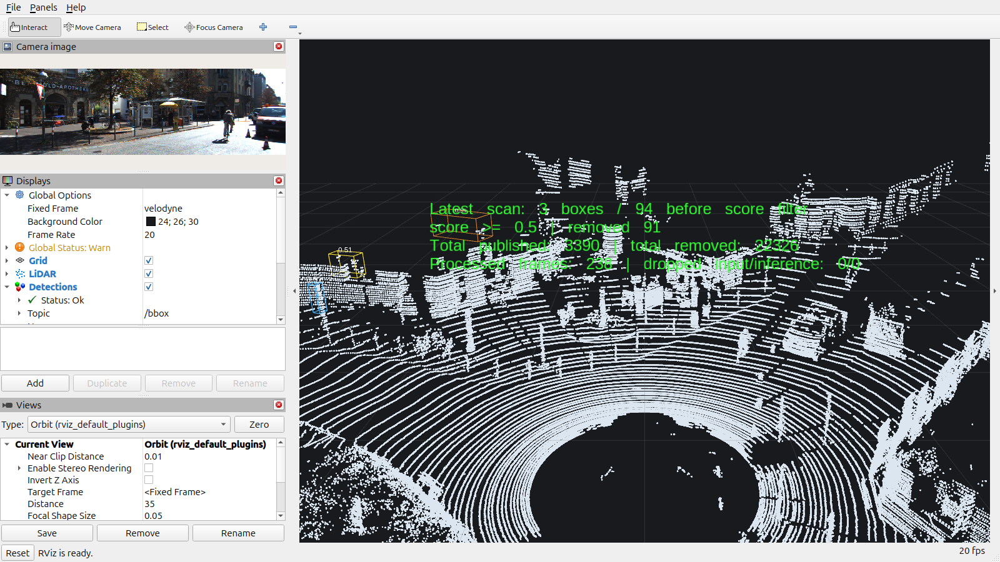

# Engineering journey: problems, investigations and outcomes

Reviewed 9 November 2026; experimental evidence through 8 November 2026. This chapter reconstructs the documented technical work from the Foxy-era baseline through the current Ouster evaluation. It is also included in the [thesis draft](THESIS_DRAFT.md). The problem register at the end links each subject to its evidence and distinguishes completed fixes from diagnostic findings and unfinished work.

The account uses the preserved discussion, dated implementation notebook, Git milestones, current source and frozen experiment reports. The discussion export covers the available early turns and later summaries; it is not a complete recording of every subsequent terminal action. Dates below refer to recorded work periods. A later commit date is not substituted for an unavailable experiment date. No new inference experiment was performed while writing this chapter.

## How the investigation developed

The project began with a practical question: could an older PointPillars application be made usable on a newer ROS and NVIDIA stack? Answering that question uncovered several different problems. Some prevented compilation. Others allowed execution but made its output unsafe to trust. Later, correctly delivered and well-formed messages still contained inaccurate objects. The investigation therefore developed from software compatibility, through repeatable operation, to numerical behavior and labeled accuracy.

| Recorded period | Main work | What the evidence established |
| --- | --- | --- |
| 1–2 October 2026 | Separate geometry, ROS and GPU responsibilities; validate tensors; reuse GPU resources; build with colcon and cache target-GPU engines. | The execution path became inspectable and testable. This did not establish object accuracy. |
| 3 October 2026 | Freeze a labeled KITTI diagnostic sample and compare TensorRT 8/10 outputs and NMS. | TensorRT 8 also produced poor 3D results and upward centers. NMS agreed on identical candidates; capacity remained unresolved. |
| 13–14 October 2026 | Compare Ouster feature encodings and preserve original geometry, raw detail and camera data. | Normalized features avoided the recorded numerical failures. Timing and rendering remained separate from accuracy. |
| 23 October 2026 | Add a live confidence gate and per-frame counters; verify native/deployed GPU publication and RViz. | Published boxes and counters followed the tested rules. Totals count detection events, not unique objects. |
| 28 October–8 November 2026 | Diagnose physical-host driver and schema issues; test fresh MOSEP adapter-to-GPU-to-RViz flow; align profiles, cache builds and fix shutdown. | The tested Ouster operating path worked. These checks did not complete accuracy acceptance. |
| 8 November 2026 | Complete 1,120 measured GPU observations in the paired channel study and separate capacity control. | Reflectivity produced four test Vehicle BEV matches per repeat; signal produced none. Neither encoding produced qualifying 3D matches. |

The chronology records stages of the investigation; a later stage does not mean that every earlier problem was closed. In particular, model-input semantics, internal pillar capacity, memory/failure acceptance and sustained latency remain open.

## Starting from an incompatible baseline

The inherited instructions targeted Ubuntu 20.04, ROS Foxy, TensorRT 8.2 and hard-coded CUDA paths. The chosen machine instead used Ubuntu 24.04 and ROS Jazzy. The original CMake configuration mixed language standards, fixed a CUDA location and omitted dependencies used by the source. The node also included a missing local header and used an older `vision_msgs` hypothesis layout. These were concrete build and interface problems; reinstalling the application would not resolve them.

The first design separated CPU box geometry, ROS message adaptation and GPU inference. C++17 and explicit target dependencies replaced the conflicting build settings. A reduced CPU configuration made it possible to verify geometry without ROS, CUDA or TensorRT, while a separate ROS configuration tested messages without a real engine. Jazzy output construction uses nested hypothesis fields and preserves the incoming cloud header.

This separation made progress possible while the SDK was downloading and gave failures a clearer location. It did not complete the proposed architecture: a single inference worker with at most one pending frame was designed but has not been implemented. The current callback still runs inference synchronously and requests reliable history depth 700. The often-cited example of 70 seconds at a 10 Hz input is a possible backlog calculation, not a measured delay.

## Keeping work recoverable across interruptions

Development was interrupted by usage limits, disk-space pressure and an unmounted project volume. Relying on a conversation's remembered state was insufficient: one narrative draft existed only in session storage when a limit was reached. It later had to be recovered from the available session record and saved as a real file. The volume was reconnected through the normal disk service; the recorded recovery did not format it or force a filesystem repair.

The checkpoint helper records eligible source files, hashes, Git identity, separate staged/unstaged patches, task state and the next action. Temporary checkpoints become complete only after their contents are written. Integrity checks and drift reporting help the next session identify what changed. Twelve early tests included index preservation, corrupt or interrupted snapshots and a directory replaced by a file; the last case exposed a bug that was corrected.

Models, SDKs, engines, bags and most generated evidence are excluded from these small source checkpoints. The helper does not restore files automatically, run tests, buy usage credits or decide that a milestone passed. Large experimental assets still require an independent backup. This distinction became part of the project method: source continuity and scientific evidence preservation are related, but neither replaces the other.

## Distinguishing GPU access from a broken driver

An early `nvidia-smi` call failed in the restricted execution environment. A GPU-accessible host check then found a working RTX 4060 Laptop GPU. The first failure was therefore an access limitation, not evidence that this laptop needed a driver reinstall. Host driver capability, installed CUDA compiler version and container CUDA libraries were recorded separately; they do not have to display the same version number.

A later physical-host case was different. User-supplied logs from an RTX A4500 Embedded system showed NVIDIA modules built for a different kernel and conflicting package proposals from mixed repositories. Matching driver/modules followed by a reboot restored GPU access in that record. The Ouster driver also had an undefined Fast CDR serialization symbol; updating the compatible ROS/DDS package group restored its launch according to those logs. These were host-specific repairs. They are not evidence that the A4500 completed the later RTX 4060 accuracy study.

That host's engine-building attempts also showed why workspace is not total GPU memory: 256 MiB was below a plugin's 270,532,608-byte scratch request, a 1024 MiB attempt encountered allocation failure, and a 512 MiB build succeeded. Neither the largest nor the smallest setting was universally best. A fatal CUDA/driver state may require the recovery action reported by the system even when `nvidia-smi` still responds; the project did not establish a general display-GPU reset procedure.

## Finding the model and selecting a compatible runtime

The repository contained no ready model or engine. The supplied Downloads directory held a deployable ONNX and a trainable TLT artifact. Both were inventoried and hashed. The ONNX was used; the TLT was not decrypted or retrained. Read-only metadata inspection identified FLOAT32 points with capacity 204,800 by four features, an INT32 point count, candidate boxes with nine columns and a separate box count. It also identified the required VoxelGenerator, PillarScatter and DecodeBbox3D plugins.

A pretrained model did not remove the need for a compatible C++ runtime and plugins. TAO training/export, TensorRT engine building and application inference were explained as separate stages. TensorRT 11.3 was discussed but not validated. TensorRT 10.16.1 was selected only after checking that its actual library contained the required version-one plugin creators, that ONNX parsing succeeded and that a batch-one FP32 engine could be built and executed. An OSS plugin rebuild proved unnecessary for this selected SDK.

Native provisioning also changed from the initial proposal. Because password-protected system installation was unavailable to the tool session, the downloaded repository DEB and selected component packages were extracted into a local SDK. This supplied headers, shared libraries and `trtexec` without running maintainer scripts or registering host packages. Later Docker builds obtained their own declared packages. These are two recorded provisioning methods, not evidence that the original host completed every installation command printed in an earlier guide.

## Making ROS input and box geometry defensible

The old input path assumed that a received cloud could be converted and sent to the model. The replacement validates dimensions, multiplication/byte bounds, field offsets and scalar types, row stride and padding, endianness, point capacity and positive intensity scale before conversion. The generic detector expects little-endian FLOAT32 XYZI. Valid organized padding is supported, nonfinite points are removed, and an empty valid cloud skips GPU inference. Oversized clouds are rejected explicitly instead of being silently truncated.

The original rotated-overlap code also had unsafe degenerate calculations, including a division without a valid intersection count. Convex polygon clipping and geometry validation replaced that path. Analytical cases and 2,000 randomized comparisons checked overlap and NMS behavior independently of the model. Deterministic tie handling and candidate bounds made the filtering policy testable. Class-aware suppression is available in the CPU core, but production remains class-agnostic; it was not silently enabled as an accuracy fix.

Jazzy message fixtures verified dimensions, yaw quaternions, hypotheses and copied timestamps/frame IDs. Focused CPU ASan/UBSan paths passed. LeakSanitizer could not operate under the traced environment, and ROS node creation exposed an allocator type mismatch in installed system code. The latter path was tested normally while instrumented data-only fixtures remained separate. No blanket suppression was used to turn these limits into a memory-safety pass.

## Replacing fragile TensorRT assumptions

The legacy inference path relied on tensor binding positions, incompletely checked sizes and difficult resource lifetimes. The migrated runtime checks names, tensor roles, types, shapes, profile, linear format and device storage before accepting an engine. Named tensor addresses and `enqueueV3` replace the old binding-index execution path. A file is not accepted merely because it deserializes or has four tensors.

The runtime now owns the TensorRT runtime, engine, context and profiler, alongside a reusable CUDA stream and capacity-sized buffers. Input padding and counts are reset deliberately. Output transfer reads the count first, synchronizes, validates the count, then copies only the required rows and synchronizes again. Impossible counts, invalid classes/scores and nonfinite or nonpositive dimensions fail the output contract. This is a checked count-first implementation, not the fully asynchronous pipeline originally proposed.

Real SDK testing found details that header compilation alone had missed. TensorRT version macros used aliases, so the build guard needed a preprocessor check. `setProfiler(nullptr)` was rejected by the actual runtime; the solution retained the owned profiler and disabled accumulation. Callback overhead is therefore not proven absent when collection is disabled. A failure in the CUDA/TensorRT execution and transfer path latches a fault and rejects later inference until restart; the node logs and drops affected frames. Candidate decoding and NMS validation occur outside that fault-latch catch. Automatic runtime reconstruction and restart/rollback supervision remain unfinished. The Ouster launcher already supervises the two child process groups and stops both if either child exits.

The selected SDK linked successfully and ran ten synthetic GPU frames, capacity rejection, profiler and empty-result/destruction checks. A subsequent live ROS synthetic round trip preserved the header. These were progressively stronger checks than syntax compilation, but neither a synthetic box nor successful destruction proved real-scene accuracy or exhaustive fault handling.

## Solving build and deployment obstacles

Several build problems were small but blocking. PCL/VTK exports required C/MPI configuration in the ROS build path; the reduced CPU build remained C++ only. ROS parameter tests needed a writable log directory. Strict shell nounset handling conflicted with ROS setup scripts, so it was relaxed only while those scripts were sourced. The user-facing native workflow moved to colcon, with separate build directories preventing reduced test options from contaminating the full inference build. The legacy launch file's absolute paths were not modernized into a validated production launcher.

Docker packaging developed in stages: first local SDK/model inputs, then automatic source/package/model retrieval, and finally the current local-source build. Initial package resolution mixed incompatible TensorRT secondary components; the selected lean, dispatch, plugin and related GPU package versions were then pinned consistently. Large development images and unused static libraries exhausted root-disk space. The footprint was reduced to required CUDA components and shared runtime libraries, with identified generated cache cleanup recorded. Moving the checkout to another disk did not move Docker's layer storage.

A multistage image kept compilers in the build stage. A separate check using Dockerfile input and an empty context established that the then-automatic download route did not secretly rely on local ignored model files. That historical result applies to that recipe; current local-source mode deliberately includes runtime source from the checkout. Base tags and non-GPU apt packages are not fully frozen, so the deployment is not hermetic.

## Separating image preparation, engine generation and execution

The request for a build that also left a node running required a wrapper: a Docker build cannot keep its build container as the persistent application. The deployment script therefore prepares the image and then starts a foreground runtime container. The host supplies the NVIDIA driver and Docker GPU integration; the image supplies application libraries. Support is limited to the tested Linux x86-64 recipe, with an RTX 4060 physically exercised. A capability check is not proof of all-GPU compatibility; Jetson/ARM needs another platform build.

Engine generation belongs to startup on the chosen GPU. Cache identity includes model, GPU identity/capability, driver, CUDA/TensorRT and build settings. A lock serializes builders; a temporary engine is promoted only after success. Early restart checks generated one engine across two starts and preserved synthetic message flow. An engine is a local execution plan, not an archive extracted from ONNX or a retrained model. Standard startup still checks ONNX even on cache reuse.

The cache protects against an interrupted build, but automatic recovery from a later corrupted nonempty cache file is not complete. The runtime retains a fault until restart, and there is no completed rollback supervisor. These are operational gaps alongside the successful cache checks.

## Correcting repeated rebuilds and difficult shutdown

The early Dockerfile fetched published Git source. That was convenient for clone-and-deploy operation, but a local edit was absent from the image until published, and changes near dependency installation could invalidate expensive layers. The user later reported repeated downloads and having to press Ctrl+C several times. The original command also pulled base images on each deployment invocation. Image caching, dependency caching and engine caching had become confused in the operating workflow.

The November correction builds local runtime source by default and fingerprints the relevant inputs. A matching saved image skips rebuilding; independent SDK/model layers survive source edits; base refresh is explicit. The runtime fingerprint excludes documentation-only edits, and SOURCE_REVISION is declared after dependency installation so revision metadata does not invalidate that expensive layer. Existing-image startup is separate from deployment. Optional `PP_BUILD_ONLY=1` prepares the image and exits, avoiding an unwanted detector before starting the combined Ouster stack. It is not a mandatory operating mode.

Shutdown handling records the exact created container ID in a private temporary directory and stops that owned container when the launcher receives SIGINT. The private directory prevents another local process from substituting a container-ID file. Engine-builder interruption also removes unfinished pending files while preserving good cached engines. It does not target an unrelated replacement merely because it reuses a name. The validation recorded one SIGINT stopping each test launcher with exit 130 in under 0.5 seconds, alongside dependency-layer reuse, repeated-build skipping, 91 Python tests and seven C++/ROS tests. This fixes the measured launch behavior; it does not certify every possible hung application or host state.

## Diagnosing quiet terminals and missing ROS data

A terminal that stopped printing after GPU information initially looked like a stalled launch. Inspection showed a running node with a reused engine but no point-cloud publisher. The missing part was the source, not another installation. The bag player, detector and viewer became explicit separate jobs. ROS package, executable and node names were also distinguished: `ros2 run pp_infer pp_infer` selects a package/executable, while `/pointpillars` is the configured node name.

The first host-to-container Fast DDS shared-memory path did not deliver data in the tested root-container/desktop-user arrangement. UDPv4 did. The viewer/helper defaults were adjusted accordingly, with overrides retained. Reliable detector input was another separate constraint: a best-effort-only sensor publisher could be visible in discovery without matching it. The later Ouster adapter accepts sensor-data best effort and republishes reliable XYZI; configurable QoS throughout the detector is still pending.

A November report combined a live-profile stack with the bag player. The stack listened on `/ouster1/points` through Zenoh/domain 0, while the bag published `/sensing/lidar/points` through Fast DDS/domain 99. No reachable Zenoh router was present. Shared explicit bag defaults resolved this profile mismatch. Host networking alone cannot connect different middleware/domain settings, and `sudo` can discard environment exports. The original MCAP metadata warning was not the established cause: unchanged replay later published and processed clouds despite it.

## Making the output visible without inventing geometry

RViz was installed but its `Detection3DArray` display plugin was missing. The official plugin package was extracted locally when system installation was unavailable; the launcher also supports a normal system installation. Live point and box rendering was then verified. Path-with-spaces checks were important after the checkout moved: quoted paths and location-relative helpers were repaired, while native generated caches containing old absolute paths required regeneration.

Sensor-only playback did not supply a world transform tree. Selecting the actual common sensor frame allowed clouds and boxes to render without fabricating a transform. Numeric class colors were used while class provenance was unresolved. Later NGC artifact metadata verified Vehicle/Pedestrian/Cyclist order, superseding the earlier uncertainty without rewriting it as if it had always been known. No tracking was added; empty tracking IDs and repeated detection totals are not unique-object estimates.

The Ouster view later looked sparse. Inspection showed 32,768 source entries but 13,206–15,775 zero-range/zero-XYZ entries in the selected scans. Display distance, point size and intensity coloring also affected appearance. A separate raw-data topic and brighter, closer view made original geometry inspectable. Byte comparisons showed normalization had not moved or deleted the source coordinates. The solution was an honest original-data view, not invented points or a hidden change to inference input.

This recorded screenshot verifies visible points, boxes and counters for that trial. It is not evidence that individual detections match ground truth. The figure catalog preserves its capture identity and KITTI attribution.

## Obtaining useful data and preserving its identity

The first reproducible demonstration used the public KITTI sequence04 ROS conversion, mapped to drive 2011_09_30_drive_0016. Its 283 clouds and IMU messages did not contain camera images or the object labels needed for an accuracy score. Input remapping and explicit reliable playback QoS enabled integration checks: 25 matched frames inside Docker and another 25 through host transport had valid output fields. Those short samples did not establish sustained rate or detection correctness.

The matching camera archive was much larger than the selected images. Validated HTTP range reads, object identity checks, ZIP member CRCs, bounded caches and pending-file promotion allowed selected data to be obtained and resumed. Corrupt completed files were preserved and reported. Camera timestamps drove a variable-frame-rate MP4. The 285 camera frames, 283 clouds, approximately 0.210-second initial offset and independently controlled playback speeds prevented an exact synchronization claim. The video provided scene context, not a calibrated box overlay.

Labeled KITTI preparation followed a different method. All 7,481 training annotations were considered before deterministic scenario selection. Entire source drives were separated into 16 tuning and 16 test frames. Selected clouds, labels, calibration and images were preserved; full rectification and extrinsic transforms converted camera-bottom box centers into LiDAR geometric centers. DontCare stayed a 2D ignore region. Known geometry fixtures, hashes and split checks guarded against an apparently plausible but wrong ground truth.

The preparation also recorded model-range coverage. Many points or box corners outside the export range indicated a compatibility question, but did not justify translating the sensor or removing inconvenient labels. Pretrained training-frame overlap remained unknown. A small scenario-rich diagnostic sample was not relabeled as an unbiased benchmark.

## Discovering that valid boxes were inaccurate

The first labeled KITTI measurement used original XYZI, scale 1.0, the existing FP32 engine, NMS IoU 0.01 and top-N 4096. The evaluator reused pinned official devkit routines with an explicit Vehicle-to-Car compatibility mapping. Calibrated camera visibility, neighboring classes, difficulty and ignore regions were retained. Of 2,876 predictions across 32 frames, 862 were camera-visible and 2,014 were outside this camera-labeled evaluation; the latter were not silently counted as false positives.

On the 16 test frames, moderate 3D AP was zero for all three classes. BEV AP_R40 was 5.7516% Car, 0% Pedestrian and 0.02577% Cyclist. Twelve BEV-matched test cars had a median upward center error of about 1.53 m. Green calibrated boxes in RViz exposed the problem more clearly than a view containing predictions alone.

Known-box controls produced 100% AP, missing predictions produced false negatives and duplicates produced false positives. These checks made an obvious evaluator mistake less likely, but did not prove the model correct. A same-engine `trtexec` probe showed elevated centers already in raw candidates. It was only a limited consistency check: shared engine/plugins, rounded JSON and non-unique matching could not establish exact reference parity. No label-fitted z translation was installed to make the pictures agree.

## Testing suspected causes instead of choosing one from appearance

The next experiment separated inference, postprocessing and transport. A direct runner executed the exact ONNX in TensorRT 8.6 and TensorRT 10, three repeats for all 32 KITTI frames: 192 raw observations. NVIDIA's unchanged sample NMS and the current CPU NMS were then applied to identical candidates. Their selected boxes agreed in all 192 comparisons. This narrowed the NMS hypothesis; it did not validate every upstream candidate or make class-agnostic suppression optimal.

Both runtimes reproduced poor 3D accuracy and upward displacement. Cross-runtime final-box agreement was about 75.70% at the diagnostic tolerance, while repeated execution within each runtime was similarly variable. The evidence did not support blaming the API migration alone, declaring exact numerical parity, or blaming the pretrained weights alone. Shared preprocessing or plugins could affect both environments.

A capacity audit found 12 of 32 KITTI scans above 10,000 occupied pillars and crowded pillars above 32 points. Published kernel source raised an internal tensor-bounds concern, although source inspection could not establish the exact packaged machine code. Two tuning-only, geometry-preserving capacity controls improved repeated matching to roughly 99.6–100%. That was evidence about variability, not a tested production correction or accuracy recovery.

Memory checks had two different outcomes. Early Compute Sanitizer 12.0 failed to initialize meaningful instrumentation. Later actual 12.9 allocation probes ran on one original and one capped frame with zero reported errors. TensorRT can place internal tensors within a larger allocation, so those two probes did not clear tensor-bound violations, races, leaks or all resource-failure scenarios. Both the failed tool attempt and limited successful probe belong in the result.

| Observed symptom | What the checks establish | Justified next work |
| --- | --- | --- |
| Raw Ouster signal failed: 15 of 48 October observations were rejected, while normalized variants had no recorded rejection. | Feature scaling affects numerical behavior. Removing the observed failure does not prove physical calibration. | Verify field meaning, divisor and model-training input. Do not assume an intensity-to-signal alias. |
| Boxes were too high in KITTI and annotated Ouster comparisons, giving poor 3D overlap. | TensorRT 8 reproduces the broad KITTI symptom, and NMS agrees on 192 identical-candidate observations. Migration or NMS alone is an insufficient explanation. | Trace sensor origin, training coordinates, anchors and decoder conventions. Do not guess a z offset. |
| Repeated inference can change accepted boxes despite identical input geometry. | Internal capacity limits are exceeded. Separate controls improve some repeat behavior without repairing 3D accuracy. | Test valid-return handling and bounded pillars as a separate change, then evaluate fresh labeled recordings. |
| No recent clouds arrived when live and bag profiles used different topics, domains and middleware. | Matching profiles restored the tested path. The later large-cloud UDP A/B attempt remained incomplete. | Verify actual schema, topic, QoS, middleware and load. A direct GPU study does not certify ROS delivery. |

These diagnostic routes separate a missing message from an invalid numerical output and from a well-formed but inaccurate box. Each row motivates a narrower investigation; none establishes a unique root cause or complete operational and 3D accuracy acceptance.

## Learning why raw Ouster signal was unsuitable

The Koide/AIST OS1-32 bags introduced a different fourth-feature distribution. All 556 source clouds were structurally valid FLOAT32 XYZI and below total point capacity, but signal reached 9,059 rather than KITTI's approximately 0–1 range. Initial short replay produced hundreds of saturated-score boxes and 51 logged frame drops for invalid output boxes. Received valid messages alone had hidden the failed observations.

A controlled comparison froze 16 scans and changed only the fourth feature across four encodings and three repeats: 192 observations. Raw signal rejected 15 of 48 observations, with 33 nonfinite box lengths. Signal/65,535, reflectivity/255 and clipped reflectivity/100 each rejected zero of 48. Median accepted box counts fell from 590 for raw signal to 15, 18.5 and 26 respectively. Geometry, point order and zero returns were identical. This established a numerical input improvement, not correct objects.

| Feature | Rejected | Invalid rows | Median boxes | Score median |
| --- | ---: | ---: | ---: | ---: |
| Raw signal | 15/48 | 33 | 590 | 1.000 |
| Signal / 65,535 | 0/48 | 0 | 15 | 0.164 |
| Reflectivity / 255 | 0/48 | 0 | 18.5 | 0.166 |
| min(reflectivity / 100, 1) | 0/48 | 0 | 26 | 0.173 |

Box-count medians include accepted observations only; score entries are medians of per-observation medians. The 48 observations per feature are 16 scans repeated three times. This table measures numerical behavior on unlabeled data, not object accuracy.

Reflectivity/255 was a bounded code encoding rather than a proven physical reflectance fraction; high reflectivity codes have nonlinear meaning. No per-scan maximum normalization was used. The old helper retained raw signal as its reproducible default, with normalized replay explicit. The newer live adapter uses a different default. Those two helper paths must not be described as one automatic selection mechanism.

Complete normalized replay initially appeared to lose messages because the verifier counted unique headers. The originals actually contain duplicate timestamps: 291 occurrences with 289 unique headers and 265 with 264. Counting occurrences separately corrected the verification method without retiming the data. All 556 normalized occurrences then matched input and output, with no recorded detector log errors. The original failed verifier output was retained. This was a correction to measurement logic, not a detector fix.

## Keeping camera context and scene detail honest

Koide's original camera messages were only approximately 2 Hz. A 30 fps preview held those source images; it did not create 30 independent measurements each second. Combined bags preserved all 111 image and CameraInfo payloads and 556 prepared clouds. Camera headers around 756 seconds and LiDAR headers around 1744 seconds used different clock values, while bag record times were epoch-based. Playback used recorded arrival ordering, not proven acquisition synchronization or camera-to-LiDAR projection.

A separate frontal KITTI drive provided a denser road scene and a forward-looking camera. The full 360-degree LiDAR scans were kept; “frontal” did not mean filtering away rear points. All 154 clouds, matching detections, images and CameraInfo messages were verified, with source XYZI and camera pixels preserved. Its approximately 10 ms paired camera/cloud timestamp offset was retained. Neither this clip nor the Koide camera preview supplied object labels for an accuracy score.

## Making confidence filtering and counters interpretable

Cluttered visual output motivated a publication confidence gate after NMS. The output layer now publishes accepted boxes, aggregate diagnostics and RViz count text. The live parameter rejects invalid values atomically. Tests exercised boundaries, complete box/header preservation, remapped topics, empty frames, error reporting and retained status. Later native and deployed checks matched 20 observations at each of thresholds 0.0, 0.5 and 0.95: 60 per execution path. Actual RViz rendering was verified separately.

This change addressed output selection and observability. NMS decides overlap-based suppression; the confidence gate removes low-scoring surviving candidates. Neither corrects vertical displacement, changes the engine or proves accuracy. A cumulative total counts detection events across scans, not tracked people or vehicles. Failed frames have unavailable counts rather than successful zeros, and retained counters may be stale after input stops.

The node/YAML default is 0.5, while the current launcher fallback is 0.4. Earlier documentation that named only one default was incomplete. Reproduction must record the effective live parameter. Frozen baseline collection explicitly requests an unfiltered publication threshold and refuses inconsistent mid-collection settings, preserving the old accuracy evidence rather than rewriting it after adding the gate.

## Adding a separate adapter and testing an unchanged fresh bag

Physical-host clouds eventually revealed another issue: FLOAT32 XYZ and integer signal/reflectivity, but no FLOAT32 intensity field. The detector rejected 565 observed clouds on that host because the schema was incompatible. This was distinct from TensorRT execution. A separate Ouster adapter was added so the sensor-specific representation could become compact FLOAT32 XYZI before generic inference. It validates the selected field and divisor, preserves XYZ/header and republishes reliable output. It does not discover arbitrary schemas, blend channels or automatically decide which channel is better.

Before that fresh test, an offline check passed 556 recorded scans through four declared schema cases, giving 2,224 converter/packer observations. One case used original reflectivity fields; another renamed recorded signal from intensity to signal in memory. Two reconstructed live-layout cases numerically converted signal/reflectivity to the documented integer types and offsets, while retaining the recorded scan dimensions. The actual production C++ converter and detector XYZI packer were exercised. These fixtures did not verify GPU execution, DDS delivery or a physical 128-beam recording, which is why a new unchanged source bag and end-to-end test were still needed.

The fresh November test downloaded different MOSEP recordings and verified the publisher checksum. The nine extracted original files remained read-only and unchanged after replay. A saved image lacked the new adapter, so an isolated image compiled the adapter against the existing ROS stack while retaining the detector/model and original saved image. Reflectivity/255 from `/sensing/lidar/points` reached GPU inference and an actual RViz window in the correct `lidar/os_lidar` frame.

The observer verified 40 raw/adapted pairs with bit-identical XYZ and independently calculated intensity, plus 39 matching detection headers. A later snapshot showed 103 processed loop frames and no input/inference errors. These are different observation scopes, not a lossless full-bag count. The test demonstrated the adapter and end-to-end path; it did not establish channel accuracy or complete delivery under best-effort transport.

An important alias gap remains: these recordings call signal `intensity`, while the production adapter selects literal `signal` or `reflectivity`. The offline study reads the verified schema; that does not add live alias support. Renaming a field's datatype without converting its bytes would not be a valid repair.

## Moving from a numerical preference to labeled channel evidence

Neither camera appearance nor box count could decide the user's question about ground truth. The November comparison therefore added original Dur360BEV-Extended points and supplied labels containing both channels. Validated range retrieval avoided downloading the approximately 159 GB archive in full. All 32 selected point/label pairs passed publisher checksums, and selection was frozen before inference. Publisher train/test indices were disjoint, but independent recording-drive separation was not established. The annotation method was model-assisted with human review according to the original paper; the Extended card did not separately document its process.

The initial large-cloud host-to-container ROS A/B attempt lost UDP messages and did not complete. Its logs were preserved and those incomplete observations were excluded. The completed comparison called unchanged production C++ inference/NMS directly. This isolated the feature question from that transport failure without claiming the complete ROS A/B path had passed.

The original 262,144-point labeled scans exceeded the 204,800-point input capacity. Identical model-ROI and all-zero-return removal reduced both variants to 65,238–175,559 points; this adaptation was explicit. The primary weather run retained original points. Twenty of 32 primary labeled scans still exceeded the internal 10,000-pillar limit, motivating a separate bounded-pillar sensitivity control rather than a hidden production preprocessing change.

The completed study used 80 distinct primary scans: 48 weather scans and 32 labeled scans, each repeated five times for two features. The separate control reused those same 32 labeled scans; repeats are not new scenes. It made 1,120 measured GPU inferences: 480 weather, 320 labeled primary and 320 separate capacity-control observations, plus 18 excluded warmups. Both normalized channels completed all 560 measurements per channel. At confidence 0.4 and Vehicle IoU at least 0.7, among 60 in-region test vehicles, reflectivity/255 found four BEV matches in every repeat; signal/65,535 found none. Reflectivity's mean run precision was 27.81% and recall 6.67%. Neither channel produced qualifying 3D or pedestrian matches. The four first-repeat vehicle footprints overlapped well, but their centers were 0.60–1.14 m too high.

Independent label-convention and Python/C++ overlap checks supported the geometry calculation. Removing the confidence gate still produced no qualifying 3D matches. The capacity control removed empty/nonempty repeat changes but retained the four-versus-zero BEV result and zero 3D matches, with mean reflectivity precision 21.99%. This supported reflectivity as the experimental baseline and capacity as a repeatability concern; it did not solve 3D accuracy or establish a universal stability winner.

## Preserving negative results and the unfinished work

The journey produced working software boundaries, deployment, conversion, visualization and an auditable evaluation. It also produced evidence against several simple explanations. Bad ROS display alone does not explain elevated raw candidates. A different NMS implementation did not change selected boxes on identical candidates. A TensorRT 8 compatibility reference shared the broad accuracy failure. Scaling the feature removed the observed raw-signal numerical failures, but did not create accurate 3D boxes. Deterministic capacity selection improved aspects of repeatability, but did not repair localization.

The next defensible step is to resolve valid-return/capacity handling and the input/training/decoder coordinate contract, with a trusted independent reference. Any model change or fine-tuning must be chosen on training/tuning data and evaluated on fresh recording-disjoint data. The inspected small test subset cannot become an untouched acceptance set again. The latest-frame worker, configurable detector QoS, sustained stage/end-to-end latency, full memory/failure checks, CI and clean-host/multi-GPU acceptance also remain unfinished.

Documentation itself had a recurring failure mode. Built-in LaTeX attempts encountered missing compiler resources, network/DNS failures and font dependencies. Font-loading adjustments reduced some dependencies, but successful compilation and complete page layout were not verified. A historical separately rendered presentation is not a newly compiled thesis PDF. Editable sources, original images and diagnostics are preserved, with visible placeholders when the standalone compiler cannot receive external figures.

## Problem register and evidence map

The register is an index into the narrative above. “Fixed” means the stated tested behavior changed; it does not imply that the entire project passed acceptance. “Diagnostic” means an experiment narrowed the cause without delivering a production correction. “Open” and “limited” retain their ordinary meaning.

| ID | Problem or question | Recorded response and present outcome | Evidence |
| --- | --- | --- | --- |
| J01 | Old OS/ROS/compiler/CUDA settings | C++17, explicit dependencies and separated build targets; fixed for the tested stack | History sections 1 and 5; architecture; CMake |
| J02 | Missing include and old message schema | Removed unused include; Jazzy nested hypotheses and copied headers; fixed | Review baseline; ROS adapter/tests |
| J03 | Malformed/oversized/nonfinite clouds | Checked layout/arithmetic/capacity/scale; explicit rejection and finite packing; implemented | Point-cloud adapter; W03 |
| J04 | Degenerate overlap and unstable filtering | Convex clipping, validated NMS and deterministic ties; tested | History 5; CPU geometry tests |
| J05 | Cross-class suppression policy | Core supports class-aware option; production remains class-agnostic | Postprocess source; reference report |
| J06 | Session/usage interruption | Immutable source checkpoints, integrity/drift checks and saved handoff; limited backup scope | History 2 and 15; recovery helper/tests |
| J07 | Snapshot directory-to-file edge case | Corrected and added regression coverage | W00 record; recovery tests |
| J08 | GPU query failure | Sandbox access distinguished from working laptop GPU; corrected diagnosis | History 3; environment inventory |
| J09 | Separate physical-host driver mismatch | Matching kernel modules/driver and reboot reported successful; later accuracy on this host unverified | Live troubleshooting physical-host record |
| J10 | Fast CDR symbol failure | Compatible Ouster/ROS/DDS package group updated; launch restored in supplied logs | Live troubleshooting |
| J11 | Missing model/runtime and uncertain plugin compatibility | Inventoried ONNX/TLT; checked three creators, parser, engine and smoke; TRT11 not tested | Model/runtime inventories; history 4 and 7 |
| J12 | System SDK install unavailable | Local DEB extraction for native work; Docker packages later separate | History 7; native guide |
| J13 | Binding-position and engine assumptions | Named TensorRT10 contract checks and enqueueV3; implemented | Runtime source; W04 |
| J14 | Repeated allocation and inconsistent stream ownership | Persistent owned resources; checked count-first transfers and fault latch | Runtime/CUDA/output-contract source |
| J15 | Real SDK macro/profiler incompatibilities | Preprocessor version guard; retain profiler and gate collection | Runtime inventory; W04/W05 record |
| J16 | Build/log/setup blockers | Conditional C/MPI, writable ROS log paths and scoped nounset relaxation | W03/Docker record; build/entrypoint |
| J17 | Sanitizer limitations | Focused CPU checks pass; LSan/system ROS allocator and full GPU acceptance remain limited | W02/W03; reference memcheck record |
| J18 | SDK/dependency resolution and disk-full builds | Consistent GPU package pins, smaller component selection and identified cache cleanup | Docker inventory; history 9; progress |
| J19 | Engine portability/interrupted builds | Per-target cache, lock and temporary-file promotion; reuse tested, corruption auto-repair open | Entrypoint; Docker inventory |
| J20 | Stale remote builds/repeated downloads | Local-source default, runtime-input fingerprint, independent dependency/model caches and explicit pulls | Launcher validation; deploy script/tests |
| J21 | Multiple Ctrl+C presses and ownership hazards | Shared foreground handling stops exact owned CID; single-SIGINT checks pass | Launcher validation; foreground tests |
| J22 | Quiet launch/no source and command confusion | Inspect live node; separate source, detector and viewer; clarify ROS names | History 8, 11 and 12 |
| J23 | SHM delivery and best-effort/reliable mismatch | Tested UDPv4 fallback; adapter republishes reliable; general detector QoS still open | Visualization inventory; adapter; W07 |
| J24 | Zenoh/router/domain/topic mismatch | Shared explicit Fast DDS/domain99 MOSEP bag profile; live profile separate | Launcher validation; Ouster troubleshooting |
| J25 | MCAP serialized_metadata warning | Observed playback works despite warning; verify reception, preserve originals | Fresh visual test; troubleshooting |
| J26 | Missing RViz plugin, frame/TF and moved paths | Official plugin bootstrap, actual sensor frame, quoted/relative paths; no invented world TF | History 10–13; visualization inventory |
| J27 | Missing camera stream, huge/interrupted downloads | Pinned range/member reads, pending promotion and separate camera preparation | Demo/validation inventories; data helpers |
| J28 | Camera/LiDAR timing and video interpretation | Preserve headers/arrival order; separate Image view; no unsupported overlay/synchronization claim | Camera and frontal reports |
| J29 | Sparse Ouster appearance | Audited invalid zero returns; raw topic and closer display; original geometry preserved | Detail inventory/report |
| J30 | Class/order/coordinate/normalization uncertainty | NGC labels/decoder source narrowed semantics; full training/reference contract remains partial | Model contract; W01 progress |
| J31 | Unlabeled demos mistaken for accuracy | Separate annotation/calibration preparation and explicit evaluator policy | KITTI validation/accuracy reports |
| J32 | Ground-truth transform/visibility/split errors | Independent known geometry; full calibration, drive-disjoint KITTI split, original ignore rules | KITTI tools/tests/inventories |
| J33 | Poor labeled KITTI 3D accuracy and height | Frozen zero-AP baseline; elevated centers measured; root cause open | KITTI accuracy inventory/report |
| J34 | Migration or NMS suspected as sole cause | TRT8/TRT10 repeats and identical-candidate NMS study narrow hypotheses; no exact parity | Reference inventory/report |
| J35 | Pillar overflow/crowding and repeat variation | KITTI tuning controls and Dur360 separate control; production policy still open | Reference and Ouster channel reports |
| J36 | Allocation probes mistaken for memory proof | Failed 12.0 setup and limited 12.9 zero-error runs reported separately | Reference memcheck evidence |
| J37 | Raw Ouster saturated/invalid outputs | 51 replay drops retained; 192-observation fourth-feature study removes tested numerical failures | Ouster demo/feature inventories |
| J38 | Duplicate headers mistaken for message loss | Occurrence-based verifier; all 556 normalized occurrences matched | Feature inventory/report |
| J39 | Cluttered output and ambiguous counters | Live score gate, diagnostics/markers, explicit failure/staleness/event semantics | Filtering guide; W07 evidence |
| J40 | Threshold 0.5 versus launcher 0.4 | State both defaults; record live parameter; freeze unfiltered baseline policy | Node/YAML/launchers; monitoring guide |
| J41 | Physical Ouster has no compatible intensity | Separate field/divisor adapter; 565 prior schema rejections retained; literal signal alias still open | Adapter source/tests; live troubleshooting |
| J42 | Saved image lacks adapter; original bag integrity | Isolated image and unchanged fresh MOSEP replay; 2,224 offline conversions and sampled fresh conversion/GPU/RViz verified | Adapter-bag and fresh visual validation |
| J43 | Missing labeled two-channel comparison | Publisher-checksummed Dur360 subset, fixed paired method and label convention audit | Channel decision; dataset recipe |
| J44 | Large-cloud ROS A/B loss | Incomplete logs retained/excluded; completed direct production-C++ comparison has narrower scope | Channel report; A/B recipes |
| J45 | Dur360 point-capacity incompatibility | Declared identical ROI/zero-return adaptation; separate bounded control | Point policy; channel summary |
| J46 | Reflectivity improvement confused with 3D acceptance | Four Vehicle BEV matches versus zero; both zero qualifying 3D; experimental choice only | Channel summary/report |
| J47 | Proposed worker/real-time/CI treated as delivered | Explicit open tasks and unagreed acceptance targets retained | Task ledger; architecture; validation plan |
| J48 | Repeated LaTeX compilation problems | Editable sources/diagnostics preserved; bundle/font problems and PDF limits explicit | Documentation review; historical compiler records |
| J49 | Large files, mutable image tags and Git credentials | Ignore/exclusion policies and immutable identities; authentication advice distinguished from executed setup | History sections 10, 15 and 21; Git log |
| J50 | Unsupported quick fixes | No test-fitted z shift, silent clipping/sampling or threshold-based accuracy claim; new corrections require new experiments | Accuracy/reference/channel proposals |

## Sources and use in the thesis

The preserved records are [project history](PROJECT_HISTORY_AND_DECISION_RECORD.md), [available discussion](CHAT_DISCUSSION_RECORD.md), [original review](../PROJECT_REVIEW_AND_UPDATE_PLAN.md), [implementation notebook](../recovery/PROGRESS.md) and [task ledger](../recovery/tasks.json). Git records the implementation milestones; the historical 51-file index covers only baseline 2301135 through dd687da, not the later entire project.

The main structured evidence is [environment](../config/environment_inventory.json), [model](../config/model_inventory.json), [partial model contract](../config/model_contract.json), [native runtime](../config/runtime_inventory.json), [Docker](../config/docker_inventory.json), [visualization](../config/visualization_inventory.json), [KITTI preparation](../config/kitti_validation_inventory.json), [KITTI accuracy](../config/kitti_accuracy_inventory.json), [reference comparison](../config/kitti_reference_inventory.json), [Ouster demo](../config/ouster_demo_inventory.json), [feature study](../config/ouster_feature_inventory.json), [camera](../config/ouster_camera_inventory.json), [detail](../config/ouster_detail_inventory.json), [frontal replay](../config/kitti_front_inventory.json), [offline adapter conversion](../config/ouster_adapter_bag_validation.json), [fresh Ouster validation](../config/ouster_fresh_visual_validation.json), [launcher verification](../config/launcher_fix_validation.json) and [channel decision](../config/ouster_channel_decision.json).

Use the dated reports for exact commands, source/model/image identities and evidence hashes. The register is a synthesis, not a substitute for those records. Assertions from a proposal are labeled proposed; commands offered as advice are not reported as executed repairs. Original model weights, labels, source bags, failed attempts and historical quotations remain intact.
