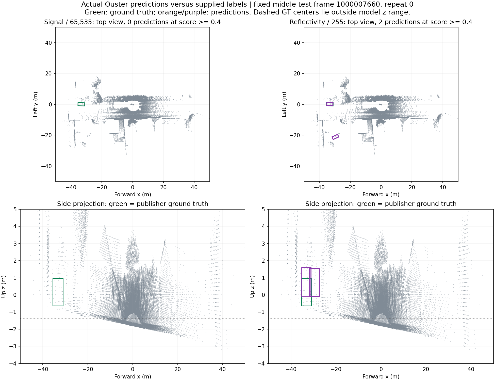

# Ouster channel decision and proposal — 8 November 2026

**Use reflectivity / 255 as the experimental input for this model. Neither tested channel is accepted as an accurate 3D detector configuration.** Reflectivity has better measured vehicle localization from above on the frozen labeled subset. Signal / 65,535 misses those vehicles. Both have zero qualifying 3D matches under the declared thresholds, including when the publication confidence gate is disabled.

This is a comparison of **these two encodings, this pretrained model and these recordings**. It does not prove every possible signal calibration inferior to reflectivity. No driver, production adapter, saved production image or deployment default was changed. Reflectivity was already the experimental launcher default.

## What was tested

The experiment made **1,120 new measured GPU inferences**, plus 18 discarded warmups, using current `src/pointpillar.cpp` and `src/postprocess.cpp` compiled unchanged. It used the existing FP32 engine read-only on the RTX 4060 Laptop, driver 595.99.02. NMS was 0.01, top-N 4096, three model classes. All post-NMS rows were saved losslessly before the confidence gate. Primary reporting uses the actual launcher threshold **0.4**; an unfiltered evaluation checks whether that gate explains the result.

| Experiment | Distinct scans | Repeats | Features | Measured inferences |
| --- | ---: | ---: | ---: | ---: |
| MOSEP: dry, 30 and 100 mm/h | 48: 16 per condition | 5 | 2 | 480 |
| Labeled Dur360BEV-Extended | 32: 16 published train, 16 published test | 5 | 2 | 320 |
| Separate bounded-pillar sensitivity, same labeled scans | 32 | 5 | 2 | 320 |

Variant/scan order was shuffled within each repeat using seed 20261108. Both features used bit-identical XYZ, point order and point count within each experiment. Signal was divided by 65,535; reflectivity by 255, using double division followed by FLOAT32 cast as in the adapter. No per-scan maximum normalization, coordinate shift, retraining or threshold tuning was performed. Repeated inferences measure variability; they are not additional independent scenes.

The direct runner calls the actual production inference and NMS implementation. It does not test ROS transport or invoke the adapter node. Earlier adapter conversion tests remain separate evidence. The initial host-to-container ROS A/B attempt suffered large-cloud UDP delivery loss and was stopped; its incomplete results were excluded. Logs remain under `.recovery/accuracy/ouster-current-ab-v1` and `v2`.

## Independent annotated data

The original [Dur360BEV-Extended dataset](https://huggingface.co/datasets/TomEeee/Dur360BEV-Extended), declared CC-BY-4.0, retains both channels and supplies 3D boxes. Its archive is about 159 GB; only approximately 302 MB of original point files, plus metadata and annotations, were retrieved using validated byte ranges. All 32 selected point/label pairs passed the publisher's per-file MD5s. Source files and labels remain unchanged.

The dataset revision is `07f166e558d7e1987e9a554ce0a89494f8fb87b0`. Selection was frozen before inference: identify 512 uniformly spaced archive members, then select 16 uniformly spaced candidates from each published split. Empty-label scenes were retained. Published train/test frame indices are disjoint, but independent-drive separation is not established.

Bundled sensor metadata reports an OS1-128, firmware 2.1.1, 128×2048 points. It has no reflectivity calibration-status flag, so individual factory calibration validity remains unverified. The [official loader at pinned revision](https://github.com/Tom-E-Durham/Dur360BEV/blob/29e5dfb12d98983949cd7b85ba353b601cdc5248/Dur360BEV_dataset/dur360bev_dataset.py) identifies XYZ, intensity, time, reflectivity, ring, ambient and range slots. XYZ, signal/intensity and reflectivity are meaningful FLOAT32 values; auxiliary integer channels must not be assumed numerically converted floats. Labels are `class height width length center_x center_y center_z yaw`, in the LiDAR frame. The annotation centers were used directly, without adding half height or shifting z.

The [dataset paper](https://arxiv.org/html/2503.00675v2) describes model-assisted annotation followed by experienced human review/additions. These labels are independent of our predictions; they are not purely manual metrology. The Extended card declares format compatibility but does not separately document its annotation process. This is a diagnostic evaluation against publisher annotations, not an official benchmark submission.

MOSEP remains **unlabeled** for object detection. Its weather measurements and camera/radar streams were not substituted for object ground truth.

## Geometry and evaluation policy

Original Dur360 scans have 262,144 points, exceeding the engine's 204,800 capacity. Before inference, the labeled-data preparation applied the encoded model ROI and removed all-zero XYZ invalid returns, identically for both channels. It retained 65,238–175,559 points. This is an explicit compatibility adaptation, not unchanged full-cloud deployment. MOSEP's primary experiment retained original points and zero returns.

The evaluation area is the publisher's 100×100 m XY region, with the model's z coverage: x/y in [−50,50), z in [−1.4,4.4). Both predictions and annotations use the same center rule. Original test labels contain 70 Car and seven Pedestrian objects. **Sixty vehicles and six pedestrians are in the evaluation ROI**: two cars are outside XY, and a further eight cars plus one pedestrian are outside model z coverage. The excluded counts are reported, not treated as detected objects. No cyclists occur in this selection, so no cyclist accuracy claim is possible.

Vehicle compatibility groups Car/Bus/Truck as model Vehicle; the selected labels contain Car and Pedestrian. Matching is class-aware, confidence-ranked, one-to-one, at rotated BEV/3D IoU ≥0.7 for Vehicle and ≥0.5 for Pedestrian. Failed frames retain their ground-truth false negatives. AP is a diagnostic continuous precision-envelope area; it is **not KITTI AP_R40 or an official Dur360 score**.

## Primary ground-truth result

These are test-set results at confidence 0.4. Counts and ratios are means over five complete runs on the **same 16 test scans**, rather than pooling the repeats into 80 new scenes.

| Vehicle result | Signal / 65,535 | Reflectivity / 255 |
| --- | ---: | ---: |
| BEV true positives per run | 0 | 4 in every run |
| BEV false positives per run, mean | 6.4 | 10.4 |
| BEV false negatives per run | 60 | 56 |
| BEV precision, mean of run ratios | 0% | 27.81% |
| BEV recall | 0% | 6.67% |
| Qualifying 3D true positives | 0 | 0 |
| 3D precision / recall | 0% / 0% | 0% / 0% |

Both channels also have zero qualifying pedestrian BEV and 3D matches among the six in-ROI test pedestrians. Reflectivity produced an average three pedestrian false positives per run; signal produced none. Therefore the vehicle advantage must not be generalized to pedestrians.

Disabling the additional publication gate does not repair 3D accuracy: both channels still have zero qualifying 3D matches. Reflectivity's unfiltered vehicle BEV recall averages 22.67%, with precision 5.84%; signal still has zero test vehicle BEV matches. The higher recall at low scores comes with many false positives.

A paired-frame bootstrap, averaging repeat counts within each frame, favors reflectivity for vehicle BEV precision and recall. Aggregate-count precision is 27.78% versus zero, with a nominal difference interval of +8.06 to +50.00 percentage points; recall difference is +6.67 points, interval +1.54 to +15.63. This assumes independent frames within one collection and is not proof of independent-drive generalization. The small pedestrian count and absence of cyclists limit the comparison.

## Why 3D accuracy still fails

The four first-repeat reflectivity vehicle BEV matches have IoUs 0.762–0.822 from above. Their centers are **0.60–1.14 m too high**, giving 3D IoUs only 0.141–0.381, below the frozen 0.7 criterion. This is nonzero overlap, but zero qualifying matches. It is not grounds for applying an arbitrary fixed z offset.

Two independent checks support this finding: all 320 exported label records agree exactly with the publisher's loader convention; Python BEV IoU agrees with current compiled C++ geometry on 5,000 random pairs and 84 actual pairs, maximum absolute difference 2.33×10⁻¹⁵. The frozen evaluation was independently reproduced from observations.



Green is publisher ground truth; orange/purple are predictions. The scene is the middle frame of the frozen test selection, not selected for a favorable output. The lower row is an XZ projection, making vertical displacement visible. [Figure provenance and attribution](figures/ouster-channel-ground-truth-provenance.json).

## Numerical stability and capacity control

**Both normalized channels completed all 560 measured inferences each without recorded inference failures.** That proves numerical success within the tested runs, not indefinite runtime reliability or accurate objects.

At score 0.4, MOSEP signal outputs were empty in 196/240 observations, versus 108/240 for reflectivity. Both had median nonempty same-scan repeat agreement 100% under the declared object matching tolerance; the comparison has very few common nonempty scenes. An empty output is never counted as ideal object repeatability. Neither channel has a demonstrated general stability advantage.

Twenty of the 32 primary labeled scans exceed the model's 10,000 occupied-pillar limit; every scan also has pillars with more than 32 points. A separate geometry-only sensitivity control selected the first 10,000 encountered pillars and first 32 points per pillar, preserving original point order and using the identical selection for both channels. It is not a reproduction of CUDA thread encounter order or a production fix.

The control yielded no inference failures. It removed empty/nonempty changes between repeats (primary: seven reflectivity and five signal pairs; control: zero for each). It retained the **same four versus zero vehicle BEV matches**, and both still had zero qualifying 3D matches at 0.4. Reflectivity's control BEV precision averaged 21.99%, so bounding capacity did not repair accuracy and did not universally improve it.

## Concrete proposal

1. **Keep reflectivity/255 as the experimental baseline.** Record selected field, divisor, source profile, model/engine identity and confidence threshold. Do not advertise accurate 3D results or universal superiority over other signal calibrations. Keep signal/65535 available as a diagnostic alternative. For a future ROS A/B launcher, add an explicit, verified signal-field alias: these recordings name signal `intensity`, while the current adapter selects a literal `signal` field. Do not reinterpret a generic intensity field without checking the sensor schema.
2. **Resolve input capacity and valid-return handling before operational acceptance.** Implement and test a declared point-selection/voxel-capacity policy as a separate change. Verify its effect on accuracy and repeatability with identical geometry for both channels. The current control is a candidate investigation, not silently enabled preprocessing.
3. **Resolve the vertical/input-training mismatch.** Trace sensor origin, model training coordinate convention, anchor/decoder behavior and point filtering against an independently validated reference. The earlier KITTI/TRT8 findings support a shared input/model issue, but do not identify a universal correction. No label-derived display-only z shift should be deployed.
4. **If the fixed model remains inaccurate, use an Ouster-compatible trained model or fine-tune on labeled Ouster data.** Choose normalization, preprocessing and thresholds on training/tuning recordings, then lock them. Do not tune on the now-inspected 16 test frames.
5. **Run a new recording-disjoint acceptance evaluation on the actual sensor.** Include dry/rain, varied distances, negatives and enough pedestrian/cyclist positives. Report per-class 3D/BEV precision, recall, AP, localization error, failures and latency. Camera appearance or box counts cannot replace annotations.

A proposed pilot gate, requiring agreement before an acceptance claim, is zero invalid-input/inference failures on the frozen run, verified capacity compliance, and at least 80% precision and recall per supported class at the declared 3D IoU and fixed operating threshold. This is an engineering proposal, not a user-approved requirement or a universal safety standard. Current results are far below it.

**Decision scope:** reflectivity/255 is the better supported development choice for this tested configuration. **Neither current configuration should be presented as a proven accurate 3D detector.**

## Reproduction and evidence

Large originals, inputs and observations stay ignored under `.recovery`; back them up independently. The committed-sized summary is [config/ouster_channel_decision.json](../config/ouster_channel_decision.json). It records image, engine, GPU, source hashes, exact report hashes, limitations and results. No models/bags are added to Git.

```bash
# Fetch a small original annotated subset, without downloading the full archive.
python3 tools/download_dur360_subset.py --output .recovery/dur360-study-new
# Prepare a NEW output directory; selection is verified against publisher MD5s.
python3 tools/run_ouster_ab.py prepare --kind dur360 \
  --source .recovery/dur360-study-new --output .recovery/accuracy/dur360-ab-new
# Uses cached pp-infer:reference-trt10 development image and existing engine;
# Docker/GPU access is required. No installation or engine rebuild is performed.
python3 tools/run_ouster_ab.py run --output .recovery/accuracy/dur360-ab-new
python3 tools/ouster_gt_evaluation.py \
  .recovery/accuracy/dur360-ab-new/observations.json \
  --output .recovery/accuracy/dur360-ab-new/ground-truth-0.4.json --threshold 0.4
python3 tools/ouster_ab_metrics.py \
  .recovery/accuracy/dur360-ab-new/observations.json \
  --output .recovery/accuracy/dur360-ab-new/repeatability-0.4.json --threshold 0.4
```

For a separate control, prepare another new directory with `--bounded-voxels`. The helper intentionally refuses to overwrite existing inference evidence. Preparation of MOSEP uses `--kind mosep --source <frozen-CDR-directory>` after sourcing ROS Jazzy; this run used the 48 source CDR messages frozen during the initial ROS test preparation. It is not a bag player.

Exact completed directories:

- `.recovery/accuracy/ouster-production-mosep-v1`: 480 primary weather observations.
- `.recovery/accuracy/ouster-production-dur360-v2`: 320 primary labeled observations, unfiltered and 0.4 reports, convention audit and vertical diagnostics.
- `.recovery/accuracy/ouster-production-dur360-bounded-v1`: 320 capacity-control observations.
- `.recovery/dur360bevet-study`: original subset, all original labels, published checksums, frozen selection, source/schema provenance and official loader snapshot.

Validation: all **119 Python tests passed**, including analytic IoU/AP/matching/failure controls, archive integrity controls and deterministic capacity selection. The production runner passed strict syntax checks and a compiled stub I/O/failure/reuse test. All three actual GPU runs completed. No test containers remain running. This document does not claim a newly verified live ROS A/B deployment or a successful LaTeX compilation; the open presentation was left unchanged.
