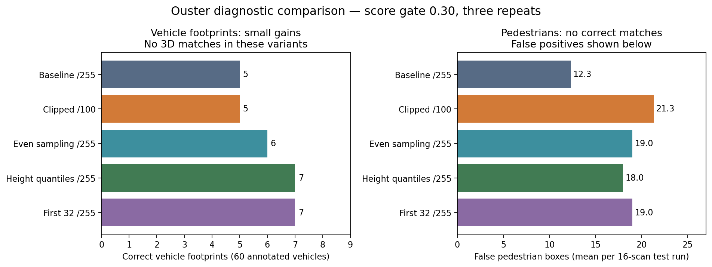
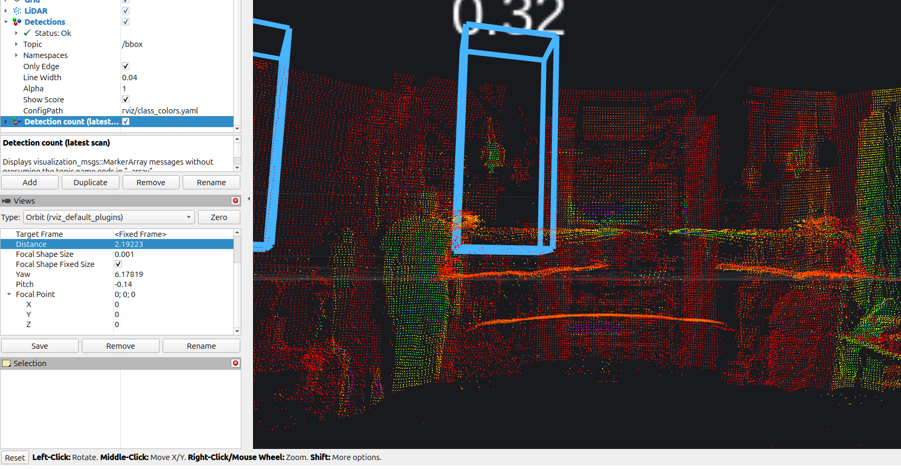
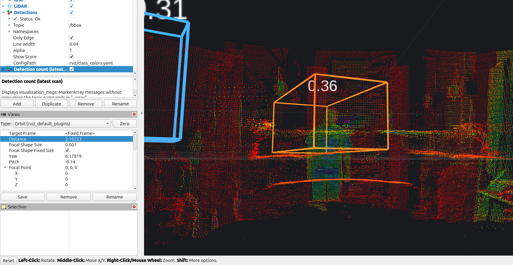
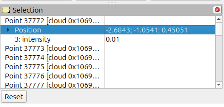
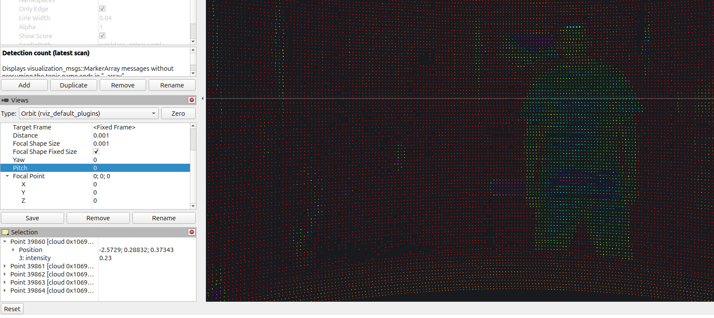
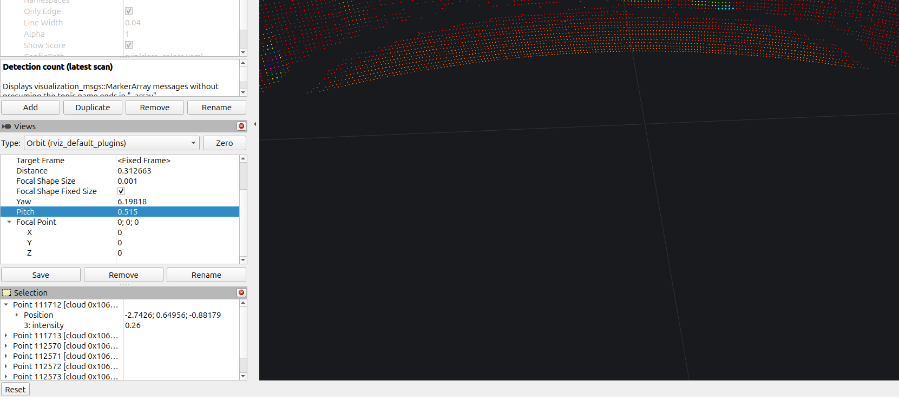
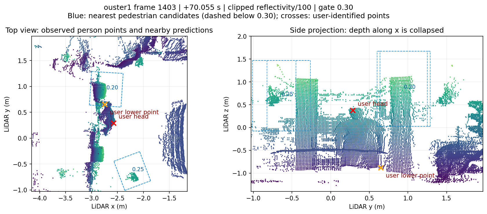

# Ouster verification and person localization — 21 November 2026

**Pedestrian accuracy remains unresolved.** This report combines the latest controlled verification with actual user screenshots and an exact source-scan diagnosis. Software checks, repeatability and object accuracy are separate results. Original recordings, models and unrelated source changes were preserved.

## Verification coverage

Three specialist agents and the primary investigator examined seven original ROS recordings with ten Ouster streams: `raw01`, `ouster1`, three MOSEP weather bags and two Koide calibration bags. Each weather bag contains two Ouster streams. Radar, backups and normalized copies were excluded as independent Ouster sources.

- **All 6,137 Ouster clouds** passed the exhaustive CPU format audit. Counts matched metadata; selected field layouts, types and offsets were valid; reflectivity was finite and in 0–255; no raw cloud exceeded 204,800 points. Many clouds contain nonfinite XYZ returns, which the actual packer removes.
- **Thirty recorded-cloud cases** passed the production C++ converter and detector packer. These probes used reflectivity/255 without clipping. Separate unit and ROS transport tests cover clipping.
- **Eight native CTest checks and twelve evaluator tests passed.**
- **2,268 measured GPU inferences succeeded**, excluding four warmups. The main batch contains 1,788 runs on 94 selected scans. Another 480 runs isolate zero-return removal on 40 of those unlabeled scans.
- The exact-person case below adds **six separate inferences** with no discarded warmups. It is not included in the 2,268-run total and is not a timing benchmark.

The 94 selected inputs include 32 frozen Dur360 reference scans and twelve scans from the user's raw01 movement interval. Inference repetitions are not additional independent scenes. Secondary weather returns are mostly zero XYZ and include an entirely zero cloud; their lack of detections cannot establish missed people.

## Accuracy policy and controlled results

The ROS recordings lack independently annotated person boxes. Dur360BEV-Extended supplies publisher annotations. Its 16 previously inspected test scans contain **60 Vehicle and six Pedestrian centers** inside the shared evaluation region. This is exploratory reuse of one collection, not fresh recording-disjoint acceptance.

At score 0.3, Vehicle IoU threshold 0.7 and Pedestrian IoU threshold 0.5, mean counts across three repeats are:

| Input preparation | Vehicle BEV matches / 60 | Vehicle 3D matches / 60 | Pedestrian BEV / 3D matches / 6 | False pedestrian boxes |
| --- | ---: | ---: | ---: | ---: |
| All finite points, reflectivity/255 | 5 | 0 | 0 / 0 | 12.33 |
| All finite points, clipped reflectivity/100 | 5 | 0 | 0 / 0 | 21.33 |
| Even sampling per pillar, /255 | 6 | 0 | 0 / 0 | 19.00 |
| Height quantiles per pillar, /255 | 7 | 0 | 0 / 0 | 18.00 |
| First 32 points per pillar, /255 | 7 | 0 | 0 / 0 | 19.00 |

Clipped /100 did not establish an accuracy improvement. Bounded selection substantially improved repeat consistency, but did not make every comparison bitwise identical or recover pedestrians. These policies remain offline controls: the live node calls the generic finite-point packer directly. Removing the publication gate still recovered no test pedestrian matches. The decoder retains its own approximately 0.1 score floor.

An independent geometric proposal detector evaluated six settings on 16 training scans, then froze one before evaluating 16 test scans. It produced **zero pedestrian true positives, 156 false positives and six misses** at BEV/3D IoU 0.5. Its constant score of 0.5 was an evaluator placeholder, not calibrated confidence. All neural variants in this study use the current ONNX; no independent neural checkpoint was installed or executed.

A separate vehicle-output height diagnostic fitted a **−1.06345 m** median correction using twelve BEV matches in six training frames, repeat zero, gate 0.3. Applied only to saved test predictions, it raised Vehicle 3D matches **0 → 2 of 60** at gates 0.3 and 0.4. Pedestrians were unchanged. Training residuals ranged from −1.954 to −0.100 m: this is not a universal calibration. The training baseline at 0.3 already had one Vehicle 3D match per repeat; zero baseline 3D matches is a test-subset statement.

## What the screenshots establish

RViz Pitch, Yaw, Distance and Focal Point describe the camera view, not LiDAR mounting calibration or selected point coordinates. Point colors show the configured intensity rendering, not semantic class. For the verified model and color mapping, blue boxes are Pedestrian, orange boxes Vehicle and yellow boxes Cyclist.

These actual user captures show false or misplaced predictions. Their exact source frames have not been established. Projected overlap does not establish a correct 3D association, and a box score is not evidence of identity. The complete seven-image sequence is retained with the earlier captures.

### Corrected manual selections

The first selected point, **(−2.6843, −1.0541, +0.45051) m**, was initially called feet and then explicitly corrected by the user to **head**. That correction is retained.

A later selected "head" at **(−15.797, −7.1147, +2.7198) m** is 14.54 m horizontally from the supplied feet at **(−2.6137, −0.9821, −1.0674) m**. They are not a plausible head–feet pair; the head selection likely includes background. Cross-position vertical differences of 1.609 m or 1.518 m were only consistency checks, not verified body heights or z corrections.

The later useful pair is:

| User-selected landmark | X (m) | Y (m) | Z (m) |
| --- | ---: | ---: | ---: |
| Head, Point 39860 | −2.5729 | +0.28832 | +0.37343 |
| Partial lower body, Point 111712 | −2.7426 | +0.64956 | −0.88179 |

The user states that the legs are incomplete. The **1.25522 m visible span is not full body height or floor level**. A search of all 1,841 ouster1 clouds found each selected XYZ uniquely within 0.000055 m per component. Both co-occur in **zero-based frame 1403**, at **+70.05539416 s**, record timestamp **1794397517854145698 ns**. Source CDR SHA256:

`bc4b08c105662e570aa73923710874515c1833d6ccfa6b79c01fb409be260117`

## Exact source-scan diagnosis

Frame 1403 was frozen and inferred offline six times: three with clipped /100 and three with /255. The experiment retained XYZ, point order, the current ONNX, the engine and production NMS. These two landmarks are not a complete ground-truth box.

For the nearest post-NMS Pedestrian candidate under clipped /100:

| Measurement | Range across three repeats |
| --- | ---: |
| Score | 0.19688–0.22240 |
| XY distance to the midpoint of the selected points | 0.47280–0.47878 m |
| Box bottom z | +0.00816 to +0.02666 m |
| Box top z | +1.65547 to +1.67069 m |
| Box top above the selected head point | 1.28204–1.29727 m |
| Box bottom above the selected lower-body point | 0.88995–0.90845 m |

No post-NMS Pedestrian box contained both selected points in any of the six runs, including candidates below 0.3. The nearby candidate is not a confirmed same-object match. Under /255 its score was similarly low, **0.19026–0.22857**. Lowering the publication gate would expose candidates without repairing their geometry.

Suggested caption: Ouster1 frame 1403, original XYZ, clipped reflectivity/100, repeat 1. Crosses identify the user-selected head and partial lower-body points. Nearby post-NMS Pedestrian candidates are dashed below score 0.3. The YZ projection collapses depth along X and does not establish 3D overlap. This figure measures candidate displacement, not person recall or full-body IoU.

## Time, playback and interpretation

Source record timestamps are monotonic, but cloud header timestamps wrap backward and sometimes repeat. Identify evaluation frames by recording path, record timestamp and CDR hash. A header alone is insufficient. The generic failure path can leave older boxes displayed until the next valid output, so screenshot analysis requires cloud/detection association.

Pause must precede PlayNext. Resume starts continuous playback and makes PlayNext fail. The verified Jazzy service types are `rosbag2_interfaces/srv/Pause`, `Resume`, `PlayNext` and `IsPaused`; see [startup instructions](STARTUP_AND_REPLAY.md).

The last explicitly configured preview was ouster1, rate 1.0, domain 99, Fast DDS, clipped reflectivity/100 and gate 0.3. This dated record does not guarantee that a process is currently running or paused. No height correction or offline sampling policy was silently enabled live.

## Next work and retained evidence

Frame 1403 is now a repeatable diagnostic; more manual head/feet selection is unnecessary for this case. Test input-height alignment as an explicit experiment, then repeat across additional identified people. A proposed correction must improve geometric alignment and false-positive behavior, as well as scores, and survive recording-disjoint evaluation. An independent trained checkpoint or Ouster-specific fine-tuning remains a higher-value direction if the fixed model cannot generalize. An output-only z shift cannot increase confidence.

All available originals, screenshots, drafts and negative-result figures are retained. See the [image archive](IMAGE_ARCHIVE.md), [figure catalog](figures/README.md), [verification record](../config/ouster_verification_20261121.json) and [corrected point measurements](../config/user_person_point_measurements_20261121.json). Large evidence is ignored under `.recovery`; selected figures and compact metadata are documentation assets. Historical studies and their totals remain separate.
