# Working thesis draft

## Measurement update — 21 November 2026

The manuscript below preserves its earlier frozen studies. Material for the next revision is in [the latest verification and exact-person report](OUSTER_VERIFICATION_AND_PERSON_DIAGNOSIS_20261121.md), with actual screenshots, measured plots and the [figure catalog](figures/README.md). The new 2,268-inference comparison and six-inference person case are separate from the earlier 1,120-observation channel study. No pedestrian fix or universal z correction was established. All image variants are retained in [the archive](IMAGE_ARCHIVE.md). The primary LaTeX manuscript now includes a dated addendum with the comparison, corrected point selections, original screenshots and generated diagnostic plots; the earlier studies retain their original scope. The 21 November built-in PDF compilation attempt failed before document processing because DNS resolution prevented downloading `article.cls`; PDF compilation and final layout remain unverified.

**Ahmed Elsaify · THI · Master of International Automotive Engineering**
Supervisor: to be confirmed.

**Expanded 9 November 2026.** Primary evaluation is recorded through 8 November; supplementary engineering reproductions are dated 9 November. The [LaTeX manuscript](THESIS_DRAFT.tex) is the primary thesis source and includes a fuller background review and bibliography. This readable version preserves the engineering story, results and [illustrated casebook](THESIS_CASEBOOK.md). The appendix covers 50 problem groups and four detailed subcases with small solution steps, editable tables and workflow diagrams. University formatting, supervisor details and the remaining evaluation still need completion. Keep the stated limits when reusing paragraphs.

Suggested title: **Migrating and Evaluating a PointPillars LiDAR Detector in ROS 2 Jazzy with TensorRT 10**.

## Abstract — draft

This work modernizes a ROS 2 LiDAR detection pipeline built around a pretrained PointPillars model. The implementation is migrated to ROS 2 Jazzy and TensorRT 10, with explicit input/output checks, reusable GPU resources, reproducible Docker deployment and an Ouster input adapter. Engineering verification is separated from object-detection accuracy. A controlled study compares signal divided by 65,535 with reflectivity divided by 255 using unchanged production inference code. It includes 480 observations on unlabeled weather recordings, 320 observations on publisher-annotated Ouster scans and a separate 320-observation capacity control. Both normalized channels complete all measured numerical observations without inference failure. In the 16-scan test subset, reflectivity yields four Vehicle bird's-eye-view matches per repeat among 60 in-region annotations, while signal yields none. Neither channel produces qualifying three-dimensional matches at the declared overlap criteria. Vertical localization errors and input-capacity effects remain unresolved. The results support reflectivity as an experimental baseline for this configuration, while showing why software migration and successful visualization are insufficient evidence of accurate 3D perception.

## 1. Introduction

LiDAR object detection links a physical sensor to a learned model and a software deployment environment. A pipeline can compile, publish messages and render boxes while still producing inaccurate objects. This distinction matters when an existing model is transferred to another runtime or sensor.

The project starts from an older PointPillars ROS implementation and targets Ubuntu 24.04, ROS 2 Jazzy and TensorRT 10. The aim is to establish a maintainable inference path and evaluate the assumptions behind its outputs. The thesis does not propose a new neural-network architecture or claim to reproduce the original PointPillars paper's benchmark performance.

Three research questions guide the work:

1. Which software and resource-management changes are needed to execute and inspect the pipeline on the new stack?
2. How do the two fixed Ouster channel encodings affect numerical behavior and agreement with supplied labels?
3. How much does a deterministic capacity control change repeatability and the measured accuracy conclusion?

## 2. Background

PointPillars groups points into vertical columns and learns features that can be processed by a two-dimensional detection network. The original method and its reported benchmark performance belong to Lang et al.; they are not results of this implementation. TensorRT converts a trained model into a deployment-specific execution plan. Building that plan is not retraining.

ROS 2 carries point clouds and detection messages between processes. Delivery settings, topics, domains and middleware must agree. These transport requirements are separate from the model's coordinate, feature and capacity requirements.

Ouster signal and reflectivity are distinct sensor channels. In some recorded point-cloud schemas, signal is named `intensity`. Dividing a channel by its code range changes its numerical scale; it does not establish equivalence to the training sensor's reflectance.

## 3. System design and migration

The current system has an optional Ouster conversion process followed by a detector process. The adapter publishes compact FLOAT32 XYZI while preserving the sensor header and XYZ. The detector validates and packs the cloud, executes the pretrained engine, validates candidate boxes, applies CPU rotated NMS and then a confidence gate. It publishes accepted boxes, diagnostic counts and RViz count text.

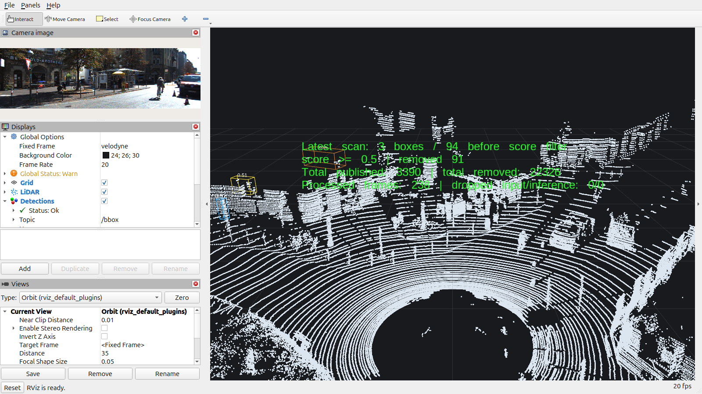

This historical image illustrates message rendering and counters; it is not labeled accuracy evidence. Its exact experiment and attribution are recorded in [figure provenance](figures/README.md).

The migration replaces older binding-oriented runtime assumptions with named TensorRT I/O checks and explicit resource ownership. Persistent buffers and a persistent stream are reused across scans. The container entrypoint manages engine generation and caching. The detector still runs synchronously with reliable depth 700; the proposed latest-frame worker is not implemented.

For the implementation section, cite [the architecture](../IMPLEMENTATION_ARCHITECTURE.md), the relevant source files and their recorded revision. Do not describe planned worker or deterministic preprocessing as deployed code.

<!-- BEGIN ENGINEERING JOURNEY -->
## 4. Engineering journey: problems, investigations and outcomes

This chapter reconstructs the available technical history. The appendix explains all 50 documented problem groups with small steps and labeled visual evidence, including additional subcases. Dated outcomes retain their original limits; the new narrative does not imply a new experiment.

### 4.1 How the investigation developed

The project began with a practical question: could an older PointPillars application be made usable on a newer ROS and NVIDIA stack? Answering that question uncovered several different problems. Some prevented compilation. Others allowed execution but made its output unsafe to trust. Later, correctly delivered and well-formed messages still contained inaccurate objects. The investigation therefore developed from software compatibility, through repeatable operation, to numerical behavior and labeled accuracy.

| Recorded period | Main work | What the evidence established |
| --- | --- | --- |
| 1–2 October 2026 | Separate geometry, ROS and GPU responsibilities; validate tensors; reuse GPU resources; build with colcon and cache target-GPU engines. | The execution path became inspectable and testable. This did not establish object accuracy. |
| 3 October 2026 | Freeze a labeled KITTI diagnostic sample and compare TensorRT 8/10 outputs and NMS. | TensorRT 8 also produced poor 3D results and upward centers. NMS agreed on identical candidates; capacity remained unresolved. |
| 13–14 October 2026 | Compare Ouster feature encodings and preserve original geometry, raw detail and camera data. | Normalized features avoided the recorded numerical failures. Timing and rendering remained separate from accuracy. |
| 23 October 2026 | Add a live confidence gate and per-frame counters; verify native/deployed GPU publication and RViz. | Published boxes and counters followed the tested rules. Totals count detection events, not unique objects. |
| 28 October–8 November 2026 | Diagnose physical-host driver and schema issues; test fresh MOSEP adapter-to-GPU-to-RViz flow; align profiles, cache builds and fix shutdown. | The tested Ouster operating path worked. These checks did not complete accuracy acceptance. |
| 8 November 2026 | Complete 1,120 measured GPU observations in the paired channel study and separate capacity control. | Reflectivity produced four test Vehicle BEV matches per repeat; signal produced none. Neither encoding produced qualifying 3D matches. |

The chronology records stages of the investigation; a later stage does not mean that every earlier problem was closed. In particular, model-input semantics, internal pillar capacity, memory/failure acceptance and sustained latency remain open.

### 4.2 Starting from an incompatible baseline

The inherited instructions targeted Ubuntu 20.04, ROS Foxy, TensorRT 8.2 and hard-coded CUDA paths. The chosen machine instead used Ubuntu 24.04 and ROS Jazzy. The original CMake configuration mixed language standards, fixed a CUDA location and omitted dependencies used by the source. The node also included a missing local header and used an older `vision_msgs` hypothesis layout. These were concrete build and interface problems; reinstalling the application would not resolve them.

The first design separated CPU box geometry, ROS message adaptation and GPU inference. C++17 and explicit target dependencies replaced the conflicting build settings. A reduced CPU configuration made it possible to verify geometry without ROS, CUDA or TensorRT, while a separate ROS configuration tested messages without a real engine. Jazzy output construction uses nested hypothesis fields and preserves the incoming cloud header.

This separation made progress possible while the SDK was downloading and gave failures a clearer location. It did not complete the proposed architecture: a single inference worker with at most one pending frame was designed but has not been implemented. The current callback still runs inference synchronously and requests reliable history depth 700. The often-cited example of 70 seconds at a 10 Hz input is a possible backlog calculation, not a measured delay.

### 4.3 Keeping work recoverable across interruptions

Development was interrupted by usage limits, disk-space pressure and an unmounted project volume. Relying on a conversation's remembered state was insufficient: one narrative draft existed only in session storage when a limit was reached. It later had to be recovered from the available session record and saved as a real file. The volume was reconnected through the normal disk service; the recorded recovery did not format it or force a filesystem repair.

The checkpoint helper records eligible source files, hashes, Git identity, separate staged/unstaged patches, task state and the next action. Temporary checkpoints become complete only after their contents are written. Integrity checks and drift reporting help the next session identify what changed. Twelve early tests included index preservation, corrupt or interrupted snapshots and a directory replaced by a file; the last case exposed a bug that was corrected.

Models, SDKs, engines, bags and most generated evidence are excluded from these small source checkpoints. The helper does not restore files automatically, run tests, buy usage credits or decide that a milestone passed. Large experimental assets still require an independent backup. This distinction became part of the project method: source continuity and scientific evidence preservation are related, but neither replaces the other.

### 4.4 Distinguishing GPU access from a broken driver

An early `nvidia-smi` call failed in the restricted execution environment. A GPU-accessible host check then found a working RTX 4060 Laptop GPU. The first failure was therefore an access limitation, not evidence that this laptop needed a driver reinstall. Host driver capability, installed CUDA compiler version and container CUDA libraries were recorded separately; they do not have to display the same version number.

A later physical-host case was different. User-supplied logs from an RTX A4500 Embedded system showed NVIDIA modules built for a different kernel and conflicting package proposals from mixed repositories. Matching driver/modules followed by a reboot restored GPU access in that record. The Ouster driver also had an undefined Fast CDR serialization symbol; updating the compatible ROS/DDS package group restored its launch according to those logs. These were host-specific repairs. They are not evidence that the A4500 completed the later RTX 4060 accuracy study.

That host's engine-building attempts also showed why workspace is not total GPU memory: 256 MiB was below a plugin's 270,532,608-byte scratch request, a 1024 MiB attempt encountered allocation failure, and a 512 MiB build succeeded. Neither the largest nor the smallest setting was universally best. A fatal CUDA/driver state may require the recovery action reported by the system even when `nvidia-smi` still responds; the project did not establish a general display-GPU reset procedure.

### 4.5 Finding the model and selecting a compatible runtime

The repository contained no ready model or engine. The supplied Downloads directory held a deployable ONNX and a trainable TLT artifact. Both were inventoried and hashed. The ONNX was used; the TLT was not decrypted or retrained. Read-only metadata inspection identified FLOAT32 points with capacity 204,800 by four features, an INT32 point count, candidate boxes with nine columns and a separate box count. It also identified the required VoxelGenerator, PillarScatter and DecodeBbox3D plugins.

A pretrained model did not remove the need for a compatible C++ runtime and plugins. TAO training/export, TensorRT engine building and application inference were explained as separate stages. TensorRT 11.3 was discussed but not validated. TensorRT 10.16.1 was selected only after checking that its actual library contained the required version-one plugin creators, that ONNX parsing succeeded and that a batch-one FP32 engine could be built and executed. An OSS plugin rebuild proved unnecessary for this selected SDK.

Native provisioning also changed from the initial proposal. Because password-protected system installation was unavailable to the tool session, the downloaded repository DEB and selected component packages were extracted into a local SDK. This supplied headers, shared libraries and `trtexec` without running maintainer scripts or registering host packages. Later Docker builds obtained their own declared packages. These are two recorded provisioning methods, not evidence that the original host completed every installation command printed in an earlier guide.

### 4.6 Making ROS input and box geometry defensible

The old input path assumed that a received cloud could be converted and sent to the model. The replacement validates dimensions, multiplication/byte bounds, field offsets and scalar types, row stride and padding, endianness, point capacity and positive intensity scale before conversion. The generic detector expects little-endian FLOAT32 XYZI. Valid organized padding is supported, nonfinite points are removed, and an empty valid cloud skips GPU inference. Oversized clouds are rejected explicitly instead of being silently truncated.

The original rotated-overlap code also had unsafe degenerate calculations, including a division without a valid intersection count. Convex polygon clipping and geometry validation replaced that path. Analytical cases and 2,000 randomized comparisons checked overlap and NMS behavior independently of the model. Deterministic tie handling and candidate bounds made the filtering policy testable. Class-aware suppression is available in the CPU core, but production remains class-agnostic; it was not silently enabled as an accuracy fix.

Jazzy message fixtures verified dimensions, yaw quaternions, hypotheses and copied timestamps/frame IDs. Focused CPU ASan/UBSan paths passed. LeakSanitizer could not operate under the traced environment, and ROS node creation exposed an allocator type mismatch in installed system code. The latter path was tested normally while instrumented data-only fixtures remained separate. No blanket suppression was used to turn these limits into a memory-safety pass.

### 4.7 Replacing fragile TensorRT assumptions

The legacy inference path relied on tensor binding positions, incompletely checked sizes and difficult resource lifetimes. The migrated runtime checks names, tensor roles, types, shapes, profile, linear format and device storage before accepting an engine. Named tensor addresses and `enqueueV3` replace the old binding-index execution path. A file is not accepted merely because it deserializes or has four tensors.

The runtime now owns the TensorRT runtime, engine, context and profiler, alongside a reusable CUDA stream and capacity-sized buffers. Input padding and counts are reset deliberately. Output transfer reads the count first, synchronizes, validates the count, then copies only the required rows and synchronizes again. Impossible counts, invalid classes/scores and nonfinite or nonpositive dimensions fail the output contract. This is a checked count-first implementation, not the fully asynchronous pipeline originally proposed.

Real SDK testing found details that header compilation alone had missed. TensorRT version macros used aliases, so the build guard needed a preprocessor check. `setProfiler(nullptr)` was rejected by the actual runtime; the solution retained the owned profiler and disabled accumulation. Callback overhead is therefore not proven absent when collection is disabled. A failure in the CUDA/TensorRT execution and transfer path latches a fault and rejects later inference until restart; the node logs and drops affected frames. Candidate decoding and NMS validation occur outside that fault-latch catch. Automatic runtime reconstruction and restart/rollback supervision remain unfinished. The Ouster launcher already supervises the two child process groups and stops both if either child exits.

The selected SDK linked successfully and ran ten synthetic GPU frames, capacity rejection, profiler and empty-result/destruction checks. A subsequent live ROS synthetic round trip preserved the header. These were progressively stronger checks than syntax compilation, but neither a synthetic box nor successful destruction proved real-scene accuracy or exhaustive fault handling.

### 4.8 Solving build and deployment obstacles

Several build problems were small but blocking. PCL/VTK exports required C/MPI configuration in the ROS build path; the reduced CPU build remained C++ only. ROS parameter tests needed a writable log directory. Strict shell nounset handling conflicted with ROS setup scripts, so it was relaxed only while those scripts were sourced. The user-facing native workflow moved to colcon, with separate build directories preventing reduced test options from contaminating the full inference build. The legacy launch file's absolute paths were not modernized into a validated production launcher.

Docker packaging developed in stages: first local SDK/model inputs, then automatic source/package/model retrieval, and finally the current local-source build. Initial package resolution mixed incompatible TensorRT secondary components; the selected lean, dispatch, plugin and related GPU package versions were then pinned consistently. Large development images and unused static libraries exhausted root-disk space. The footprint was reduced to required CUDA components and shared runtime libraries, with identified generated cache cleanup recorded. Moving the checkout to another disk did not move Docker's layer storage.

A multistage image kept compilers in the build stage. A separate check using Dockerfile input and an empty context established that the then-automatic download route did not secretly rely on local ignored model files. That historical result applies to that recipe; current local-source mode deliberately includes runtime source from the checkout. Base tags and non-GPU apt packages are not fully frozen, so the deployment is not hermetic.

### 4.9 Separating image preparation, engine generation and execution

The request for a build that also left a node running required a wrapper: a Docker build cannot keep its build container as the persistent application. The deployment script therefore prepares the image and then starts a foreground runtime container. The host supplies the NVIDIA driver and Docker GPU integration; the image supplies application libraries. Support is limited to the tested Linux x86-64 recipe, with an RTX 4060 physically exercised. A capability check is not proof of all-GPU compatibility; Jetson/ARM needs another platform build.

Engine generation belongs to startup on the chosen GPU. Cache identity includes model, GPU identity/capability, driver, CUDA/TensorRT and build settings. A lock serializes builders; a temporary engine is promoted only after success. Early restart checks generated one engine across two starts and preserved synthetic message flow. An engine is a local execution plan, not an archive extracted from ONNX or a retrained model. Standard startup still checks ONNX even on cache reuse.

The cache protects against an interrupted build, but automatic recovery from a later corrupted nonempty cache file is not complete. The runtime retains a fault until restart, and there is no completed rollback supervisor. These are operational gaps alongside the successful cache checks.

### 4.10 Correcting repeated rebuilds and difficult shutdown

The early Dockerfile fetched published Git source. That was convenient for clone-and-deploy operation, but a local edit was absent from the image until published, and changes near dependency installation could invalidate expensive layers. The user later reported repeated downloads and having to press Ctrl+C several times. The original command also pulled base images on each deployment invocation. Image caching, dependency caching and engine caching had become confused in the operating workflow.

The November correction builds local runtime source by default and fingerprints the relevant inputs. A matching saved image skips rebuilding; independent SDK/model layers survive source edits; base refresh is explicit. The runtime fingerprint excludes documentation-only edits, and SOURCE_REVISION is declared after dependency installation so revision metadata does not invalidate that expensive layer. Existing-image startup is separate from deployment. Optional `PP_BUILD_ONLY=1` prepares the image and exits, avoiding an unwanted detector before starting the combined Ouster stack. It is not a mandatory operating mode.

Shutdown handling records the exact created container ID in a private temporary directory and stops that owned container when the launcher receives SIGINT. The private directory prevents another local process from substituting a container-ID file. Engine-builder interruption also removes unfinished pending files while preserving good cached engines. It does not target an unrelated replacement merely because it reuses a name. The validation recorded one SIGINT stopping each test launcher with exit 130 in under 0.5 seconds, alongside dependency-layer reuse, repeated-build skipping, 91 Python tests and seven C++/ROS tests. This fixes the measured launch behavior; it does not certify every possible hung application or host state.

### 4.11 Diagnosing quiet terminals and missing ROS data

A terminal that stopped printing after GPU information initially looked like a stalled launch. Inspection showed a running node with a reused engine but no point-cloud publisher. The missing part was the source, not another installation. The bag player, detector and viewer became explicit separate jobs. ROS package, executable and node names were also distinguished: `ros2 run pp_infer pp_infer` selects a package/executable, while `/pointpillars` is the configured node name.

The first host-to-container Fast DDS shared-memory path did not deliver data in the tested root-container/desktop-user arrangement. UDPv4 did. The viewer/helper defaults were adjusted accordingly, with overrides retained. Reliable detector input was another separate constraint: a best-effort-only sensor publisher could be visible in discovery without matching it. The later Ouster adapter accepts sensor-data best effort and republishes reliable XYZI; configurable QoS throughout the detector is still pending.

A November report combined a live-profile stack with the bag player. The stack listened on `/ouster1/points` through Zenoh/domain 0, while the bag published `/sensing/lidar/points` through Fast DDS/domain 99. No reachable Zenoh router was present. Shared explicit bag defaults resolved this profile mismatch. Host networking alone cannot connect different middleware/domain settings, and `sudo` can discard environment exports. The original MCAP metadata warning was not the established cause: unchanged replay later published and processed clouds despite it.

### 4.12 Making the output visible without inventing geometry

RViz was installed but its `Detection3DArray` display plugin was missing. The official plugin package was extracted locally when system installation was unavailable; the launcher also supports a normal system installation. Live point and box rendering was then verified. Path-with-spaces checks were important after the checkout moved: quoted paths and location-relative helpers were repaired, while native generated caches containing old absolute paths required regeneration.

Sensor-only playback did not supply a world transform tree. Selecting the actual common sensor frame allowed clouds and boxes to render without fabricating a transform. Numeric class colors were used while class provenance was unresolved. Later NGC artifact metadata verified Vehicle/Pedestrian/Cyclist order, superseding the earlier uncertainty without rewriting it as if it had always been known. No tracking was added; empty tracking IDs and repeated detection totals are not unique-object estimates.

The Ouster view later looked sparse. Inspection showed 32,768 source entries but 13,206–15,775 zero-range/zero-XYZ entries in the selected scans. Display distance, point size and intensity coloring also affected appearance. A separate raw-data topic and brighter, closer view made original geometry inspectable. Byte comparisons showed normalization had not moved or deleted the source coordinates. The solution was an honest original-data view, not invented points or a hidden change to inference input.

This recorded screenshot verifies visible points, boxes and counters for that trial. It is not evidence that individual detections match ground truth. The figure catalog preserves its capture identity and KITTI attribution.

### 4.13 Obtaining useful data and preserving its identity

The first reproducible demonstration used the public KITTI sequence04 ROS conversion, mapped to drive 2011_09_30_drive_0016. Its 283 clouds and IMU messages did not contain camera images or the object labels needed for an accuracy score. Input remapping and explicit reliable playback QoS enabled integration checks: 25 matched frames inside Docker and another 25 through host transport had valid output fields. Those short samples did not establish sustained rate or detection correctness.

The matching camera archive was much larger than the selected images. Validated HTTP range reads, object identity checks, ZIP member CRCs, bounded caches and pending-file promotion allowed selected data to be obtained and resumed. Corrupt completed files were preserved and reported. Camera timestamps drove a variable-frame-rate MP4. The 285 camera frames, 283 clouds, approximately 0.210-second initial offset and independently controlled playback speeds prevented an exact synchronization claim. The video provided scene context, not a calibrated box overlay.

Labeled KITTI preparation followed a different method. All 7,481 training annotations were considered before deterministic scenario selection. Entire source drives were separated into 16 tuning and 16 test frames. Selected clouds, labels, calibration and images were preserved; full rectification and extrinsic transforms converted camera-bottom box centers into LiDAR geometric centers. DontCare stayed a 2D ignore region. Known geometry fixtures, hashes and split checks guarded against an apparently plausible but wrong ground truth.

The preparation also recorded model-range coverage. Many points or box corners outside the export range indicated a compatibility question, but did not justify translating the sensor or removing inconvenient labels. Pretrained training-frame overlap remained unknown. A small scenario-rich diagnostic sample was not relabeled as an unbiased benchmark.

### 4.14 Discovering that valid boxes were inaccurate

The first labeled KITTI measurement used original XYZI, scale 1.0, the existing FP32 engine, NMS IoU 0.01 and top-N 4096. The evaluator reused pinned official devkit routines with an explicit Vehicle-to-Car compatibility mapping. Calibrated camera visibility, neighboring classes, difficulty and ignore regions were retained. Of 2,876 predictions across 32 frames, 862 were camera-visible and 2,014 were outside this camera-labeled evaluation; the latter were not silently counted as false positives.

On the 16 test frames, moderate 3D AP was zero for all three classes. BEV AP_R40 was 5.7516% Car, 0% Pedestrian and 0.02577% Cyclist. Twelve BEV-matched test cars had a median upward center error of about 1.53 m. Green calibrated boxes in RViz exposed the problem more clearly than a view containing predictions alone.

Known-box controls produced 100% AP, missing predictions produced false negatives and duplicates produced false positives. These checks made an obvious evaluator mistake less likely, but did not prove the model correct. A same-engine `trtexec` probe showed elevated centers already in raw candidates. It was only a limited consistency check: shared engine/plugins, rounded JSON and non-unique matching could not establish exact reference parity. No label-fitted z translation was installed to make the pictures agree.

### 4.15 Testing suspected causes instead of choosing one from appearance

The next experiment separated inference, postprocessing and transport. A direct runner executed the exact ONNX in TensorRT 8.6 and TensorRT 10, three repeats for all 32 KITTI frames: 192 raw observations. NVIDIA's unchanged sample NMS and the current CPU NMS were then applied to identical candidates. Their selected boxes agreed in all 192 comparisons. This narrowed the NMS hypothesis; it did not validate every upstream candidate or make class-agnostic suppression optimal.

Both runtimes reproduced poor 3D accuracy and upward displacement. Cross-runtime final-box agreement was about 75.70% at the diagnostic tolerance, while repeated execution within each runtime was similarly variable. The evidence did not support blaming the API migration alone, declaring exact numerical parity, or blaming the pretrained weights alone. Shared preprocessing or plugins could affect both environments.

A capacity audit found 12 of 32 KITTI scans above 10,000 occupied pillars and crowded pillars above 32 points. Published kernel source raised an internal tensor-bounds concern, although source inspection could not establish the exact packaged machine code. Two tuning-only, geometry-preserving capacity controls improved repeated matching to roughly 99.6–100%. That was evidence about variability, not a tested production correction or accuracy recovery.

Memory checks had two different outcomes. Early Compute Sanitizer 12.0 failed to initialize meaningful instrumentation. Later actual 12.9 allocation probes ran on one original and one capped frame with zero reported errors. TensorRT can place internal tensors within a larger allocation, so those two probes did not clear tensor-bound violations, races, leaks or all resource-failure scenarios. Both the failed tool attempt and limited successful probe belong in the result.

| Observed symptom | What the checks establish | Justified next work |
| --- | --- | --- |
| Raw Ouster signal failed: 15 of 48 October observations were rejected, while normalized variants had no recorded rejection. | Feature scaling affects numerical behavior. Removing the observed failure does not prove physical calibration. | Verify field meaning, divisor and model-training input. Do not assume an intensity-to-signal alias. |
| Boxes were too high in KITTI and annotated Ouster comparisons, giving poor 3D overlap. | TensorRT 8 reproduces the broad KITTI symptom, and NMS agrees on 192 identical-candidate observations. Migration or NMS alone is an insufficient explanation. | Trace sensor origin, training coordinates, anchors and decoder conventions. Do not guess a z offset. |
| Repeated inference can change accepted boxes despite identical input geometry. | Internal capacity limits are exceeded. Separate controls improve some repeat behavior without repairing 3D accuracy. | Test valid-return handling and bounded pillars as a separate change, then evaluate fresh labeled recordings. |
| No recent clouds arrived when live and bag profiles used different topics, domains and middleware. | Matching profiles restored the tested path. The later large-cloud UDP A/B attempt remained incomplete. | Verify actual schema, topic, QoS, middleware and load. A direct GPU study does not certify ROS delivery. |

These diagnostic routes separate a missing message from an invalid numerical output and from a well-formed but inaccurate box. Each row motivates a narrower investigation; none establishes a unique root cause or complete operational and 3D accuracy acceptance.

### 4.16 Learning why raw Ouster signal was unsuitable

The Koide/AIST OS1-32 bags introduced a different fourth-feature distribution. All 556 source clouds were structurally valid FLOAT32 XYZI and below total point capacity, but signal reached 9,059 rather than KITTI's approximately 0–1 range. Initial short replay produced hundreds of saturated-score boxes and 51 logged frame drops for invalid output boxes. Received valid messages alone had hidden the failed observations.

A controlled comparison froze 16 scans and changed only the fourth feature across four encodings and three repeats: 192 observations. Raw signal rejected 15 of 48 observations, with 33 nonfinite box lengths. Signal/65,535, reflectivity/255 and clipped reflectivity/100 each rejected zero of 48. Median accepted box counts fell from 590 for raw signal to 15, 18.5 and 26 respectively. Geometry, point order and zero returns were identical. This established a numerical input improvement, not correct objects.

| Feature | Rejected | Invalid rows | Median boxes | Score median |
| --- | ---: | ---: | ---: | ---: |
| Raw signal | 15/48 | 33 | 590 | 1.000 |
| Signal / 65,535 | 0/48 | 0 | 15 | 0.164 |
| Reflectivity / 255 | 0/48 | 0 | 18.5 | 0.166 |
| min(reflectivity / 100, 1) | 0/48 | 0 | 26 | 0.173 |

Box-count medians include accepted observations only; score entries are medians of per-observation medians. The 48 observations per feature are 16 scans repeated three times. This table measures numerical behavior on unlabeled data, not object accuracy.

Reflectivity/255 was a bounded code encoding rather than a proven physical reflectance fraction; high reflectivity codes have nonlinear meaning. No per-scan maximum normalization was used. The old helper retained raw signal as its reproducible default, with normalized replay explicit. The newer live adapter uses a different default. Those two helper paths must not be described as one automatic selection mechanism.

Complete normalized replay initially appeared to lose messages because the verifier counted unique headers. The originals actually contain duplicate timestamps: 291 occurrences with 289 unique headers and 265 with 264. Counting occurrences separately corrected the verification method without retiming the data. All 556 normalized occurrences then matched input and output, with no recorded detector log errors. The original failed verifier output was retained. This was a correction to measurement logic, not a detector fix.

### 4.17 Keeping camera context and scene detail honest

Koide's original camera messages were only approximately 2 Hz. A 30 fps preview held those source images; it did not create 30 independent measurements each second. Combined bags preserved all 111 image and CameraInfo payloads and 556 prepared clouds. Camera headers around 756 seconds and LiDAR headers around 1744 seconds used different clock values, while bag record times were epoch-based. Playback used recorded arrival ordering, not proven acquisition synchronization or camera-to-LiDAR projection.

A separate frontal KITTI drive provided a denser road scene and a forward-looking camera. The full 360-degree LiDAR scans were kept; “frontal” did not mean filtering away rear points. All 154 clouds, matching detections, images and CameraInfo messages were verified, with source XYZI and camera pixels preserved. Its approximately 10 ms paired camera/cloud timestamp offset was retained. Neither this clip nor the Koide camera preview supplied object labels for an accuracy score.

### 4.18 Making confidence filtering and counters interpretable

Cluttered visual output motivated a publication confidence gate after NMS. The output layer now publishes accepted boxes, aggregate diagnostics and RViz count text. The live parameter rejects invalid values atomically. Tests exercised boundaries, complete box/header preservation, remapped topics, empty frames, error reporting and retained status. Later native and deployed checks matched 20 observations at each of thresholds 0.0, 0.5 and 0.95: 60 per execution path. Actual RViz rendering was verified separately.

This change addressed output selection and observability. NMS decides overlap-based suppression; the confidence gate removes low-scoring surviving candidates. Neither corrects vertical displacement, changes the engine or proves accuracy. A cumulative total counts detection events across scans, not tracked people or vehicles. Failed frames have unavailable counts rather than successful zeros, and retained counters may be stale after input stops.

The node/YAML default is 0.5, while the current launcher fallback is 0.4. Earlier documentation that named only one default was incomplete. Reproduction must record the effective live parameter. Frozen baseline collection explicitly requests an unfiltered publication threshold and refuses inconsistent mid-collection settings, preserving the old accuracy evidence rather than rewriting it after adding the gate.

### 4.19 Adding a separate adapter and testing an unchanged fresh bag

Physical-host clouds eventually revealed another issue: FLOAT32 XYZ and integer signal/reflectivity, but no FLOAT32 intensity field. The detector rejected 565 observed clouds on that host because the schema was incompatible. This was distinct from TensorRT execution. A separate Ouster adapter was added so the sensor-specific representation could become compact FLOAT32 XYZI before generic inference. It validates the selected field and divisor, preserves XYZ/header and republishes reliable output. It does not discover arbitrary schemas, blend channels or automatically decide which channel is better.

Before that fresh test, an offline check passed 556 recorded scans through four declared schema cases, giving 2,224 converter/packer observations. One case used original reflectivity fields; another renamed recorded signal from intensity to signal in memory. Two reconstructed live-layout cases numerically converted signal/reflectivity to the documented integer types and offsets, while retaining the recorded scan dimensions. The actual production C++ converter and detector XYZI packer were exercised. These fixtures did not verify GPU execution, DDS delivery or a physical 128-beam recording, which is why a new unchanged source bag and end-to-end test were still needed.

The fresh November test downloaded different MOSEP recordings and verified the publisher checksum. The nine extracted original files remained read-only and unchanged after replay. A saved image lacked the new adapter, so an isolated image compiled the adapter against the existing ROS stack while retaining the detector/model and original saved image. Reflectivity/255 from `/sensing/lidar/points` reached GPU inference and an actual RViz window in the correct `lidar/os_lidar` frame.

The observer verified 40 raw/adapted pairs with bit-identical XYZ and independently calculated intensity, plus 39 matching detection headers. A later snapshot showed 103 processed loop frames and no input/inference errors. These are different observation scopes, not a lossless full-bag count. The test demonstrated the adapter and end-to-end path; it did not establish channel accuracy or complete delivery under best-effort transport.

An important alias gap remains: these recordings call signal `intensity`, while the production adapter selects literal `signal` or `reflectivity`. The offline study reads the verified schema; that does not add live alias support. Renaming a field's datatype without converting its bytes would not be a valid repair.

### 4.20 Moving from a numerical preference to labeled channel evidence

Neither camera appearance nor box count could decide the user's question about ground truth. The November comparison therefore added original Dur360BEV-Extended points and supplied labels containing both channels. Validated range retrieval avoided downloading the approximately 159 GB archive in full. All 32 selected point/label pairs passed publisher checksums, and selection was frozen before inference. Publisher train/test indices were disjoint, but independent recording-drive separation was not established. The annotation method was model-assisted with human review according to the original paper; the Extended card did not separately document its process.

The initial large-cloud host-to-container ROS A/B attempt lost UDP messages and did not complete. Its logs were preserved and those incomplete observations were excluded. The completed comparison called unchanged production C++ inference/NMS directly. This isolated the feature question from that transport failure without claiming the complete ROS A/B path had passed.

The original 262,144-point labeled scans exceeded the 204,800-point input capacity. Identical model-ROI and all-zero-return removal reduced both variants to 65,238–175,559 points; this adaptation was explicit. The primary weather run retained original points. Twenty of 32 primary labeled scans still exceeded the internal 10,000-pillar limit, motivating a separate bounded-pillar sensitivity control rather than a hidden production preprocessing change.

The completed study used 80 distinct primary scans: 48 weather scans and 32 labeled scans, each repeated five times for two features. The separate control reused those same 32 labeled scans; repeats are not new scenes. It made 1,120 measured GPU inferences: 480 weather, 320 labeled primary and 320 separate capacity-control observations, plus 18 excluded warmups. Both normalized channels completed all 560 measurements per channel. At confidence 0.4 and Vehicle IoU at least 0.7, among 60 in-region test vehicles, reflectivity/255 found four BEV matches in every repeat; signal/65,535 found none. Reflectivity's mean run precision was 27.81% and recall 6.67%. Neither channel produced qualifying 3D or pedestrian matches. The four first-repeat vehicle footprints overlapped well, but their centers were 0.60–1.14 m too high.

Independent label-convention and Python/C++ overlap checks supported the geometry calculation. Removing the confidence gate still produced no qualifying 3D matches. The capacity control removed empty/nonempty repeat changes but retained the four-versus-zero BEV result and zero 3D matches, with mean reflectivity precision 21.99%. This supported reflectivity as the experimental baseline and capacity as a repeatability concern; it did not solve 3D accuracy or establish a universal stability winner.

### 4.21 Preserving negative results and the unfinished work

The journey produced working software boundaries, deployment, conversion, visualization and an auditable evaluation. It also produced evidence against several simple explanations. Bad ROS display alone does not explain elevated raw candidates. A different NMS implementation did not change selected boxes on identical candidates. A TensorRT 8 compatibility reference shared the broad accuracy failure. Scaling the feature removed the observed raw-signal numerical failures, but did not create accurate 3D boxes. Deterministic capacity selection improved aspects of repeatability, but did not repair localization.

The next defensible step is to resolve valid-return/capacity handling and the input/training/decoder coordinate contract, with a trusted independent reference. Any model change or fine-tuning must be chosen on training/tuning data and evaluated on fresh recording-disjoint data. The inspected small test subset cannot become an untouched acceptance set again. The latest-frame worker, configurable detector QoS, sustained stage/end-to-end latency, full memory/failure checks, CI and clean-host/multi-GPU acceptance also remain unfinished.

Documentation itself had a recurring failure mode. Built-in LaTeX attempts encountered missing compiler resources, network/DNS failures and font dependencies. Font-loading adjustments reduced some dependencies, but successful compilation and complete page layout were not verified. A historical separately rendered presentation is not a newly compiled thesis PDF. Editable sources, original images and diagnostics are preserved, with visible placeholders when the standalone compiler cannot receive external figures.

<!-- END ENGINEERING JOURNEY -->

## 5. Experimental method

### 5.1 Fixed configuration

The channel study uses the same pretrained model, existing FP32 engine, GPU and production C++ inference/NMS source for both encodings. NMS IoU is 0.01, top-N is 4096 and the main publication score is 0.4. The first export retains all post-NMS scores, allowing a separate unfiltered analysis.

Each pair uses identical geometry, order and point count. Variant order is randomized within each of five repeats with a fixed seed. Warmups are excluded. Original files and publisher labels remain unchanged, and hashes record prepared inputs and outputs.

### 5.2 Data and annotation scope

| Data | Selected scans | Role |
| --- | ---: | --- |
| MOSEP dry, 30 and 100 mm/h | 48 | Numerical and weather-condition observations; no object ground truth |
| Dur360BEV-Extended published train subset | 16 | Diagnostic training-side comparison; no model training performed |
| Dur360BEV-Extended published test subset | 16 | Fixed labeled comparison |

The original Dur360 point files contain both channels. The subset was selected before inference and verified against publisher checksums. Its published split indices are disjoint, but drive independence is unverified. The original dataset paper describes model-assisted annotation followed by human review/additions; the Extended card does not separately document that process.

The 128-beam scans exceed the engine's point capacity before adaptation. Identical model-ROI cropping and removal of all-zero invalid XYZ returns reduce them to a supported point count. The primary MOSEP experiment retains its original points. These differing preparation policies must remain visible in the thesis.

### 5.3 Metrics and exclusions

The evaluation region is x/y [−50,50) m and z [−1.4,4.4) m. The test subset has 60 Vehicle and six Pedestrian annotations inside that region. Eleven original test annotations are excluded by the declared region; none is counted as a successful detection. No Cyclist labels occur in the subset.

Same-class predictions are matched one-to-one using rotated footprint or volume overlap. Required IoU is 0.7 for Vehicle and 0.5 for Pedestrian. The continuous precision-envelope AP used here is diagnostic and differs from the older KITTI AP_R40 calculation. Failed observations retain missed annotations in recall.

The capacity sensitivity control keeps the first 10,000 encountered XY pillars and first 32 points per retained pillar, preserving input order. It is applied identically to both features. It does not reproduce CUDA thread encounter order and is not a deployed fix.

## 6. Results

All 1,120 measured channel-study inferences complete without recorded inference failure. This includes repeated and controlled observations, not 1,120 independent scenes. The latest recorded regression suite has 119 passing Python tests.

| Test Vehicle result at score 0.4 | Signal / 65,535 | Reflectivity / 255 |
| --- | ---: | ---: |
| BEV true positives per repeat | 0 | 4 |
| Mean BEV precision | 0% | 27.81% |
| BEV recall | 0% | 6.67% |
| Qualifying 3D true positives | 0 | 0 |

Neither encoding produces a qualifying Pedestrian match. Lowering the additional publication gate does not produce qualifying 3D matches in the primary study. Reflectivity's four first-repeat Vehicle BEV matches have positive vertical errors of 0.60–1.14 m. Their 3D IoUs fall below the declared threshold.

| Measured quantity | Signal / 65,535 | Reflectivity / 255 |
| --- | --- | --- |
| Test Vehicle BEV true positives per repeat, score 0.4 | 0 | 4 among 60 in-region annotations |
| Qualifying test Vehicle 3D matches | 0 | 0 |
| BEV IoU of the four first-repeat qualifying BEV matches | No qualifying matches | 0.762–0.822 |
| Upward center error of those four matches | Not applicable | +0.60–1.14 m |
| 3D IoU of those four matches | Not applicable | 0.141–0.381, below the required 0.7 |

The overlap and height ranges describe four first-repeat matches, not four necessarily distinct physical vehicles across time. Repeated observations are not new independent scenes.

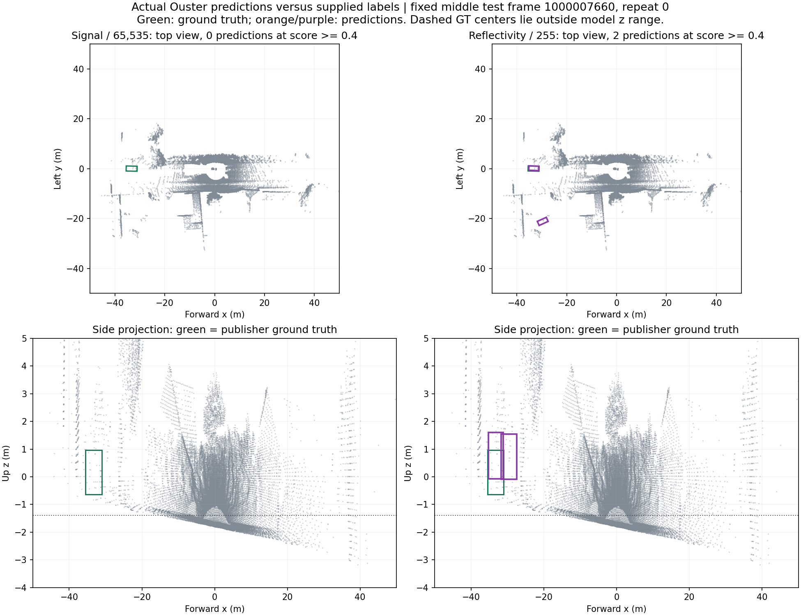

The bounded-pillar control removes empty/nonempty repeat changes but preserves the four-versus-zero Vehicle BEV result and zero qualifying 3D matches. It does not generally improve precision. These observations support further capacity investigation without establishing a complete correction.

The earlier labeled KITTI baseline also has zero moderate 3D matches. A separate TensorRT 8 compatibility comparison reproduces poor accuracy and elevated centers. Together, these findings motivate investigation of shared input/model assumptions rather than attributing the result to the API migration alone.

## 7. Discussion

Reflectivity/255 is the better supported development baseline for this fixed comparison. It is not a universal claim about every signal normalization, sensor profile or model. The measured BEV precision and recall are low, and both tested configurations fail the declared 3D criteria.

Numerical completion, repeatability and accuracy answer different questions. Signal often produces empty outputs at score 0.4; those outputs must not be credited as perfect object stability. A successful ROS replay establishes message flow, not correct objects. Likewise, the short direct inference/NMS timings exclude full sensor-to-consumer latency.

The vertical displacement is a measured symptom, not a validated constant correction. An empirical z shift fitted after viewing test labels would change the evaluation question and risk hiding input/training incompatibility. The next work should trace sensor origin, coordinate conventions, anchor/decoder behavior and training preprocessing against a verified reference.

## 8. Limitations and validity

- The labeled subset is small and comes from one collection; the split is not established as drive-disjoint.
- The 64-beam weather sensor and 128-beam labeled sensor differ. There is no labeled weather-accuracy claim.
- Publisher annotations are independent of this study's outputs but are not perfect metrology.
- Frame-level bootstrap intervals assume independence that temporal correlation may weaken.
- Internal pillar capacity is exceeded in 20 of 32 primary labeled scans; the separate control does not resolve every implementation concern.
- The current runtime does not implement bounded latest-frame scheduling, a sustained real-time benchmark or full memory/failure acceptance.
- The direct comparison uses unchanged production inference/NMS, but does not certify the complete ROS A/B transport path. The initial large-cloud UDP attempt was incomplete and excluded.

### Follow-up diagnosis — 9 November 2026

The [new multi-agent investigation](DETECTION_INVESTIGATION_AND_PLAN.md) verifies the exact model and label hashes but finds no version-specific training manifest. The shared NVIDIA model card describes proprietary solid-state LiDAR data; this supports a domain-compatibility concern without proving the exact v1.1 training sensor or data.

| Separate check | Result and limit |
| --- | --- |
| Packaged decoder | Three known encodings return the expected geometric-center z; no universal bottom/center correction is supported. |
| Tiny voxel controls | Expected ten features match; zero XYZ returns change cluster means. Overflow is not tested. |
| KITTI tuning geometry | Car boxes retain 34,698/41,329 counted points in the model ROI; 6,618 fall below the lower z bound inside XY. Counts may include background/overlap and do not prove the cause of inaccurate boxes. |
| New production controls | Eighteen inferences on two unlabeled Ouster scans compare original, nonzero-only and bounded inputs. Bounded repeated outputs match at tolerance 0.001; zero removal alone is not consistently better. This is repeatability, not accuracy or bitwise output identity. |

A small offline CPU preparation helper now supports explicit bounded selection while preserving retained XYZI bits/order. Its default is passthrough; the live detector and adapter are unchanged. Independent C++/Python outputs match on both real scans. Fresh regression119 tests and CPU CTest3/3 pass; review corrected an optional-target dependency on files excluded from the Docker context. These controls are separate from the frozen 1,120-observation study. A trusted training/export reference and compatible target-sensor evaluation remain necessary before claiming an accuracy repair.

## 9. Conclusion and next work

The project demonstrates a working migration and an auditable evaluation workflow. The channel study favors reflectivity/255 as an experimental input for the tested configuration, while rejecting an accuracy-acceptance claim for either current 3D detector configuration.

The next stages are explicit valid-return/capacity handling, investigation of the vertical/input-training mismatch, an Ouster-compatible model or fine-tuning if needed, and a fresh recording-disjoint evaluation with agreed targets. Worker/QoS/timing work should then be validated under sustained load rather than inferred from mean GPU time.

<!-- BEGIN ILLUSTRATED CASEBOOK -->
## Appendix A. Illustrated problem and solution casebook

Each case answers five questions: what happened, why it happened, what small steps were taken, what checked the result, and what remains open. A successful software check is kept separate from a successful accuracy result.

Each problem has an editable table showing the observed condition and the recorded outcome. Selected flowcharts explain validation, startup, shutdown, transport and evaluation. These diagrams explain the recorded implementation or method; they are not screenshots of an experiment. New controlled checks use isolated fixtures, and a mock Docker service does not mean a real container failed. Preserved logs, source reviews and unresolved conditions remain clearly labeled. Original RViz captures and two genuine terminal demonstrations are retained where they help explain the evidence.

Unsafe physical failures were not recreated: no disk was filled, no display driver was deliberately broken, and no source bag or annotation was damaged. Where only supplied-log summaries survive, that is stated. The six new raw-signal/reflectivity GPU demonstrations are separate from the frozen 1,120-observation accuracy/numerical study; they do not add independent labeled scenes or establish accuracy.

### J01. Old OS, ROS and build settings

**What happened:** The old build combined C++14 settings with an explicit C++11 flag, old CUDA paths and a Foxy-era dependency layout.

**Why:** Those settings described another software stack. The migration made CPU tests independent and declared ROS and GPU dependencies only for targets that need them.

**Small steps:**

1. Read the old CMake file without changing the checkout.
2. Select C++17 and explicit target dependencies.
3. Configure the CPU-only build with runtime and ROS adapter disabled.
4. Build and run the geometry and output-contract controls before enabling ROS/GPU targets.

**Check:** A fresh isolated current-source CPU configuration and build succeeded on 9 November; both test executables passed. Legacy CMake was inspected through git show 2301135:CMakeLists.txt.

**What remains open:** This does not validate a fresh host installation, another GPU or exact inference parity.

**Evidence type:** Source-based explanation.

| What was observed | Recorded outcome |
| --- | --- |
| Old source mixes C++14 and C++11 settings and hardcoded CUDA paths. | Current CPU-only targets configure and build independently; focused checks pass. |

**Evidence files:** `CMakeLists.txt`, `PROJECT_REVIEW_AND_UPDATE_PLAN.md`, `docs/PROJECT_HISTORY_AND_DECISION_RECORD.md`, `.recovery/verification/thesis-evidence-2026-11-09/migration/cpu-configure.log`, `.recovery/verification/thesis-evidence-2026-11-09/migration/cpu-build.log`.

### J02. Old include and ROS message schema

**What happened:** The source included a nonexistent local point_cloud2_iterator.hpp and wrote obsolete hypothesis fields.

**Why:** Jazzy stores class ID and score inside hypothesis. Removing the unused include is separate from correctly translating box and header data.

**Small steps:**

1. Remove the unused nonexistent include.
2. Construct the current nested Jazzy hypothesis fields.
3. Copy the source header to the array and each detection.
4. Check dimensions, pose and class ID using a small known box.

**Check:** A safe compiler-only control of the missing include exited 1 with a real fatal error. The freshly compiled current-code probe then emitted class_id=1, source_frame=lidar and the fixture timestamp; the ROS data suite passed.

**What remains open:** The old full node was not executed; this is a controlled include failure and a current-schema control.

**Evidence type:** New controlled reproduction.

| What was observed | Recorded outcome |
| --- | --- |
| Compiler-only old-include control: the referenced header cannot be found. | Current production validator constructs Jazzy nested hypotheses and preserves the fixture header. |

**Evidence files:** `PROJECT_REVIEW_AND_UPDATE_PLAN.md`, `src/pointcloud_adapter.cpp`, `tests/ros/test_ros_adapter.cpp`, `.recovery/verification/thesis-evidence-2026-11-09/migration/J02-original-include-control.log`, `.recovery/verification/thesis-evidence-2026-11-09/migration/production-validator-probe.log`.

### J03. Malformed, oversized and nonfinite clouds

**What happened:** Malformed rows, missing fields, excessive point counts or NaNs could make point-cloud conversion unsafe or misleading.

**Why:** A PointCloud2 message has a binary layout. Validate dimensions, strides, field bounds and capacity before conversion; is_dense alone is not proof that points are finite.

**Small steps:**

1. Check width, height, point_step, row_step and exact data length.
2. Require nonoverlapping scalar little-endian FLOAT32 x/y/z/intensity fields.
3. Reject point or byte capacity overflow before allocation.
4. Remove nonfinite points even when is_dense is true.
5. Require a finite positive intensity divisor and clear stale packed output on failure.

**Check:** The fresh production-code probe printed exact layout, capacity, missing-field, endian and divisor rejections. Repairing row_step accepted four points; inserting one NaN packed three. All 11 existing ROS data controls passed.

**What remains open:** Finite all-zero invalid returns are not removed here. Total point limits do not enforce the internal pillar limits.

**Evidence type:** New controlled reproduction.

| What was observed | Recorded outcome |
| --- | --- |
| Invalid row stride, point capacity, field layout, byte order or divisor is rejected. | Correct padded rows pack four points; one NaN reduces the packed cloud to three. |

**How this part works:**

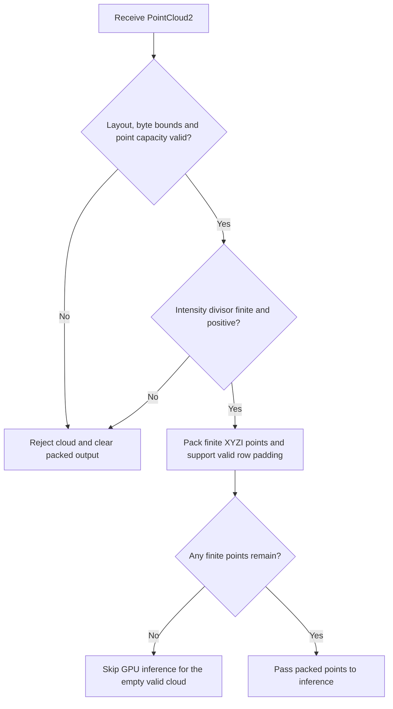

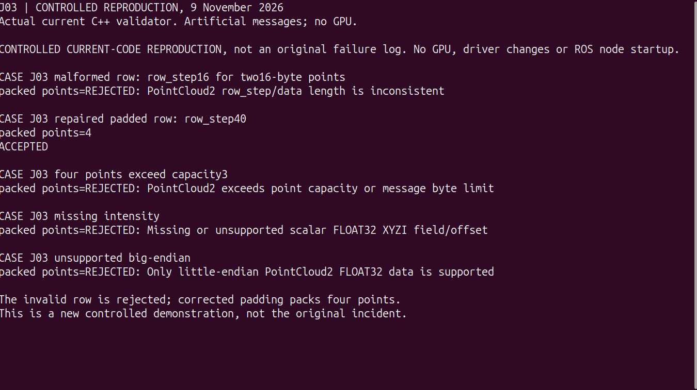

Actual new terminal capture: the current C++ validator rejects an artificial malformed row and accepts corrected padding. Other invalid-layout controls are shown. No GPU or ROS node is created.

**Evidence files:** `src/pointcloud_adapter.cpp`, `include/pp_infer/model_contract.hpp`, `tests/ros/test_ros_adapter.cpp`, `.recovery/verification/thesis-evidence-2026-11-09/migration/production-validator-probe.log`, `.recovery/verification/thesis-evidence-2026-11-09/migration/ros-data.log`.

### J04. Degenerate overlap and unstable filtering

**What happened:** Degenerate boxes, unstable overlap calculations or stale outputs could undermine filtering.

**Why:** Rotated IoU needs robust geometry handling. Suppression should reject invalid configuration, preserve deterministic score ties and replace previous-frame output even for an empty frame.

**Small steps:**

1. Validate finite centers, dimensions and yaw; require positive dimensions.
2. Compute rotated overlap using bounded polygon clipping.
3. Validate IoU threshold and top-N before suppression.
4. Use stable score ordering and clear the output on every attempt.
5. Check touching, contained, rotated, degenerate and random boxes.

**Check:** The current-source probe returned IoU=0 for zero-length geometry, rejected a negative NMS threshold and changed a one-box output to zero on an empty frame. Fresh geometry tests passed 15 cases including 2,000 randomized comparisons.

**What remains open:** Robust suppression does not move inaccurate boxes or establish detector accuracy.

**Evidence type:** New controlled reproduction.

| What was observed | Recorded outcome |
| --- | --- |
| Negative NMS threshold is rejected; zero-length geometry safely yields zero overlap. | Valid suppression returns one box; a subsequent empty input clears it. |

**Evidence files:** `src/postprocess.cpp`, `tests/core/test_postprocess.cpp`, `.recovery/verification/thesis-evidence-2026-11-09/migration/production-validator-probe.log`, `.recovery/verification/thesis-evidence-2026-11-09/migration/cpu-geometry.log`.

### J05. Cross-class suppression policy

**What happened:** Two overlapping predictions with different class IDs can suppress each other.

**Why:** Production NMS intentionally remains class-agnostic. The CPU core has a class-aware option, but it is not the current production policy or a demonstrated accuracy improvement.

**Small steps:**

1. Create two boxes with identical footprints and different class IDs.
2. Run the current default NMS and record the retained count.
3. Run the core class-aware option on the same candidates.
4. Keep the production policy explicit; evaluate a proposed change on tuning data before deployment.

**Check:** The fresh current-source probe retained one box with the default and two with the class-aware option; the existing same-class/cross-class regression passed.

**What remains open:** No production policy was changed, and no class-aware accuracy advantage has been measured.

**Evidence type:** New controlled reproduction.

| What was observed | Recorded outcome |
| --- | --- |
| Default class-agnostic NMS keeps one of two overlapping boxes with different classes. | The diagnostic core class-aware option keeps both; production was not changed. |

**Evidence files:** `src/postprocess.cpp`, `tests/core/test_postprocess.cpp`, `.recovery/verification/thesis-evidence-2026-11-09/migration/production-validator-probe.log`.

### J06. Session and usage interruption

**What happened:** A usage/session interruption can lose the next action and confuse what was actually tested.

**Why:** Recovery saves eligible source, hashes, separate patches and a handoff. Its evidence text is caller-reported, not a substitute for test execution.

**Small steps:**

1. Save a checkpoint before a coherent change or long operation.
2. Record the next action and actual verification commands.
3. On return, read RESUME, PROGRESS and the task ledger.
4. Run recovery status and inspect Git drift before continuing.
5. Back up ignored large artifacts separately.

**Check:** All 12 recovery tests passed in isolated temporary repositories. A deliberate corruption in a temporary checkpoint produced the actual Integrity: FAILED status with exit 1.

**What remains open:** A local source checkpoint does not buy credits, resume an unavailable model or back up models, bags, engines and the whole machine.

**Evidence type:** New controlled reproduction.

| What was observed | Recorded outcome |
| --- | --- |
| Intentional corruption of an isolated checkpoint produces Integrity: FAILED. | The helper detects corrupted checkpoint content; all 12 isolated regression tests pass. |

**Evidence files:** `tools/recovery.py`, `tests/test_recovery.py`, `recovery/RESUME.md`, `.recovery/verification/thesis-evidence-2026-11-09/migration/recovery-tests.log`, `.recovery/verification/thesis-evidence-2026-11-09/migration/J06-integrity-failure-control.log`.

### J07. Checkpoint directory replaced by a file

**What happened:** A tracked directory replaced by a regular file made looking up its former child raise NotADirectoryError.

**Why:** A deleted child path may have a parent that is now a file. Snapshot collection must record that child as deleted while saving the replacement.

**Small steps:**

1. Use a temporary repository with a tracked directory and child file.
2. Replace the directory with a regular file.
3. Catch NotADirectoryError alongside FileNotFoundError during path inspection.
4. Verify the old child is marked deleted and the replacement content is saved.

**Check:** The isolated fixture recorded component/old.cpp as deleted and saved the replacement component file. Its dedicated regression and the complete 12-test recovery suite passed.

**What remains open:** This tests the corrected current behavior; it is not a rerun of the historical buggy implementation.

**Evidence type:** New controlled reproduction.

| What was observed | Recorded outcome |
| --- | --- |
| A temporary tracked directory is replaced with a regular file. | Current checkpoint records the child as deleted and saves the replacement. |

**Evidence files:** `tools/recovery.py`, `tests/test_recovery.py`, `.recovery/verification/thesis-evidence-2026-11-09/migration/J07-directory-to-file-control.log`.

### J08. GPU query failed inside the sandbox

**What happened:** An early nvidia-smi query failed inside the restricted execution environment.

**Why:** The sandbox did not expose NVIDIA device nodes. A host-accessible read-only query showed the laptop GPU and working driver; the early query did not justify reinstalling the driver.

**Small steps:**

1. Check whether the execution environment exposes the GPU devices.
2. Compare with an authorized host-side read-only GPU query.
3. Record which environment produced each result.
4. Continue GPU tests in the environment with actual device access.

**Check:** The saved environment inventory records RTX 4060 Laptop, 8,188 MiB and driver 595.71.05 outside the sandbox. No new GPU isolation failure was induced.

**What remains open:** This is distinct from the later physical-host driver mismatch. The historical inventory alone is not current hardware health.

**Evidence type:** Preserved historical evidence.

| What was observed | Recorded outcome |
| --- | --- |
| Historical sandbox query could not see NVIDIA device nodes. | Saved host-accessible inventory records the working RTX 4060 and driver. |

**Evidence files:** `config/environment_inventory.json`, `docs/PROJECT_HISTORY_AND_DECISION_RECORD.md`, `recovery/PROGRESS.md`.

### J09. Physical-host kernel and NVIDIA driver mismatch

**What happened:** On the separate alfonso-h017 host, NVIDIA modules did not match the running kernel.

**Why:** User-supplied physical-host logs reported a real kernel/driver mismatch, unlike the laptop sandbox access issue. Matching branch-595 open modules and driver plus reboot reportedly restored access.

**Small steps:**

1. Inspect the actual GPU, running kernel and installed module packages.
2. Simulate the package transaction and check mixed Ubuntu/CUDA sources.
3. Install only the compatible kernel-module/driver set identified for that host.
4. Reboot, then verify GPU access before starting ROS.

**Check:** The physical-host repair record reports restored GPU access. This documentation task did not reinstall drivers or reproduce the fault.

**What remains open:** Later live inference and accuracy on that RTX A4500 Embedded host remain unverified by the supplied logs. These steps are historical, not a universal driver prescription.

**Evidence type:** Preserved historical evidence.

| What was observed | Recorded outcome |
| --- | --- |
| Separate physical host: installed NVIDIA modules did not match its kernel. | Supplied-log summary reports compatible modules/driver and reboot restored access. |

**Evidence files:** `docs/LIVE_OUSTER_TROUBLESHOOTING.md`.

### J10. Ouster Fast CDR serialization symbol failure

**What happened:** The Ouster drivers reported an undefined Fast CDR serialization symbol on the physical host.

**Why:** The driver and ROS/DDS serialization packages were incompatible. The supplied logs reported that updating the compatible package group restored launch.

**Small steps:**

1. Stop the affected ROS nodes.
2. Inspect versions of ouster-ros, ouster-sensor-msgs, fastcdr, fastrtps and typesupport/RMW packages.
3. Update a compatible group after reviewing package resolution.
4. Start the driver and check its actual topic schema.

**Check:** The physical-host record reports launch recovery and an observed 128x1024 cloud with signal and reflectivity but no intensity. No serialization library fault was deliberately created.

**What remains open:** Updating one arbitrary library is not a reproducible general fix. Successful driver launch is not successful model inference.

**Evidence type:** Preserved historical evidence.

| What was observed | Recorded outcome |
| --- | --- |
| Separate physical host: Ouster driver reports an undefined serialization symbol. | Supplied-log summary reports compatible Ouster/ROS/DDS packages restored launch. |

**Evidence files:** `docs/LIVE_OUSTER_TROUBLESHOOTING.md`.

### J11. Model and plugin compatibility uncertainty

**What happened:** A pretrained ONNX was available, but compatible TensorRT libraries and required plugin creators were not established.

**Why:** A trained model still needs an inference runtime and plugins. TensorRT 10.16.1.11 was verified with the exact model; the proposed TensorRT 11 package was not treated as a drop-in replacement.

**Small steps:**

1. Hash and inventory the ONNX and any separate trainable artifact.
2. Inspect input/output tensor metadata.
3. Check VoxelGeneratorPlugin, PillarScatterPlugin and DecodeBbox3DPlugin creators.
4. Parse the exact ONNX and build a target-GPU engine.
5. Run a synthetic smoke test after actual linking.

**Check:** The historical runtime inventory and smoke log record all three creators, successful engine creation and ten synthetic frames. No model, SDK or GPU experiment was rerun for this case.

**What remains open:** Structural and smoke checks do not prove original training parity, object accuracy or TensorRT 11 compatibility.

**Evidence type:** Preserved historical evidence.

| What was observed | Recorded outcome |
| --- | --- |
| An ONNX alone does not establish compatible runtime and plugin availability. | Saved actual SDK smoke reports repeated inference, capacity rejection and empty-result checks. |

**Evidence files:** `config/model_inventory.json`, `config/runtime_inventory.json`, `.recovery/verification/w04-gpu-smoke.txt`, `.recovery/verification/w01-engine-build.txt`.

### J12. System TensorRT installation unavailable

**What happened:** System SDK installation could not proceed through the intended sudo-based route.

**Why:** The actual native workaround extracted the repository DEB and selected component package data into a local SDK, without running maintainer scripts or registering host packages. Docker later used a separate package-install recipe.

**Small steps:**

1. Verify the downloaded repository DEB hash.
2. Extract it into a dedicated local SDK directory.
3. Extract compatible shared libraries, headers and tools; omit unused static archives.
4. Source the local environment helper.
5. Verify the actual plugin registry and linker/runtime before inference.

**Check:** The historical runtime inventory and SDK build/smoke records identify the local extracted SDK and successful native execution. No extraction or host install was repeated.

**What remains open:** Local extraction does not create a complete system package installation. SDK binaries and installers are excluded from source checkpoints.

**Evidence type:** Source-based explanation.

| What was observed | Recorded outcome |
| --- | --- |
| Normal system SDK installation was unavailable through the intended sudo route. | Recorded native method uses a local extracted SDK; Docker later installs its own packages. |

**Evidence files:** `docs/local_runtime.md`, `tools/env_tensorrt.sh`, `config/runtime_inventory.json`, `.recovery/verification/w04-sdk-build.txt`.

### J13. Binding-position and engine assumptions

**What happened:** The old runtime depended on binding positions and assumed an engine interface.

**Why:** A deserialized engine is not automatically compatible. The migrated runtime checks names, roles, types, format, device location, shapes, profile and capacity before binding tensors.

**Small steps:**

1. Require the supported four named I/O tensors and one profile.
2. Check FLOAT32/INT32 types, device locations and linear format.
3. Resolve the batch-one shapes and verify capacities.
4. Set named tensor addresses and execute enqueueV3.
5. Reject an incompatible engine before processing clouds.

**Check:** Current source was inspected; the historical SDK configure/build/smoke logs record actual TensorRT 10 execution. Fresh output-contract tests also passed, but do not instantiate an incompatible GPU engine.

**What remains open:** A full incompatible-engine matrix and exact original-model numerical parity remain incomplete.

**Evidence type:** Source-based explanation.

| What was observed | Recorded outcome |
| --- | --- |
| A positional engine assumption does not validate tensor identity or capacity. | Current runtime checks named roles, types, format and resolved shapes before inference. |

**Evidence files:** `src/pointpillar.cpp`, `include/pp_infer/model_contract.hpp`, `.recovery/verification/w04-sdk-configure.txt`, `.recovery/verification/w04-gpu-smoke.txt`.

### J14. Repeated allocation and stream ownership

**What happened:** Per-frame allocations, resource lifetime ambiguity and unchecked output counts could create stale data or unsafe copies.

**Why:** Owned persistent resources remove repeated allocation. The runtime copies the result count first, checks it against capacity and only then copies box rows; serious GPU-work failure latches the runtime as faulted.

**Small steps:**

1. Create and own the runtime, engine, context, stream and buffers once.
2. Reuse buffers and clear input padding/output count for each cloud.
3. Copy and validate the output count before copying rows.
4. Validate decoded classes, geometry and scores before publication.
5. Drain work during failure unwinding and require restart after a fault.

**Check:** The freshly compiled probe rejected counts -1 and 11 for capacity 10, then accepted count 10. Fresh output-contract tests passed; historical GPU smoke exercised repeated inference and cleanup.

**What remains open:** The current probe validates pure CPU count behavior, not injected GPU faults or complete resource/memory safety.

**Evidence type:** New controlled reproduction.

| What was observed | Recorded outcome |
| --- | --- |
| Counts below zero or above engine capacity are rejected before box-row transfer. | A count equal to capacity is accepted; GPU fault handling remains a separate limit. |

**Evidence files:** `src/pointpillar.cpp`, `include/pp_infer/cuda_resources.hpp`, `include/pp_infer/output_contract.hpp`, `tests/runtime/test_output_contract.cpp`, `.recovery/verification/thesis-evidence-2026-11-09/migration/production-validator-probe.log`, `.recovery/verification/thesis-evidence-2026-11-09/migration/cpu-output-contract.log`.

### J15. Real SDK version-macro and profiler incompatibilities

**What happened:** Actual TensorRT headers used macro aliases, and TensorRT 10.16 rejected setting the context profiler to null.

**Why:** Parsing a literal version from a header was insufficient. The build now asks the preprocessor; the runtime keeps an owned profiler attached and gates its accumulation.

**Small steps:**

1. Evaluate NV_TENSORRT_MAJOR with a compiler preprocessor guard.
2. Reject unsupported major versions before building the runtime.
3. Keep the profiler alive for the context lifetime.
4. Toggle accumulation instead of passing null.
5. Run actual SDK smoke checks; record callback overhead as unresolved.

**Check:** A compiler-only control using macro aliases rejected major 8 with TensorRT 10 required and accepted major 10. The historical record explains the null-profiler failure and subsequent GPU smoke success.

**What remains open:** The null-profiler GPU failure was not rerun. Callback overhead is not proven absent when timing accumulation is disabled.

**Evidence type:** New controlled reproduction.

| What was observed | Recorded outcome |
| --- | --- |
| Synthetic major-8 header is rejected by the same preprocessor guard used in CMake. | Macro-aliased major 10 passes; historical null-profiler fix retains an owned profiler. |

**Evidence files:** `CMakeLists.txt`, `src/pointpillar.cpp`, `recovery/PROGRESS.md`, `.recovery/verification/thesis-evidence-2026-11-09/migration/J15-version-8-control.log`, `.recovery/verification/thesis-evidence-2026-11-09/migration/J15-version-10-control.log`, `.recovery/verification/w04-gpu-smoke.txt`.

### J16. Build, ROS logging and shell setup blockers

**What happened:** ROS builds needed C/MPI target support, writable logging and compatible shell setup; an unsourced probe could not load librclcpp.so.

**Why:** Different blockers occurred at different layers. Enable C only for ROS/PCL targets, give tests a writable ROS_LOG_DIR and relax nounset only while sourcing generated setup scripts. Native executables also need the ROS library environment.

**Small steps:**

1. Keep the standalone CPU build independent of ROS/PCL.
2. Enable C in the ROS build path to satisfy exported MPI targets.
3. Use a build-local writable ROS log directory.
4. Source ROS and the overlay with scoped nounset relaxation.
5. Rerun the same executable and compare the actual failure and success.

**Check:** On 9 November the isolated compiled probe really exited 127 with missing librclcpp.so before ROS setup. The same executable succeeded after sourcing Jazzy. The fresh CPU configure and existing ROS data tests also passed.

**What remains open:** The newly observed loader failure is a controlled environment mistake, not a claimed replay of the original MPI/logging failure. No system package change was made.

**Evidence type:** New controlled reproduction.

| What was observed | Recorded outcome |
| --- | --- |
| New isolated executable really fails to load librclcpp.so without ROS setup. | Sourcing Jazzy allows the same executable to run all current validator controls. |

**Evidence files:** `CMakeLists.txt`, `docker/entrypoint.sh`, `.recovery/verification/thesis-evidence-2026-11-09/migration/J16-unsourced-probe-failure.log`, `.recovery/verification/thesis-evidence-2026-11-09/migration/production-validator-probe.log`, `.recovery/verification/w04-sdk-configure.txt`.

### J17. Sanitizer coverage limitations

**What happened:** Some sanitizer runs could not support the requested coverage; ROS node creation exposed an allocator type mismatch and early GPU instrumentation failed.

**Why:** A sanitizer result has a limited scope. The record separates passing CPU/data checks, distribution ROS allocator behavior, unavailable leak checking and incomplete GPU memory acceptance.

**Small steps:**

1. Run focused CPU address/undefined-behavior checks in a separate build.
2. Record why LeakSanitizer is disabled in the traced environment.
3. Keep the original ROS allocator mismatch log.
4. Test parameter construction normally and instrument data paths separately.
5. Distinguish the failed early GPU instrumentation from the later two zero-error allocation probes.

**Check:** The original saved log contains AddressSanitizer new-delete-type-mismatch through rcutils_string_map_fini. The early Compute Sanitizer log says the application terminated before its first instrumented call. Later reference records report two zero-error allocation checks. No harmful allocator/sanitizer environment was recreated.

**What remains open:** Two allocation probes do not clear internal pooled tensor bounds, races or full GPU failure acceptance. The original allocator error was not hidden with blanket suppression.

**Evidence type:** Preserved historical evidence.

| What was observed | Recorded outcome |
| --- | --- |
| Saved ASan trace reports new-delete-type-mismatch in the installed ROS allocator. | Focused data checks and normal parameter checks are separated; full sanitizer acceptance remains open. |

**Evidence files:** `.recovery/verification/w03-system-allocator-asan.txt`, `.recovery/verification/w03-sanitized-data.txt`, `.recovery/verification/w05-gpu-memcheck.txt`, `docs/MODEL_REFERENCE_COMPARISON.md`, `CMakeLists.txt`.

### J18. Dependency resolution and disk-full builds

**What happened:** Docker package resolution mixed CUDA variants, and bulky build inputs exhausted storage in earlier attempts.

**Why:** Pinning only top-level TensorRT packages let dependencies select another CUDA variant. Shared-library/header-only component selection reduced unused static/development content. Disk space for Docker is separate from the source drive.

**Small steps:**

1. Inspect the resolver error and exact conflicting package variants.
2. Pin the compatible lean, dispatch and plugin dependencies too.
3. Install only required CUDA components and shared/header packages.
4. Check the actual Docker storage filesystem before rebuilding.
5. Remove only identified disposable task-owned cache, then rerun the build.

**Check:** The preserved automatic-deploy-first-failure log genuinely reports cuda12.9 dependencies with cuda13.2 candidates and exit 100. The current Dockerfile explicitly pins the compatible group; later saved full builds passed. Disk-full history is documented, not deliberately reproduced.

**What remains open:** No fresh package installation or disk-full fault was induced. Base tags and all apt dependencies are not a fully hermetic supply chain.

**Evidence type:** Preserved historical evidence.

| What was observed | Recorded outcome |
| --- | --- |
| Saved Docker resolver error mixes required cuda12.9 with selected cuda13.2 dependencies. | Current Dockerfile pins the compatible group; later recorded full builds pass. |

**Evidence files:** `Dockerfile`, `.recovery/verification/automatic-deploy-first-failure.txt`, `.recovery/verification/automatic-dockerfile-only-build.txt`, `docs/PROJECT_HISTORY_AND_DECISION_RECORD.md`, `config/docker_inventory.json`.

### J19. Build an engine for the selected GPU, then reuse it

**What happened:** A saved engine could be missing, built for another GPU, or left incomplete after an interrupted build.

**Why:** A TensorRT engine is tied to its deployment conditions. The image contains the trained ONNX; startup builds a matching execution plan and keeps it in persistent storage.

**Small steps:**

1. Check the selected GPU and retain the ONNX checksum.
2. Calculate the cache identity from model, GPU, driver/CUDA and build settings.
3. Acquire the engine-file lock before checking or building that entry.
4. Build into a pending file, and promote it only after trtexec succeeds.
5. On interruption, stop the builder and remove its pending file.
6. Reuse the matching completed engine on the next startup.

**Check:** Historical startup/restart logs record one engine generation across two successful starts. The present audit rereads the cache and cleanup implementation; it does not rebuild an engine.

**What remains open:** A nonempty corrupted engine is not automatically regenerated. Cross-GPU portability and exhaustive interruption/failure paths remain unaccepted.

**Evidence type:** Preserved historical evidence.

| What was observed | Recorded outcome |
| --- | --- |
| A matching engine was absent at the first recorded startup. | The engine was generated once and reused after restart. Interrupted pending files are removed; corrupted completed-cache recovery remains open. |

**How this part works:**

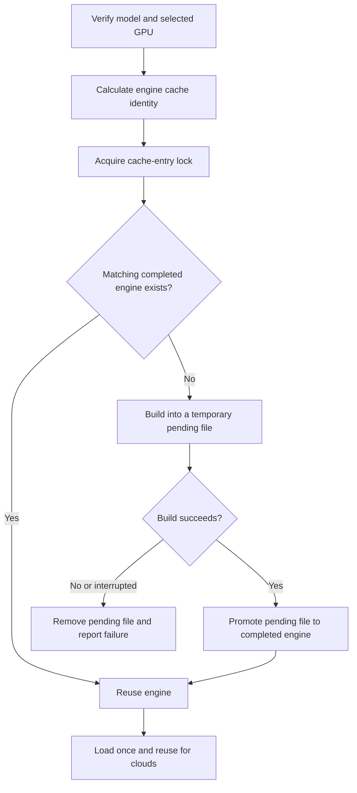

**Evidence files:** `config/docker_inventory.json`, `docker/entrypoint.sh`, `recovery/PROGRESS.md`.

### J20. Stop rebuilding unchanged application inputs

**What happened:** The user saw repeated dependency downloads after edits, and local edits could be absent from a remote-source image.

**Why:** Image preparation, dependency layers and target-GPU engine generation use different caches. Local runtime source is now the default; a matching runtime-input hash skips Docker build.

**Small steps:**

1. Check host GPU access and Docker before attempting the build.
2. Hash only the declared runtime source, build settings and configuration.
3. Compare the hash with the label on the saved image.
4. Skip the build when the hashes match; documentation edits do not change it.
5. When source changes, reuse independent dependency/model layers.
6. Refresh base images only when PP_PULL_BASE=1 is requested.

**Check:** Fresh isolated launcher tests passed reuse after documentation edits, rebuild after runtime edits, explicit pulls/remote source and custom-build-option cache separation. Docker and nvidia-smi are mocks in this rerun.

**What remains open:** First builds, removed caches or changed dependency recipes still require downloads. This fixture is not a new clean-machine Docker build.

**Evidence type:** New controlled reproduction.

| What was observed | Recorded outcome |
| --- | --- |
| The first fixture invocation requests an image build. | Unchanged inputs and a documentation-only edit skip the build; the recorded Docker calls show no rebuild. |

**Evidence files:** `tools/deploy.sh`, `Dockerfile`, `tests/test_deploy_launcher.py`, `config/launcher_fix_validation.json`, `.recovery/verification/thesis-evidence-2026-11-09/operations/deploy_launcher.stderr.log`, `.recovery/verification/thesis-evidence-2026-11-09/operations/observable-scenario-01.json`.

### J21. Make one Ctrl+C stop the owned pipeline

**What happened:** Several Ctrl+C presses were needed, and stopping by container name could target a later unrelated container.

**Why:** The launcher waits interruptibly, records its exact created container ID in a private directory and stops that ID. The Ouster supervisor owns both child process groups.

**Small steps:**

1. Create a private temporary directory for Docker to write the new container ID.
2. Start Docker without automatic signal forwarding and wait with Bash.
3. On Ctrl+C, read and validate the owned ID.
4. Ask Docker to stop that ID with an eight-second cleanup bound.
5. Stop both adapter/detector process groups when either exits.
6. Remove the temporary ID file while retaining the image and good engine cache.

**Check:** The fresh single-SIGINT fixture passed with a fake Docker client that deliberately ignores SIGINT. Fresh supervisor tests also passed peer failure, descendant cleanup and unexpected clean exit. Historical actual GPU launch shutdown took under 0.5 s per launcher.

**What remains open:** The fresh rerun uses isolated processes and mocked Docker; it is not proof for every hung host or application.

**Evidence type:** New controlled reproduction.

| What was observed | Recorded outcome |
| --- | --- |
| A private fake Docker run client deliberately ignores SIGINT. | One injected SIGINT returns 130 and requests stop for the exact owned ID. Its private CID directory is removed. |

**How this part works:**

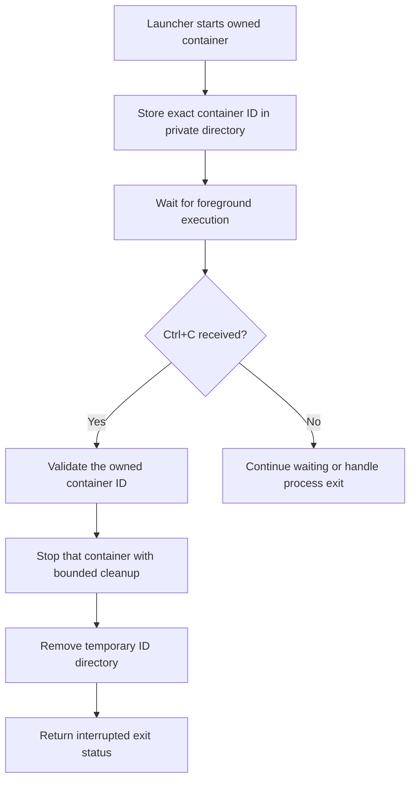

**Evidence files:** `tools/docker_foreground.sh`, `docker/ouster_stack.sh`, `tests/test_docker_foreground.py`, `tests/test_start_ouster.py`, `config/launcher_fix_validation.json`, `.recovery/verification/thesis-evidence-2026-11-09/operations/docker_foreground.stderr.log`, `.recovery/verification/thesis-evidence-2026-11-09/operations/start_ouster.stderr.log`, `.recovery/verification/thesis-evidence-2026-11-09/operations/observable-scenario-05.json`.

### J22. Recognize a running detector that has no input

**What happened:** The terminal became quiet after GPU information and appeared stalled.

**Why:** A cached engine and initialized node can wait normally until a driver or player publishes. Package/executable names and the ROS node name describe different things.

**Small steps:**

1. Inspect the detector log and ROS node information.
2. Confirm that the expected point-cloud topic has an active publisher.
3. Start exactly one intended driver or bag player.
4. Check adapter reception and detector processed/error counters.
5. Open RViz separately using the matching source settings.

**Check:** Historical synthetic and real-bag checks established a running node and later message round trips. Fresh monitor fixtures passed the distinction between a stopped container, a timed-out read and actual counter output.

**What remains open:** A quiet terminal alone cannot diagnose a stall; the fresh fixture does not start a real sensor or detector.

**Evidence type:** New controlled reproduction.

| What was observed | Recorded outcome |
| --- | --- |
| A stopped container and an unanswered monitor read provide no usable count. | The helper reports refusal or bounded timeout. A separate successful fixture reply is read; it is not scene data. |

**Evidence files:** `docs/STARTUP_AND_REPLAY.md`, `tools/monitor_detections.sh`, `tests/test_monitor_helper.py`, `recovery/PROGRESS.md`, `.recovery/verification/thesis-evidence-2026-11-09/operations/monitor_helper.stderr.log`, `.recovery/verification/thesis-evidence-2026-11-09/operations/observable-scenario-02.json`.

### J23. Match delivery policy as well as topic names

**What happened:** A host viewer received no clouds although container playback was active; best-effort sensor data also conflicted with reliable detector input.

**Why:** The recorded host/container shared-memory path did not deliver in that setup. UDPv4 restored delivery. A best-effort-only publisher generally cannot satisfy a reliable subscriber under DDS.

**Small steps:**

1. Inspect the publisher and subscriber QoS and their actual topic names.
2. For the recorded Fast DDS host/viewer setup, use the tested UDPv4 transport fallback.
3. Receive raw Ouster data with sensor-data best-effort QoS in the adapter.
4. Republish adapted XYZI reliably for the existing detector.
5. Verify received messages and increasing processing counters, rather than discovery alone.

**Check:** Historical observer checks matched 25 frames inside the container and 25 through the host after UDPv4 selection. The actual adapter source declares the two QoS policies. No fresh physical SHM fault was recreated.

**What remains open:** Transport behavior depends on the host/RMW setup. Detector-wide configurable sensor QoS and sustained overload delivery remain open.

**Evidence type:** Preserved historical evidence.

| What was observed | Recorded outcome |
| --- | --- |
| The recorded default host transport received no clouds within eight seconds. | UDPv4 restored host delivery; 25 input/output frames matched. The adapter separately bridges best-effort input to reliable output. |

**Evidence files:** `config/visualization_inventory.json`, `src/ouster_adapter_node.cpp`, `src/pp_inference_node.cpp`, `tools/visualize.sh`.

### J24. Keep the bag and live Ouster profiles separate

**What happened:** The live stack listened on a different raw topic, domain and middleware from the original-bag player; Zenoh had no reachable router.

**Why:** The mismatch combined /ouster1/points + domain 0 + Zenoh with /sensing/lidar/points + domain 99 + Fast DDS. Waiting longer could not align these settings.

**Small steps:**

1. Choose live mode only for a working driver using matching settings.
2. For the original MOSEP recording, start tools/start_ouster.sh bag.
3. Start tools/start_ouster_bag.sh in another terminal.
4. Keep topic, ROS_DOMAIN_ID and RMW_IMPLEMENTATION identical across participants.
5. Pass custom settings through sudo env when sudo would discard exports.

**Check:** Fresh isolated launcher/player tests passed shared Fast DDS/domain99/raw-topic defaults, custom routing and preservation of existing containers. Historical actual GPU replay also confirmed the corrected profile.

**What remains open:** The scripts do not start or repair a live driver or Zenoh router. Fixture success is separate from a current network test.

**Evidence type:** New controlled reproduction.

| What was observed | Recorded outcome |
| --- | --- |
| Live-mode invocation requests Zenoh, domain 0 and /ouster1/points. | Bag mode requests Fast DDS, domain 99 and /sensing/lidar/points, matching the player profile. This captures settings, not fresh discovery. |

**How this part works:**

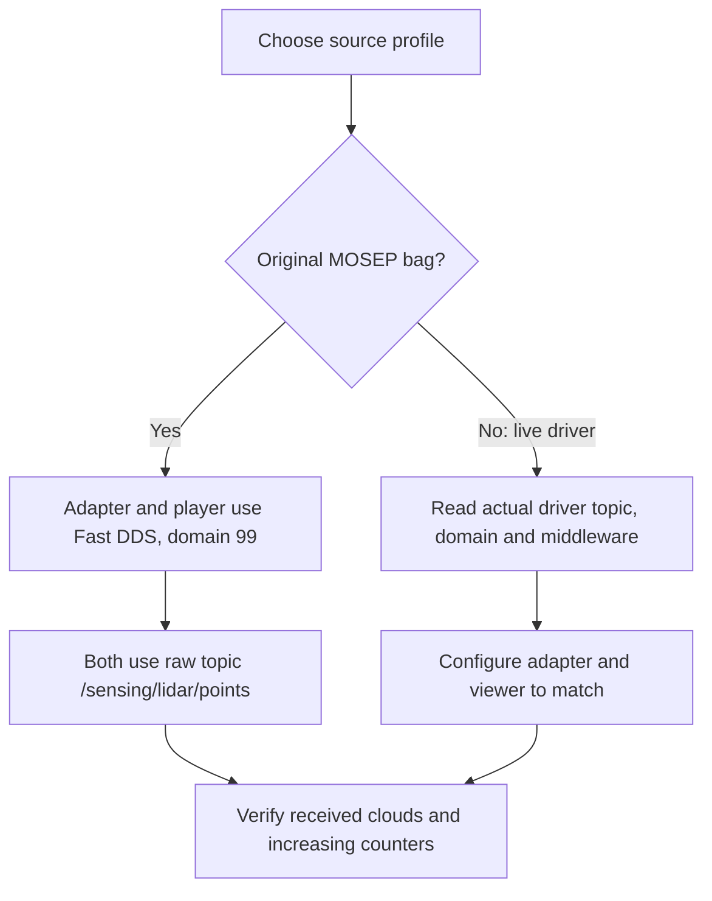

**Evidence files:** `tools/ouster_profile.sh`, `tools/start_ouster.sh`, `tools/start_ouster_bag.sh`, `tests/test_start_ouster.py`, `tests/test_start_ouster_bag.py`, `config/launcher_fix_validation.json`, `.recovery/verification/thesis-evidence-2026-11-09/operations/start_ouster.stderr.log`, `.recovery/verification/thesis-evidence-2026-11-09/operations/start_ouster_bag.stderr.log`, `.recovery/verification/thesis-evidence-2026-11-09/operations/observable-scenario-03.json`.

### J25. Treat the MCAP metadata warning according to observed playback

**What happened:** The player warned that rosbag2 metadata lacked serialized_metadata.

**Why:** The warning appeared while reading the publisher’s original MCAP, but actual playback still published clouds. It was not the established cause of the mismatched-topic failure.

**Small steps:**

1. Keep the original MCAP and metadata.yaml unchanged.
2. Read the player log to identify the exact warning.
3. Check whether raw clouds are actually arriving.
4. Check adapted-cloud and detector counters independently.
5. Record the warning alongside successful observations instead of suppressing or rewriting it.

**Check:** The original player log preserves the warning. The fresh visual observer matched 40 raw/adapted pairs and 39 detection headers; a later snapshot showed processing without input/inference errors. This audit does not rerun the player.

**What remains open:** That observed warning was nonfatal in the recorded replay; other playback errors still require separate diagnosis.

**Evidence type:** Preserved historical evidence.

| What was observed | Recorded outcome |
| --- | --- |
| The original player log reports missing serialized_metadata. | Independent historical observers still verify conversion and detector processing. The original bag is preserved. |

**Evidence files:** `.recovery/ouster-fresh-test/player.log`, `config/ouster_fresh_visual_validation.json`, `docs/FRESH_OUSTER_VISUAL_TEST.md`, `.recovery/verification/thesis-evidence-2026-11-09/operations/mcap-warning-excerpt.log`.

### J26. Open RViz with the right plugin, frame and paths

**What happened:** The Detection3DArray display plugin was missing, sensor-only bags had a TF warning, and moved paths broke generated configuration.

**Why:** The viewer needs its own desktop dependencies. Matching the real sensor frame is sufficient for shared points/boxes; inventing a world transform would hide missing information.

**Small steps:**

1. Install host ROS Jazzy/RViz or use the already prepared desktop.
2. Provide the official vision_msgs RViz plugin, through the system package or verified local extraction.
3. Run the viewer as the desktop user with matching domain/middleware.
4. Choose the actual cloud frame: velodyne for the recorded KITTI demo or lidar/os_lidar for MOSEP.
5. Quote paths containing spaces and regenerate native caches after relocation.
6. Use File → Open Config to update an existing RViz window.

**Check:** Historical actual rendering and isolated plugin bootstrap were verified, including a checkout path with spaces. Genuine RViz captures remain saved. No package installation or current desktop launch was performed for this rerun.

**What remains open:** A sensor-only bag may still lack a world TF tree. Rendering does not establish detection accuracy or complete multi-host portability.

**Evidence type:** Preserved historical evidence.

| What was observed | Recorded outcome |
| --- | --- |
| The recorded desktop lacked the required detection-display plugin and had sensor-only frame information. | The official plugin and actual sensor frame enabled the saved RViz view. No world transform was invented. |

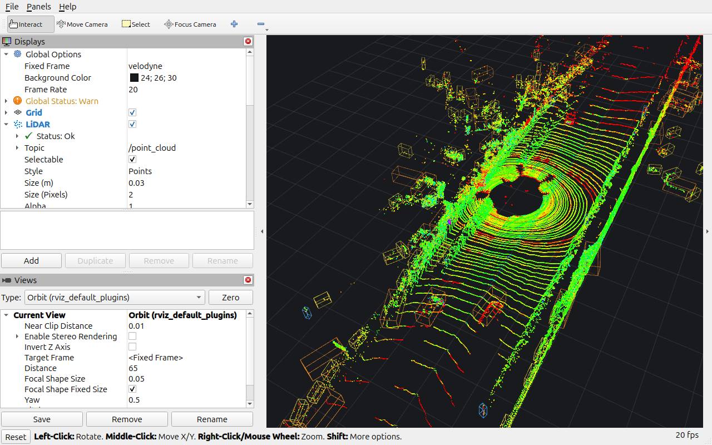

Original 2 October RViz capture after display/plugin and transport checks. KITTI data: Geiger et al., KIT/TTI-C, CC-BY-NC-SA-3.0. This is rendering evidence, not accuracy.

**Evidence files:** `tools/visualize.sh`, `config/visualization_inventory.json`, `docs/STARTUP_AND_REPLAY.md`, `.recovery/verification/rviz-current.png`, `.recovery/ouster-fresh-test/rviz-detections.png`.

### J27. Download only needed camera/data assets and resume safely

**What happened:** The first bag had no camera images, while original camera archives were large and downloads could be interrupted.

**Why:** Pinned source identities and checked HTTP ranges let the helper retrieve selected files. Complete checked assets are reused; corrupt completed files are preserved and reported.

**Small steps:**

1. Identify the original recording that produced the bag.
2. Pin the bag checksum and the remote archive object identity.
3. Fetch selected ZIP members with validated range responses and CRC checks.
4. Resume incomplete downloads and promote only verified pending files.
5. Encode and probe the camera video using the separate tool image.
6. Reuse verified completed assets instead of downloading them again.

**Check:** Fresh existing HTTP/range/resume/corruption/timestamp fixture tests passed. Historical actual downloads, MP4 encoding/full decoding and isolated playback remain separate evidence.

**What remains open:** These fixture tests use localhost data, not a new public dataset download. The camera video is unannotated scene context.

**Evidence type:** New controlled reproduction.

| What was observed | Recorded outcome |
| --- | --- |
| A localhost fixture server ignores the requested byte range; the real helper refuses its response. | A compliant fixture returns only selected archive ranges, and the real helper extracts the correct member with less than one quarter of archive bytes transferred. |

**Evidence files:** `tools/prepare_kitti_demo.py`, `tools/rosbag_demo.sh`, `tests/test_kitti_demo.py`, `config/demo_inventory.json`, `.recovery/verification/thesis-evidence-2026-11-09/operations/kitti_demo.stderr.log`, `.recovery/verification/thesis-evidence-2026-11-09/operations/observable-scenario-08.json`.

### J28. Keep camera playback separate from acquisition-time calibration

**What happened:** Camera and LiDAR streams had different counts, offsets or header clocks, so synchronized-looking playback could be misleading.

**Why:** Bag arrival order is not proof of synchronized acquisition. A 30 fps video can hold the same approximately 2 Hz camera image rather than contain new measurements.

**Small steps:**

1. Keep original message headers and bag-record timestamps.
2. Measure the first-frame offset and count the original observations.
3. Build the preview timeline by holding each original image for its recorded duration.
4. Preserve camera payloads and tie ordering in merged playback.
5. Display camera context separately unless extrinsic/time calibration is verified.
6. State that independent video/player speeds are not automatically synchronized.

**Check:** Fresh camera-timeline fixtures passed initial offsets, intervals, final hold, rejection of invalid timelines and preservation of SQLite payloads/timestamp ties. Historical records preserve 111 Ouster images/CameraInfo messages; KITTI offsets are reported separately.

**What remains open:** No calibrated detection-image overlay or acquisition-clock synchronization was established. Preview frame rate is not sensor measurement rate.

**Evidence type:** New controlled reproduction.

| What was observed | Recorded outcome |
| --- | --- |
| A synthetic image timestamp outside the selected interval is rejected. | Valid synthetic timestamps retain the initial gap, source-image interval and final hold. Playback coordination is not acquisition calibration. |

**Evidence files:** `tools/export_ouster_camera.py`, `tools/prepare_ouster_visual.py`, `tests/test_ouster_camera.py`, `config/ouster_camera_inventory.json`, `config/demo_inventory.json`, `config/kitti_front_inventory.json`, `.recovery/verification/thesis-evidence-2026-11-09/operations/ouster_camera.stderr.log`, `.recovery/verification/thesis-evidence-2026-11-09/operations/observable-scenario-06.json`.

### J29. Explain sparse Ouster views without creating points

**What happened:** The Ouster scene looked much sparser than the KITTI view after normalization.

**Why:** The original 32,768-entry scans included 13,206–15,775 zero-range/zero-XYZ returns. Orbit distance, point size and feature coloring also changed appearance; normalization had not moved the retained geometry.

**Small steps:**

1. Count the source entries and invalid zero returns before changing the display.
2. Compare XYZ and other non-intensity bytes between source and adapted streams.
3. Publish a separate original-data topic for visual comparison.
4. Use a closer orbit and larger flat-color points to inspect geometry.
5. Keep zero returns and the original recordings unchanged in this visualization path.

**Check:** The historical detail audit reports five matching live clouds with every non-intensity byte preserved. Source/input counts and display settings are recorded in the detail inventory. No synthetic denser cloud or new inference input was created.

**What remains open:** The raw-view adjustment improves inspection, not scene density or model accuracy. Invalid-return preprocessing remains a separate research change.

**Evidence type:** Preserved historical evidence.

| What was observed | Recorded outcome |
| --- | --- |
| The original Ouster scans include many zero returns; a distant small-point view looks sparse. | The raw-data view preserves geometry and uses a closer, brighter display. No denser scene was synthesized. |

**Evidence files:** `docs/FRONTAL_COMPARISON_AND_RVIZ_DETAIL.md`, `config/ouster_detail_inventory.json`, `rviz/ouster_detail.rviz`, `tools/prepare_ouster_raw_view.py`.

### J30. Bind labels and coordinates to the exact model

**What happened:** Early messages used numeric class IDs with provisional names and intensity scale. A local label file alone did not prove the export order.

**Why:** A model contract needs the exact artifact, its labels, tensor layout and coordinate conventions. Successful deserialization only checks a subset of those assumptions.

**Small steps:**

1. Identify the ONNX by SHA-256 rather than by filename.
2. Compare the repository label file with the recorded exact-version NVIDIA label digest.
3. Read the decoder convention: XYZ is a geometric box center, dimensions follow local axes and yaw is in radians.
4. Keep generic display labels and unresolved training semantics separate from the verified artifact facts.

**Check:** The new read-only check confirms label.txt matches the recorded digest and prints Vehicle/Pedestrian/Cyclist order, axes and remaining contract gaps. No internet lookup or inference is repeated.

**What remains open:** Exact original-training/reference parity, sensor feature equivalence and runtime enforcement of the full semantic contract remain incomplete.

**Evidence type:** Source-based explanation. read-only artifact/contract audit.

| What was observed | Recorded outcome |
| --- | --- |
| Names and scale were provisional. | Exact artifact labels verified; training/input semantics remain partial. |

**Evidence files:** `config/model_contract.json`, `label.txt`, `src/pointcloud_adapter.cpp`, `include/pp_infer/model_contract.hpp`, `.recovery/verification/thesis-evidence-2026-11-09/research/J30.json`, `.recovery/verification/thesis-evidence-2026-11-09/research/J30.log`.

### J31. Prove the evaluator responds to correct, missing and duplicate predictions

**What happened:** A plausible score could come from broken matching or ignore logic rather than from the detector.

**Why:** Before interpreting a poor model result, controlled predictions must produce known outcomes. A second identical prediction must not reuse one annotation.

**Small steps:**

1. Create a known annotated box and an identical prediction in an analytic control.
2. Remove that prediction and check that one false negative remains.
3. Add a duplicate and check that only one prediction matches.
4. Run the existing official KITTI metric controls using the already-cached development kit.

**Check:** Actual controls print exact=1 TP/0 FP/0 FN, missing=0/0/1, and duplicate=1/1/0 with precision 0.5. The KITTI controls independently use 41 artificial frames per class and check AP_R40=1 for exact boxes.

**What remains open:** These artificial fixtures verify metric behavior. They are not real-world detector observations or evidence of dataset accuracy.

**Evidence type:** New controlled reproduction. controlled analytic failure reproduction and CPU metric tests.

| What was observed | Recorded outcome |
| --- | --- |
| Missing prediction: 0 TP / 0 FP / 1 FN. Duplicate: 1 TP / 1 FP / 0 FN. | Exact control: 1 TP / 0 FP / 0 FN. Official KITTI controls also pass. |

**Evidence files:** `tests/test_kitti_evaluation.py`, `tests/test_ouster_gt_evaluation.py`, `tools/kitti_evaluation.py`, `tools/ouster_gt_evaluation.py`, `.recovery/verification/thesis-evidence-2026-11-09/research/J31.json`, `.recovery/verification/thesis-evidence-2026-11-09/research/J31.log`.

### J32. Put predictions and labels in one coordinate and evaluation frame

**What happened:** KITTI labels use camera bottom centers; ROS detections use LiDAR geometric centers. Full scans also contain predictions outside the camera-labeled view.

**Why:** Comparing raw coordinates or counting every rear-facing prediction as a false positive would produce misleading metrics. Calibration, split and visibility rules must be fixed first.

**Small steps:**

1. Load the matching calibration, rectification and camera dimensions.
2. Convert the annotated bottom center to a geometric center and apply the complete transform.
3. Check known centers, dimensions, headings and near-plane image clipping with the existing fixtures.
4. Keep source recording drives separated between the KITTI tuning and test samples.
5. Apply the declared camera visibility and ignore policy before scoring.

**Check:** New tests exercise known camera coordinates, nontrivial translated/rectified calibration, outside-camera exclusion and near-plane clipping. The preserved baseline has 2,876 predictions: 862 camera-visible and 2,014 excluded; frozen drive overlap is zero.

**What remains open:** KITTI camera-upright prediction formatting approximates calibration tilt. Small scenario-selected data and unknown pretrained overlap prevent a population or official leaderboard claim.

**Evidence type:** New controlled reproduction. controlled coordinate/visibility tests plus frozen-policy audit.

| What was observed | Recorded outcome |
| --- | --- |
| Camera bottom centers and full LiDAR outputs are not directly comparable. | Calibration/visibility fixtures pass. Historical baseline: 862 visible / 2,876 predictions; zero split-drive overlap. |

#### J32a. Preparation and evaluation hardening retained the original baseline

Initial preparation manifests remain as .initial-pre-review. Source pin/cache hardening revalidated unchanged frame selection/assets. The original evaluator report remains evaluation.pre-review; later image-dimension hardening reproduced every score/count/visibility decision unchanged.

**Scope of this check:** New read-only equality comparison of original records; no preparation or inference rerun.

1. Read the preserved initial and final selection records.
2. Compare every split metric and per-frame visibility decision.
3. Keep old records and report unchanged findings beside the hardened policy.

| What was observed | Recorded outcome |
| --- | --- |
| Earlier preparation/evaluator records were kept before hardening. | 32 frame visibility decisions and all split metrics are unchanged. Policy identity changed; the poor accuracy result did not. |

**Subcase evidence:** `config/kitti_validation_inventory.json`, `config/kitti_accuracy_inventory.json`, `.recovery/verification/thesis-evidence-2026-11-09/research/J32a.json`, `.recovery/verification/thesis-evidence-2026-11-09/research/J32a.log`.

**Evidence files:** `tests/test_kitti_validation.py`, `tests/test_kitti_evaluation.py`, `tools/kitti_geometry.py`, `tools/kitti_evaluation.py`, `config/kitti_validation_inventory.json`, `config/kitti_accuracy_inventory.json`, `.recovery/verification/thesis-evidence-2026-11-09/research/J32.json`, `.recovery/verification/thesis-evidence-2026-11-09/research/J32.log`, `.recovery/verification/kitti-rviz-live.png`.

### J33. Accept the poor KITTI result instead of treating valid messages as accuracy

**What happened:** The pipeline rendered boxes, but the labeled test had zero moderate 3D matches.

**Why:** A footprint can overlap correctly from above while the box is too high to satisfy 3D overlap. Valid message fields do not establish correct object locations.

**Small steps:**

1. Keep the first predictions and their model/input identities frozen.
2. Read the class-specific TP/FP/FN and AP_R40 table under the declared policy.
3. Inspect the calibrated height differences of BEV-matched objects.
4. Compare the limited raw-candidate trtexec probe with the ROS output without claiming full parity.

**Check:** The audit verifies the frozen moderate test has zero 3D TP for every class and prints Car BEV AP_R40=5.7516%, Pedestrian=0%, Cyclist=0.02577%. Twelve matched car footprints have median upward error about 1.529 m. An analytic vertical-overlap fixture also passes.

**What remains open:** The diagnostic sample is small and inspected. The probe shares engine/plugins, rounded output and non-unique matching. The height symptom does not justify a universal z correction.

**Evidence type:** Preserved historical evidence. read-only reanalysis of historical negative accuracy plus analytic geometry control.

| What was observed | Recorded outcome |
| --- | --- |
| Rendered boxes did not establish correct objects. | Moderate 3D matches: 0 for all classes. 12 car BEV pairs: median height error +1.529 m. |

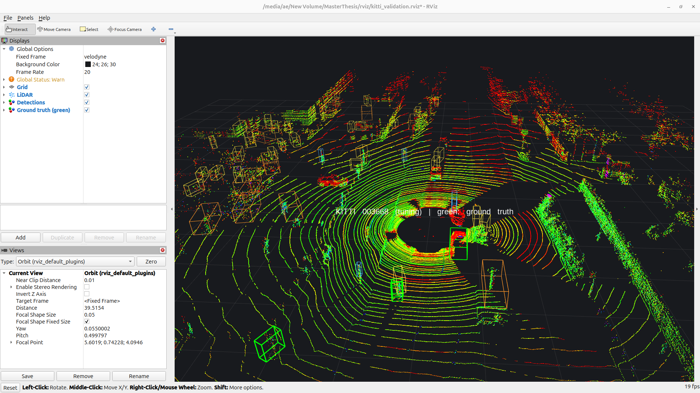

Original 3 October RViz capture of KITTI tuning frame 000368, with green calibrated annotations and predictions. It illustrates the mismatch; the reported test scores come from other frozen observations. KITTI: Geiger et al., CC-BY-NC-SA-3.0.

**Evidence files:** `config/kitti_accuracy_inventory.json`, `docs/KITTI_ACCURACY_RESULTS.md`, `.recovery/accuracy/kitti-baseline-v1/evaluation/report.json`, `.recovery/accuracy/kitti-baseline-v1/diagnostics/test-pairs.json`, `.recovery/verification/thesis-evidence-2026-11-09/research/J33.json`, `.recovery/verification/thesis-evidence-2026-11-09/research/J33.log`, `.recovery/verification/kitti-rviz-live.png`.

### J34. Separate NMS behavior from inference differences

**What happened:** Poor accuracy raised the question whether migration or duplicate suppression changed the detections.

**Why:** Feeding identical candidate rows to both NMS implementations isolates filtering. Comparing two independently generated candidate sets asks a different question.

**Small steps:**

1. Freeze the same ONNX, points, engine identities and postprocessing settings.
2. Read the preserved TensorRT 8/10 repeated outputs.
3. Apply unchanged NVIDIA NMS and project NMS to identical rows.
4. Match rows uniquely by class and geometric components rather than array order.
5. Report same-candidate agreement separately from cross-runtime numerical variability.

**Check:** The new hash audit checks the saved all-repeat NMS comparison. All 192 same-candidate observations selected the same boxes. Frozen cross-version final-box matching is about 75.70% (median per-frame final-box match fraction), and exact numerical/training parity flags remain false. Duplicate/angle matching fixtures run again.

**What remains open:** TRT8 is a compatibility reference, not a trusted original-training fixture. Both versions can share plugin/input defects. NMS agreement does not exonerate all migration behavior or establish optimal suppression.

**Evidence type:** Preserved historical evidence. hash-verified historical comparison plus unique-matching controls.

| What was observed | Recorded outcome |
| --- | --- |
| Migration and NMS were suspected causes. | NMS agrees on all 192 identical-candidate observations. Median per-frame cross-runtime final-box agreement: 75.70%; exact parity remains open. |

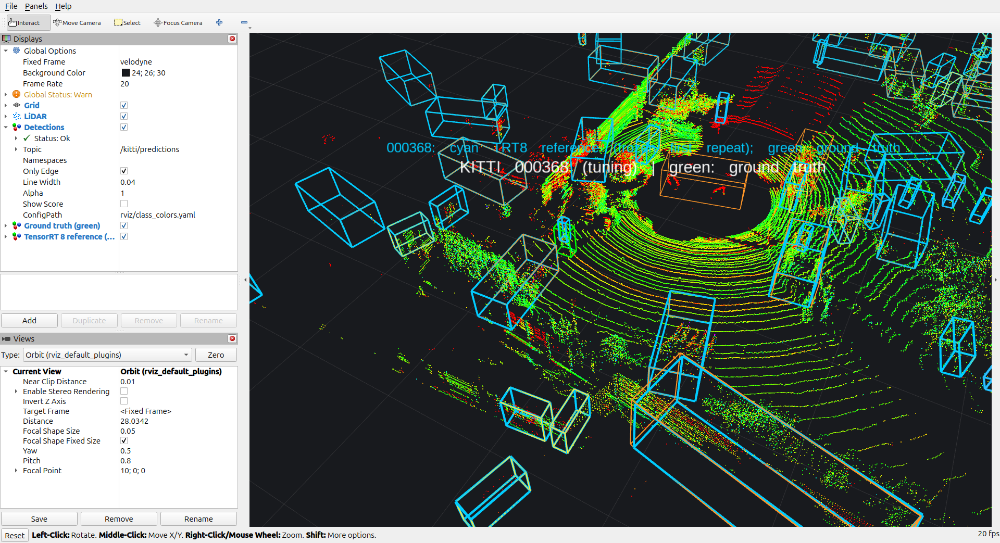

Original 3 October RViz reference comparison on a tuning frame. Cyan boxes are saved TensorRT8 outputs; appearance is not exact numerical parity. KITTI: Geiger et al., CC-BY-NC-SA-3.0.

#### J34a. Interrupted raw collection is not automatically complete evidence

The reference collector verifies indexed files against hashes. Unindexed binary outputs are renamed and moved outside the active raw folder before recollection; a changed indexed file is rejected. The older Ouster feature collector instead preserves and refuses unindexed outputs, requiring a fresh folder. These are intentionally different recovery policies.

**Scope of this check:** Read-only AST/source audit. The actual collector also starts Docker/GPU jobs; no extracted imitation of its quarantine branch was run.

1. Inspect how the real collector reads its frozen raw-file index.
2. Trace the changed-file rejection and unindexed-file quarantine branches.
3. Keep archived partial output outside the active raw folder before a future full collection.

| What was observed | Recorded outcome |
| --- | --- |
| A partial binary file is not automatically completed evidence. | Indexed outputs require matching hashes; unindexed outputs are quarantined. This recovery branch was reviewed, not newly executed. |

**Subcase evidence:** `tools/kitti_reference.py:182`, `tools/compare_ouster_features.py:203`, `.recovery/verification/thesis-evidence-2026-11-09/research/J34a.json`, `.recovery/verification/thesis-evidence-2026-11-09/research/J34a.log`.

**Evidence files:** `config/kitti_reference_inventory.json`, `.recovery/accuracy/kitti-reference-v1/all-repeat-nms-comparison.json`, `tests/test_kitti_reference.py`, `docker/reference/nms_driver.cpp`, `.recovery/verification/thesis-evidence-2026-11-09/research/J34.json`, `.recovery/verification/thesis-evidence-2026-11-09/research/J34.log`, `.recovery/verification/reference-rviz-live.png`.

### J35. Distinguish total point capacity from internal pillar capacity

**What happened:** A cloud could contain fewer than 204,800 points yet exceed the model’s 10,000 occupied-pillar or 32-point-per-pillar limits.

**Why:** The point adapter checks the input allocation. The voxel encoder has additional internal limits and potentially order-dependent point selection.

**Small steps:**

1. Count occupied XY pillars and per-pillar occupancy on the frozen KITTI clouds.
2. Compare these counts with the encoded export limits.
3. Use the existing small first-pillar/first-point control fixtures to test deterministic selection.
4. Keep two historical tuning-only capacity experiments separate from production preprocessing.

**Check:** The audit recomputes 12 of 32 KITTI scans above 10,000 pillars, maximum 15,180, from the hashed capacity report. Existing controls verify stable original-bit/order selection and half-open boundaries. Historical repeated matching improved to roughly 99.6–100% on two altered tuning frames.

**What remains open:** Capacity control changes which points reach inference. It did not establish an accuracy improvement, reproduce CUDA encounter order or deliver a production fix.

**Evidence type:** New controlled reproduction. frozen capacity-count reanalysis plus deterministic selection controls.

| What was observed | Recorded outcome |
| --- | --- |
| 12 / 32 KITTI scans exceed 10,000 occupied pillars. Maximum: 15,180 pillars. | Deterministic capacity fixtures preserve retained bytes/order. Two historical tuning controls improved repeats; no production fix. |

**Evidence files:** `config/kitti_reference_inventory.json`, `.recovery/accuracy/kitti-reference-v1/voxel-capacity-audit.json`, `.recovery/accuracy/kitti-reference-v1/voxel-controls/report.json`, `tests/test_kitti_reference.py`, `tests/test_ouster_point_policy.py`, `.recovery/verification/thesis-evidence-2026-11-09/research/J35.json`, `.recovery/verification/thesis-evidence-2026-11-09/research/J35.log`.

### J36. Keep allocation memcheck separate from internal tensor safety

**What happened:** The first GPU memory tool failed before checking; later runs reported zero allocation errors, which could be mistaken for complete memory safety.

**Why:** Compute Sanitizer can check allocation boundaries while TensorRT internal tensors share larger allocations. It also does not establish race freedom or all failure behavior.

**Small steps:**

1. Read the original CUDA 12.0 setup failure log without re-triggering a GPU fault.
2. Hash-check the later original/capped CUDA 12.9 memcheck logs.
3. Record each actual exit code and zero-error summary.
4. Keep the two-input allocation scope and unresolved tensor/race checks beside the result.

**Check:** The new audit reopens the historical failed setup and verifies both later logs against their frozen SHA-256. Original and capped runs exited 0 with ERROR SUMMARY: 0 errors. No GPU or sanitizer was run now.

**What remains open:** Two allocation probes do not certify internal tensor bounds, race freedom, leaks, long-run memory stability or complete GPU safety.

**Evidence type:** Preserved historical evidence. hash-checked historical tool-outcome audit; no GPU reproduction.

| What was observed | Recorded outcome |
| --- | --- |
| CUDA 12.0 could not instrument the process. | Two CUDA 12.9 allocation probes: exit 0, zero errors. Internal tensor bounds and races remain unverified. |

**Evidence files:** `config/runtime_inventory.json`, `config/kitti_reference_inventory.json`, `.recovery/verification/w05-gpu-memcheck.txt`, `.recovery/accuracy/kitti-reference-v1/memcheck-results.json`, `.recovery/accuracy/kitti-reference-v1/memcheck-original.log`, `.recovery/accuracy/kitti-reference-v1/memcheck-capped.log`, `.recovery/verification/thesis-evidence-2026-11-09/research/J36.json`, `.recovery/verification/thesis-evidence-2026-11-09/research/J36.log`.

### J37. Show why raw Ouster signal caused numerical failures

**What happened:** Initial Ouster replay produced hundreds of saturated-score boxes and 51 logged invalid-output frame drops.

**Why:** Structural XYZI compatibility did not make the fourth feature training-compatible. Raw Ouster signal reached thousands, whereas the model documentation describes a bounded feature range.

**Small steps:**

1. Verify the cached diagnostic image and read-only engine match the historical identities, with working GPU access.
2. Copy and hash-check the historically invalid scan000000 raw-signal and reflectivity/255 inputs into a new output folder.
3. Confirm XYZ bits, order and the 32,768-point count match between encodings.
4. Execute the existing cached pp-reference runner three times per encoding, preserving every raw GPU output.
5. Feed each result to the actual production decode_boxes implementation and record its exit code/error without removing invalid rows.
6. Keep this six-inference numerical reproduction separate from labeled accuracy and from the older 192-observation feature study.

**Check:** New actual GPU run on 9 November: one frozen original Koide scan with 32,768 identical XYZ points and 2,907 occupied pillars, three executions per encoding. Raw signal produced 2,179 candidates each time; each contained one nonfinite length and the actual production decode_boxes rejected it with exit 1, Invalid output box. Reflectivity/255 produced 176,177,176 candidates, zero invalid rows, accepted by that same decoder with exit 0. The cached image/engine identities match; no new engine build, ROS replay or accuracy test occurred.

**What remains open:** This is one unlabeled Koide scan, three raw executions followed by three reflectivity/255 executions, with no warmups or randomized order. It reproduces the numerical/output-contract failure and a working bounded encoding, not calibrated reflectance, accuracy, live ROS delivery, long-run reliability or a universal channel ranking.

**Evidence type:** New controlled reproduction. actual new GPU numerical failure reproduction and real production C++ decoder validation.

| What was observed | Recorded outcome |
| --- | --- |
| Actual GPU reproduction: raw signal rejected 3 / 3 times. Each output had one nonfinite length: Invalid output box. | Same XYZ, reflectivity / 255: accepted 3 / 3 times. Zero invalid rows; 176 / 177 / 176 raw candidates. Numerical success only; accuracy not measured. |

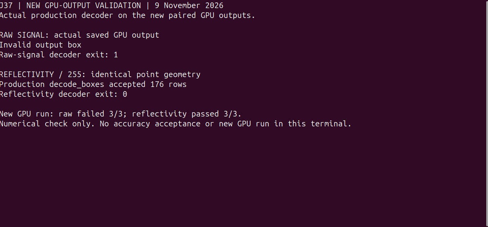

Actual new terminal capture: the production CPU decoder rejects a newly generated raw-signal GPU output and accepts the paired reflectivity/255 output. The six new GPU runs are separate from the frozen study.

**Evidence files:** `config/ouster_demo_inventory.json`, `config/ouster_feature_inventory.json`, `.recovery/accuracy/ouster-feature-v1/report.json`, `tools/compare_ouster_features.py`, `tests/test_ouster_features.py`, `.recovery/verification/thesis-evidence-2026-11-09/research/J37.json`, `.recovery/verification/thesis-evidence-2026-11-09/research/J37.log`, `.recovery/verification/thesis-evidence-2026-11-09/research/gpu-pair/report.json`, `.recovery/verification/thesis-evidence-2026-11-09/research/gpu-pair/provenance.json`, `.recovery/verification/thesis-evidence-2026-11-09/research/gpu-pair/gpu-command.json`, `.recovery/verification/thesis-evidence-2026-11-09/research/gpu-pair/gpu-command.log`, `.recovery/verification/thesis-evidence-2026-11-09/research/gpu-pair/summary.log`, `.recovery/verification/thesis-evidence-2026-11-09/research/gpu-pair/compile-decoder.json`, `.recovery/verification/thesis-evidence-2026-11-09/research/gpu-pair/cache-and-cleanup-check.json`, `.recovery/verification/thesis-evidence-2026-11-09/research/gpu-pair/decode_check.cpp`.

### J38. Correct a verifier that confused duplicate headers with missing messages

**What happened:** The first full-bag check reported 289 outputs for 291 expected messages.

**Why:** Headers were not unique in the source. A set of timestamps discarded repeated occurrences and made a complete replay appear incomplete.

**Small steps:**

1. Inspect the preserved failed unique-header report.
2. Compare source message occurrences with unique header counts.
3. Count matching occurrences rather than collapsing equal headers.
4. Preserve all original timestamps and rerun the verification logic.

**Check:** The new audit prints the original 291-expected/289-unique result and corrected 291/291 result with 289 unique headers. The second bag has 265/265 occurrences and 264 unique headers. A three-occurrence/two-header synthetic control demonstrates the counting error.

**What remains open:** The correction validates the measurement method for these runs. It is not a detector repair, an accuracy result or a guarantee that every transport experiment is lossless.

**Evidence type:** New controlled reproduction. historical verifier before/after audit plus duplicate-header analytic control.

| What was observed | Recorded outcome |
| --- | --- |
| Old check: 291 expected, 289 unique headers. | Correct check: 291 / 291 occurrences match. Second bag: 265 / 265; source timestamps unchanged. |

**How this part works:**

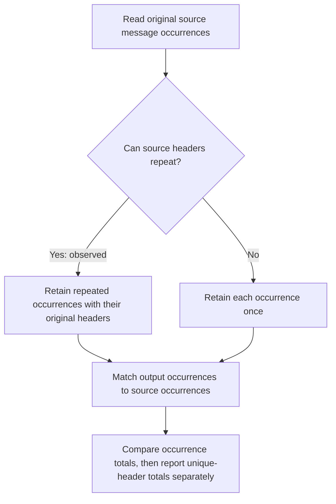

**Evidence files:** `config/ouster_feature_inventory.json`, `.recovery/accuracy/ouster-feature-v1/ros-first-sequence-unique-header-check.json`, `.recovery/accuracy/ouster-feature-v1/ros-first-sequence.json`, `.recovery/accuracy/ouster-feature-v1/ros-second-sequence.json`, `.recovery/verification/thesis-evidence-2026-11-09/research/J38.json`, `.recovery/verification/thesis-evidence-2026-11-09/research/J38.log`.

### J39. Publish accepted boxes and meaningful counts

**What happened:** Cluttered boxes made inspection hard, and a missing frame or cumulative total could be mistaken for zero objects or unique tracked objects.

**Why:** A CPU score gate follows NMS. It publishes only accepted boxes and separate aggregate diagnostics/markers; failed frames report unavailable counts rather than successful zeros.

**Small steps:**

1. Validate candidate boxes before applying the score gate.
2. Keep boxes whose score is at least the live threshold.
3. Publish the accepted array with the original cloud header.
4. Report before-filter, removed and accepted counts together.
5. Report input/inference failures separately and mark their per-frame counts unavailable.
6. Inspect timestamps because retained counters may be old; totals count detection events, not unique objects.

**Check:** Historical five C++/ROS output tests, 60 native plus 60 deployed GPU observations and actual RViz rendering verified output semantics. Fresh monitor fixtures passed retained snapshots, bounded waits and stopped-container handling. No new GPU replay was run.

**What remains open:** The gate cannot correct wrong box geometry or guarantee removal of false positives. There is no tracker.

**Evidence type:** New controlled reproduction.

| What was observed | Recorded outcome |
| --- | --- |
| No response or a stopped container cannot establish zero detections. | The helper reports unavailable data; a separately controlled reply is read. Historical RViz shows actual accepted/removed event counts. |

**Evidence files:** `src/detection_output.cpp`, `tests/ros/test_detection_output.cpp`, `docs/CONFIDENCE_FILTER_AND_MONITORING.md`, `.recovery/verification/published-deployment/rviz-live.png`, `.recovery/verification/thesis-evidence-2026-11-09/operations/monitor_helper.stderr.log`, `.recovery/verification/thesis-evidence-2026-11-09/operations/observable-scenario-02.json`.

### J40. Record the effective threshold rather than assume one default

**What happened:** The native/YAML default was 0.5 while launchers supplied 0.4, risking inconsistent comparisons.

**Why:** A shell override changes startup behavior. A live parameter query is the reliable source for the running value; frozen baseline export refuses undocumented filtering.

**Small steps:**

1. Read the C++/YAML default and launcher override separately.
2. Query confidence_threshold on the running node when performing a live run.
3. Set the intended value explicitly in the experiment configuration.
4. For baseline export, request 0.0 and validate matching per-frame statistics.
5. Refuse changed/nonfinite thresholds or inconsistent counts during collection.
6. Use a new output directory when experiment identity changes.

**Check:** Fresh baseline-gate fixtures accepted unfiltered/empty frames and rejected changed/nonfinite gates, failures, missing fields and mismatched counts. Fresh helper fixtures also confirmed threshold mode only reads the parameter.

**What remains open:** 0.0 disables the additional publication gate, not the model decode cutoff or NMS. No new threshold-specific accuracy claim is made.

**Evidence type:** New controlled reproduction.

| What was observed | Recorded outcome |
| --- | --- |
| Filtered or nonfinite publication thresholds would contaminate the frozen baseline. | The real validator refuses 0.5 and NaN fixture policies and accepts the declared unfiltered policy 0.0. |

**Evidence files:** `docker/node.yaml`, `tools/start_ouster.sh`, `tools/deploy.sh`, `tools/kitti_inference.py`, `tests/test_detection_monitor.py`, `.recovery/verification/thesis-evidence-2026-11-09/operations/detection_monitor.stderr.log`, `.recovery/verification/thesis-evidence-2026-11-09/operations/monitor_helper.stderr.log`, `.recovery/verification/thesis-evidence-2026-11-09/operations/observable-scenario-07.json`.

### J41. Convert the actual Ouster field numerically

**What happened:** The physical driver produced XYZ plus integer signal/reflectivity but no FLOAT32 intensity; 565 observed clouds were rejected.

**Why:** A sensor-specific adapter must convert the numeric selected channel into a new FLOAT32 intensity field. Changing metadata alone would reinterpret bytes. The production selector still requires literal signal or reflectivity.

**Small steps:**

1. Inspect the incoming PointCloud2 fields, datatypes, offsets and dimensions.
2. Select an existing signal or reflectivity field and declare its divisor.
3. Validate layout, point/byte bounds and divisor before reading data.
4. Copy header/XYZ and numerically convert the selected field into compact XYZI.
5. Publish reliable adapted output and inspect conversion/rejection counters.
6. For unchanged bags naming signal intensity, keep reflectivity selected until a verified alias is separately implemented.

**Check:** Historical compiled converter/ROS tests and 2,224 offline conversion observations exercised numeric layout/header contracts. The fresh original MOSEP test independently checked conversion. This rerun only executes related Python input-contract fixtures, not the C++ converter.

**What remains open:** Alias support for intensity→signal is not deployed. There is no auto-passthrough, channel choice, sensor fusion, ROI crop or production pillar-capacity policy.

**Evidence type:** Preserved historical evidence.

| What was observed | Recorded outcome |
| --- | --- |
| The original physical cloud lacked compatible FLOAT32 intensity; 565 observed frames were rejected. | The separate adapter converts a declared field numerically. The fresh saved pipeline log records reflectivity conversion; literal intensity-to-signal alias support remains open. |

**How this part works:**

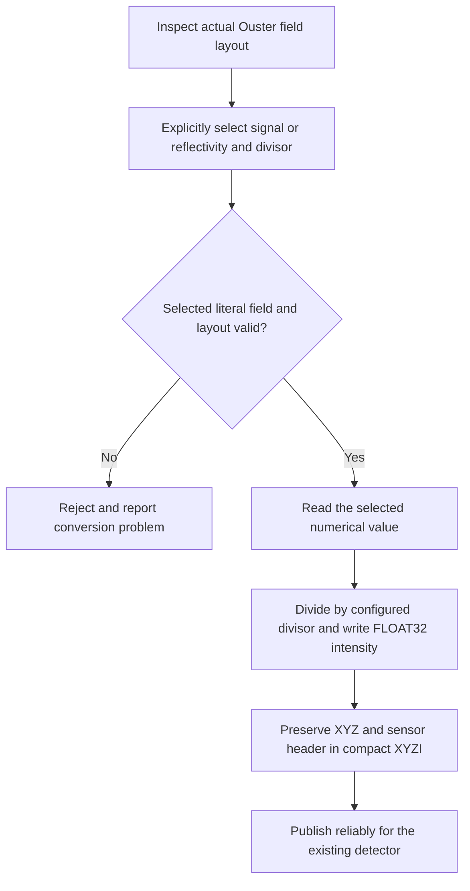

**Evidence files:** `src/ouster_adapter.cpp`, `src/ouster_adapter_node.cpp`, `tests/ros/test_ouster_adapter.cpp`, `config/ouster_adapter_bag_validation.json`, `docs/LIVE_OUSTER_ADAPTER.md`, `.recovery/verification/thesis-evidence-2026-11-09/operations/ouster_demo.stderr.log`, `.recovery/ouster-fresh-test/pipeline.log`.

### J42. Test a fresh unchanged recording without replacing the saved production image

**What happened:** The saved detector image lacked the new adapter, and the user required an original bag plus visible output.

**Why:** A separate derivative image compiled the adapter against existing ROS libraries, preserving detector/model/standard image. The new MOSEP archive was checksum-verified and replayed read-only.

**Small steps:**

1. Download and verify the publisher archive identity.
2. Preserve original extracted files and record their hashes.
3. Build a separate adapter test image when the saved main image lacks it.
4. Mount the original bag read-only and select the matching transport/topic profile.
5. Compare raw/adapted headers and XYZ bytes against independent conversion.
6. Open actual RViz in the source sensor frame and keep sampled counts separate from later snapshots.

**Check:** The historical observer checked 40 raw/adapted pairs and 39 detection headers; a later loop snapshot counted 103 processed frames and zero input/inference errors. Fresh bag-launcher fixtures passed readonly mounting, unchanged fixture bytes, existing-player refusal and image checks.

**What remains open:** The fresh rerun is mocked launcher verification, not another live GPU/RViz run. The original visual test used reflectivity only and did not establish accuracy.

**Evidence type:** New controlled reproduction.

| What was observed | Recorded outcome |
| --- | --- |
| An image missing the adapter and a private bag missing metadata are refused. | With complete fixture inputs, the launcher requests a read-only bag mount. The genuine historical MOSEP RViz screenshot is separate live evidence. |

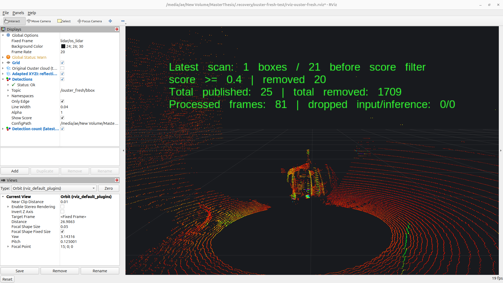

Original 7 November MOSEP replay capture. The adapted cloud, detection display and counters are visible. This earlier loop snapshot differs from the later 103-frame snapshot; it is not labeled accuracy. Source: Gaisberger and Schlager, MOSEP release19353314.

**Evidence files:** `docs/FRESH_OUSTER_VISUAL_TEST.md`, `config/ouster_fresh_visual_validation.json`, `.recovery/ouster-fresh-test/rviz-detections.png`, `tests/test_start_ouster_bag.py`, `.recovery/verification/thesis-evidence-2026-11-09/operations/start_ouster_bag.stderr.log`, `.recovery/verification/thesis-evidence-2026-11-09/operations/observable-scenario-04.json`, `.recovery/verification/thesis-evidence-2026-11-09/operations/observable-scenario-03.json`.

### J43. Obtain independent two-channel annotations without rewriting originals

**What happened:** The weather bags and camera previews could not decide which channel was closer to ground truth.

**Why:** The comparison required original scans containing both channels plus independent object annotations, source integrity and a selection frozen before predictions.

**Small steps:**

1. Use the pinned Dur360BEV-Extended revision and published checksum list.
2. Select 16 published train and 16 published test frames before inference.
3. Retrieve only the required original point/label members through validated ranges.
4. Verify every selected member against the publisher MD5.
5. Retain label conventions and the annotation/split limitations with the results.

**Check:** The new local audit rehashes all 64 original point/label files for 32 frames against the publisher checksum list and prints the frozen selection and provenance. No downloads, conversions or source writes occur.

**What remains open:** The split is index-disjoint within one collection, not verified drive-disjoint. Labels are model-assisted and human-reviewed according to the original paper; the Extended card does not separately document its procedure.

**Evidence type:** Preserved historical evidence. fresh local checksum verification of historical original subset.

| What was observed | Recorded outcome |
| --- | --- |
| Unlabeled weather recordings cannot rank object accuracy. | 32 selected frames / 64 original files pass publisher MD5 checks again. Index-disjoint split; recording independence unverified. |

#### J43a. Initial archive-order mapping and selection were replaced before inference

Source provenance explicitly retains the failed initial tar-order mapping selection. The frozen-selection.json and frozen-selection-final.json files have different selection methods; the latter selected uniform archive-ordinal candidates and was frozen before model outputs. Do not use the earlier selection as the final evaluated frame list.

**Scope of this check:** New read-only comparison of preserved manifests and provenance; no download, remapping or model run.

1. Read both preserved selection methods and frame lists.
2. Compare their membership and the recorded archive-ordinal mapping.
3. Use frozen-selection-final.json to identify the evaluated original files.

| What was observed | Recorded outcome |
| --- | --- |
| An earlier archive-mapping selection was preserved. | The evaluated final selection uses a different frozen method. Both manifests remain available; model predictions did not choose the final list. |

**Subcase evidence:** `.recovery/dur360bevet-study/source-provenance.json`, `.recovery/dur360bevet-study/frozen-selection.json`, `.recovery/dur360bevet-study/frozen-selection-final.json`, `.recovery/verification/thesis-evidence-2026-11-09/research/J43a.json`, `.recovery/verification/thesis-evidence-2026-11-09/research/J43a.log`.

**Evidence files:** `config/ouster_channel_decision.json`, `.recovery/dur360bevet-study/source-provenance.json`, `.recovery/dur360bevet-study/frozen-selection-final.json`, `.recovery/dur360bevet-study/download-verification.json`, `tools/download_dur360_subset.py`, `.recovery/verification/thesis-evidence-2026-11-09/research/J43.json`, `.recovery/verification/thesis-evidence-2026-11-09/research/J43.log`.

### J44. Exclude an incomplete ROS A/B attempt rather than interpret lost clouds

**What happened:** The initial large-cloud ROS A/B did not finish reliably across host/container UDP transport.

**Why:** Missing delivery cannot be interpreted as zero objects or model inference failure. The subsequent direct C++ comparison answered the feature question with a narrower transport scope.

**Small steps:**

1. Preserve the incomplete ROS recipe, observations and logs.
2. Check its complete flag and number of measured observations.
3. Exclude that unfinished run from the final feature comparison.
4. Use the unchanged production C++ inference/NMS directly for the completed paired study.

**Check:** The new audit prints the actual incomplete flag and observation/warmup counts from ouster-current-ab-v2, alongside its recorded domain and point policy. It does not launch ROS or repeat the delivery failure.

**What remains open:** The completed direct runner does not certify a live ROS signal/reflectivity A/B path. Existing bag signal aliases and target-sensor delivery still need separate verification.

**Evidence type:** Preserved historical evidence. read-only historical incomplete-run audit.

| What was observed | Recorded outcome |
| --- | --- |
| ROS A/B complete=false; no measured observations in v2. | Incomplete run excluded. Completed direct C++ study has narrower transport scope. |

**Evidence files:** `docs/OUSTER_CHANNEL_DECISION.md`, `.recovery/accuracy/ouster-current-ab-v2/observations.json`, `.recovery/accuracy/ouster-current-ab-v2/recipe.json`, `docker/reference/production_runner.cpp`, `tools/run_ouster_ab.py`, `.recovery/verification/thesis-evidence-2026-11-09/research/J44.json`, `.recovery/verification/thesis-evidence-2026-11-09/research/J44.log`.

### J45. Declare the Dur360 point-selection adaptation and its control

**What happened:** Original 128-beam labeled scans contain 262,144 points, beyond the 204,800-point engine allocation.

**Why:** Both feature variants need identical geometry selection. Input point capacity and internal pillar capacity remain different constraints.

**Small steps:**

1. Record the original point count before preparation.
2. Apply the encoded model ROI and all-zero-XYZ return removal identically to both channels.
3. Audit retained counts and occupied pillars.
4. Prepare a separate first-10,000-pillar/first-32-point sensitivity control.
5. Keep that control out of the production adapter until separately validated.

**Check:** The new recipe audit reports 65,238–175,559 retained points and 20/32 primary scans above the pillar limit; the bounded control has zero above that limit. Existing first-encountered pillar/32-point controls run again.

**What remains open:** ROI and zero-return adaptation changes the input. The deterministic control does not reproduce CUDA thread order or automatically improve accuracy.

**Evidence type:** Preserved historical evidence. frozen recipe count reanalysis plus analytic capacity controls.

| What was observed | Recorded outcome |
| --- | --- |
| Original labeled scan: 262,144 points; engine capacity: 204,800. | Declared ROI/nonzero selection: 65,238–175,559 points. Pillar excess: 20 / 32 primary, 0 / 32 bounded control. |

**Evidence files:** `config/ouster_channel_decision.json`, `.recovery/accuracy/ouster-production-dur360-v2/recipe.json`, `.recovery/accuracy/ouster-production-dur360-bounded-v1/recipe.json`, `tools/ouster_point_policy.py`, `tests/test_ouster_point_policy.py`, `.recovery/verification/thesis-evidence-2026-11-09/research/J45.json`, `.recovery/verification/thesis-evidence-2026-11-09/research/J45.log`.

### J46. Recommend reflectivity without claiming accepted 3D accuracy

**What happened:** Reflectivity detected four test vehicle footprints, but neither channel reached the required 3D overlap.

**Why:** BEV evaluates footprint overlap; a vertical displacement can destroy a qualifying 3D match. The recommendation is a fixed experimental encoding/model decision, not a universal sensor ranking.

**Small steps:**

1. Hash-check the saved primary production GPU observations.
2. Recompute the declared evaluator at confidence 0.4 on the CPU.
3. Report per-run Vehicle BEV precision/recall and qualifying 3D matches.
4. Inspect the four first-repeat height errors and 3D IoUs.
5. Keep the primary precision separate from the bounded-control precision.

**Check:** New CPU reanalysis of all 320 primary labeled observations reproduces four versus zero test Vehicle BEV matches, mean precision 27.81% versus zero and recall 6.67% versus zero. Both have zero qualifying 3D matches; saved height errors are 0.60–1.14 m. The full recomputed report is saved.

**What remains open:** Only 16 test scans and 60 in-ROI vehicles; no test Pedestrian matches and no Cyclist ground truth. Repeats are not independent scenes. Primary 27.81% and control 21.99% precision are distinct.

**Evidence type:** Preserved historical evidence. new CPU evaluation of hash-verified historical production GPU observations.

| What was observed | Recorded outcome |
| --- | --- |
| Signal: 0 qualifying Vehicle BEV matches at confidence 0.4. | Reflectivity: 4 / 60; precision 27.81%, recall 6.67%. Both: 0 qualifying 3D matches; height error +0.60–1.14 m. |

**How this part works:**

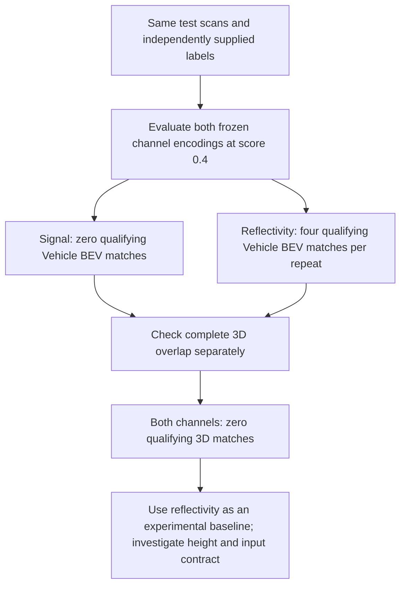

**Evidence files:** `config/ouster_channel_decision.json`, `.recovery/accuracy/ouster-production-dur360-v2/observations.json`, `tools/ouster_gt_evaluation.py`, `docs/figures/ouster-channel-ground-truth-2026-11-08.png`, `docs/figures/ouster-channel-results-summary.png`, `.recovery/verification/thesis-evidence-2026-11-09/research/J46.json`, `.recovery/verification/thesis-evidence-2026-11-09/research/J46.log`, `.recovery/verification/thesis-evidence-2026-11-09/research/J46-ground-truth-recomputed.json`.

### J47. Keep planned scheduling and acceptance separate from delivered code

**What happened:** A design for one pending frame could be mistaken for an implemented low-latency worker.

**Why:** Current inference runs synchronously in the ROS callback with reliable depth 700. No sustained benchmark can be inferred from short GPU timings or a viewer refresh rate.

**Small steps:**

1. Read the actual subscription and callback, not only the design diagram.
2. Compare implemented behavior with W06/W07/W08/W09 ledger states.
3. Separate queue policy, delivery settings, stage timing and full end-to-end age.
4. Leave throughput/accuracy acceptance open until agreed targets and sustained tests exist.

**Check:** The new read-only audit prints the actual depth-700 callback evidence and open task states/targets. It launches no workload and marks no benchmark or CI gate complete.

**What remains open:** The latest-frame worker, configurable detector QoS, sustained latency/memory acceptance, broader failure coverage and CI remain unfinished.

**Evidence type:** Open problem. read-only implementation-versus-plan audit.

| What was observed | Recorded outcome |
| --- | --- |
| Design proposes one active and one pending frame. | Actual callback remains synchronous, reliable depth 700. Worker, sustained metrics and acceptance remain open. |

**Evidence files:** `src/pp_inference_node.cpp`, `IMPLEMENTATION_ARCHITECTURE.md`, `recovery/tasks.json`, `docs/MODEL_VALIDATION_PLAN.md`, `.recovery/verification/thesis-evidence-2026-11-09/research/J47.json`, `.recovery/verification/thesis-evidence-2026-11-09/research/J47.log`.

### J48. Separate compiler-environment failures from a valid PDF

**What happened:** Built-in compilation repeatedly failed before a complete current thesis PDF could be produced.

**Why:** Missing TeX bundles, network/DNS problems and font dependencies are compiler-environment evidence, not proof that every source page has been checked.

**Small steps:**

1. Read the preserved built-in compiler diagnostics for the actual source.
2. Identify the requested resource and failure stage.
3. Keep the editable source and original figures intact.
4. Report compilation/page-layout acceptance separately from source/link checks.

**Check:** The new audit reads the actual historical compiler JSON and extracts the compile-failed/DNS/article.cls diagnostic. It does not repair networking, install a TeX distribution or claim a new compile pass. The latest native compiler result is reported separately in the thesis verification record.

**What remains open:** A historical separate rendition is not native compilation of the current source. Final PDF and illustrated layout remain unverified until the current source compiles and is inspected.

**Evidence type:** Preserved historical evidence. read-only historical native-compiler diagnostic audit.

| What was observed | Recorded outcome |
| --- | --- |
| Native compiler cannot fetch article.cls / TeX bundle. | Historical compile-failed diagnostic preserved. No source/layout acceptance inferred from this audit. |

**Evidence files:** `.recovery/verification/thesis-history-2026-11-09/latex-compilation.json`, `docs/THESIS_DRAFT.tex`, `config/documentation_review.json`, `.recovery/verification/thesis-evidence-2026-11-09/research/J48.json`, `.recovery/verification/thesis-evidence-2026-11-09/research/J48.log`.

### J49. Preserve source and artifact identity without leaking large assets

**What happened:** SDKs, models, bags and generated output could accidentally enter Git, while mutable image tags could obscure the tested runtime.

**Why:** Ignore rules protect source control size, not independent evidence backup. Immutable hashes identify an experiment more reliably than a tag. Authentication advice is not an executed login.

**Small steps:**

1. Run git check-ignore on representative generated/model paths.
2. Keep editable code, reports, figure provenance and small summaries versioned.
3. Identify the model and tested image using frozen hashes.
4. Back up ignored data and logs independently.
5. Keep historical GitHub authentication guidance separate from actual credential actions.

**Check:** The new audit runs the real git check-ignore command and prints frozen model/image identities. It reads or changes no credentials, stages nothing and pushes nothing.

**What remains open:** Ignore rules do not remove already-tracked content or back up ignored evidence. Base tags/non-GPU apt packages are not fully pinned, so source pinning alone is not hermetic reproduction.

**Evidence type:** Source-based explanation. actual ignore-rule check plus frozen identity audit.

| What was observed | Recorded outcome |
| --- | --- |
| Large generated artifacts and mutable tags weaken traceability. | Actual ignore rules verified; immutable model/image identities recorded. Credentials untouched; ignored evidence needs its own backup. |

#### J49a. A frozen recipe rejects silent changes

freeze_json compares canonical bytes with an existing record and requires a fresh output directory if they differ. This prevents a new model, selection or policy from quietly replacing a named experiment.

**Scope of this check:** Actual freeze_json exercised only in a temporary directory; expected mismatch raises ValueError, child exits1 and original bytes are preserved.

1. Create a temporary recipe using the actual freeze_json function.
2. Retry identical content and verify it is accepted.
3. Change the model identity and record the actual refusal while checking original bytes.

| What was observed | Recorded outcome |
| --- | --- |
| A frozen recipe already records model A. | Identical retry succeeds. Model B is refused. Original recipe bytes remain unchanged. |

**Subcase evidence:** `tools/prepare_kitti_validation.py:44`, `tools/kitti_evaluation.py:176`, `.recovery/verification/thesis-evidence-2026-11-09/research/J49a.json`, `.recovery/verification/thesis-evidence-2026-11-09/research/J49a.log`.

**Evidence files:** `.gitignore`, `.dockerignore`, `config/model_contract.json`, `config/kitti_reference_inventory.json`, `docs/PROJECT_HISTORY_AND_DECISION_RECORD.md`, `.recovery/verification/thesis-evidence-2026-11-09/research/J49.json`, `.recovery/verification/thesis-evidence-2026-11-09/research/J49.log`.

### J50. Reject attractive but unsupported quick fixes

**What happened:** Changing a confidence threshold or shifting boxes could make a display cleaner without resolving the model mismatch.

**Why:** A gate can remove a prediction but cannot move it. A label-fitted offset might improve the inspected data while hiding a training/frame or decoder problem.

**Small steps:**

1. Use a known analytic box pair with identical footprints and a one-metre height error.
2. Measure BEV and 3D overlap separately.
3. Raise the confidence gate and verify it changes selection, not geometry.
4. Keep real measured coordinates frozen while investigating the input/training contract.
5. Choose any future correction on development data, then evaluate fresh recording-disjoint data.

**Check:** The new analytic control prints BEV IoU=1 and 3D IoU=1/3 for the elevated box. At the declared 0.7 Vehicle criterion it remains a miss; raising confidence removes the prediction but does not recover the object. Existing vertical and score-boundary tests pass.

**What remains open:** The analytic example explains a mechanism; it is not a fitted correction, a real scene result or authorization to change production z coordinates.

**Evidence type:** New controlled reproduction. controlled analytic geometry/threshold failure reproduction.

| What was observed | Recorded outcome |
| --- | --- |
| Analytic elevated box: BEV IoU 1; 3D IoU 1/3. | Raising confidence removes the box but does not move it. No measured coordinates or production settings changed. |

**Evidence files:** `tests/test_ouster_gt_evaluation.py`, `tools/ouster_gt_evaluation.py`, `docs/OUSTER_CHANNEL_DECISION.md`, `docs/MODEL_VALIDATION_PLAN.md`, `.recovery/verification/thesis-evidence-2026-11-09/research/J50.json`, `.recovery/verification/thesis-evidence-2026-11-09/research/J50.log`.

## Appendix B. Historical source coverage

The preserved records are [project history](PROJECT_HISTORY_AND_DECISION_RECORD.md), [available discussion](CHAT_DISCUSSION_RECORD.md), [original review](../PROJECT_REVIEW_AND_UPDATE_PLAN.md), [implementation notebook](../recovery/PROGRESS.md) and [task ledger](../recovery/tasks.json). Git records the implementation milestones; the historical 51-file index covers only baseline 2301135 through dd687da, not the later entire project.

The main structured evidence is [environment](../config/environment_inventory.json), [model](../config/model_inventory.json), [partial model contract](../config/model_contract.json), [native runtime](../config/runtime_inventory.json), [Docker](../config/docker_inventory.json), [visualization](../config/visualization_inventory.json), [KITTI preparation](../config/kitti_validation_inventory.json), [KITTI accuracy](../config/kitti_accuracy_inventory.json), [reference comparison](../config/kitti_reference_inventory.json), [Ouster demo](../config/ouster_demo_inventory.json), [feature study](../config/ouster_feature_inventory.json), [camera](../config/ouster_camera_inventory.json), [detail](../config/ouster_detail_inventory.json), [frontal replay](../config/kitti_front_inventory.json), [offline adapter conversion](../config/ouster_adapter_bag_validation.json), [fresh Ouster validation](../config/ouster_fresh_visual_validation.json), [launcher verification](../config/launcher_fix_validation.json) and [channel decision](../config/ouster_channel_decision.json).

Use the dated reports for exact commands, source/model/image identities and evidence hashes. The register is a synthesis, not a substitute for those records. Assertions from a proposal are labeled proposed; commands offered as advice are not reported as executed repairs. Original model weights, labels, source bags, failed attempts and historical quotations remain intact.

<!-- END ILLUSTRATED CASEBOOK -->

## Source and evidence notes

Background sources:

- Lang et al., [PointPillars: Fast Encoders for Object Detection from Point Clouds](https://arxiv.org/abs/1812.05784), CVPR 2019.
- E et al., [Dur360BEV dataset paper](https://arxiv.org/html/2503.00675v2), and the [Extended data card](https://huggingface.co/datasets/TomEeee/Dur360BEV-Extended), publisher CC-BY-4.0.
- [MOSEP source recording release](https://zenodo.org/records/19353314).
- [Pinned Dur360 loader](https://github.com/Tom-E-Durham/Dur360BEV/blob/29e5dfb12d98983949cd7b85ba353b601cdc5248/Dur360BEV_dataset/dur360bev_dataset.py).

Project-specific claims come from [the channel summary](../config/ouster_channel_decision.json), [the detailed report](OUSTER_CHANNEL_DECISION.md), [KITTI results](KITTI_ACCURACY_RESULTS.md), [reference comparison](MODEL_REFERENCE_COMPARISON.md) and the source files identified in their manifests. Figure captions and source hashes are listed in [the figure catalog](figures/README.md).

Before submission: confirm supervisor details; obtain supervisor agreement on scope and acceptance targets; complete the final literature review; complete the larger evaluation; verify figure permissions and source attribution; compile and visually check the final university template. These are remaining tasks, not completed thesis results.
